<h1 align="center">Cockpit</h1>

  Run many Claude Code sessions at once on macOS, each in a git worktree. Several sessions can share one.

  
  

- **One board** for every session: working, blocked on you, or waiting.
- **What changed**: files, diff and the PR of each worktree.
- **Several sessions per worktree**: a fresh context or a side question on the same branch, in tabs.
- **Your own `claude`**: plugins, skills, hooks, MCP servers and permission prompts work as in a terminal. Cockpit never writes to `~/.claude/`.

**Contents:** [Installation](#installation) · [Features](#features) · [Keyboard shortcuts](#keyboard-shortcuts) · [Updating](#updating) · [License](#license)

---

## Installation

### Requirements

| Requirement | Needed for |
|---|---|
| macOS (Apple Silicon or Intel) | Running Cockpit |
| [Claude Code](https://docs.anthropic.com/en/docs/claude-code) (`claude`), signed in | Every session |
| `git` | Worktrees, diffs, branch status |
| [GitHub CLI](https://cli.github.com) (`gh`), signed in with `gh auth login` | PR badges and the PR tab (optional) |

> [!NOTE]
> These must be on your login shell's `PATH`. Cockpit reads it from `$SHELL -l -i`.

### Download and install

1. Download the latest `Cockpit_<version>_universal.dmg` from [cockpit-releases](https://github.com/kaimunlau/cockpit-releases/releases/latest). One app for Apple Silicon and Intel.
2. Open the DMG and drag Cockpit to Applications.
3. Open Cockpit. macOS blocks it the first time: the app is ad-hoc signed, not signed with an Apple Developer ID.
4. Go to **System Settings → Privacy & Security → Security**, click **Open Anyway**, confirm, and open Cockpit again.

> [!TIP]
> You do this once per Mac. After an update, macOS may ask again for access to folders like Documents or Desktop.

### First steps

**1. Add a repo.** Click **Add repo**, pick a local git repo, then click **Add repo** in the dialog. Cockpit preselects the repo's default branch; keep it.

**2. Start a session.** Click **New session** (1), write a **First prompt** (2), click **Create session** (3). Leave the other fields as they are.

**3. Open it.** Click the new card.

---

## Features

### Board

One row per repo, one column per state:

| Column | Meaning |
|---|---|
| **Working** | Claude is running. The card counts running subagents, shells and monitors. |
| **Blocked** | Claude needs you, usually a permission prompt. The card glows and you get one macOS notification; click it to open the session. |
| **Your turn** | Claude is done. Ended sessions show dimmed here. A turn that ends on an API error (a server error, a rate limit) lands here too: you get a notification with the error, and the next message you send goes in right away. A message you queued before the error is held until you press **Send**. |

Cards show the branch, the state icon with how long the session has been in that state (hover the icon for the state's name), lines changed and the PR badge. The badge turns red on failed CI, requested changes or conflicts; click it to open the PR.

Each session has its own card, also when several share a worktree. The worktree's PR badge shows on its oldest session's card, and the other cards add the worktree's name to their title.

- Rows are in alphabetical order. To set your own order, set **Repo order** to **Manual** in Settings, then drag a repo row.
- **+** starts a session in that repo.
- **…** → **Default branch…** changes the repo's default branch. **…** → **Remove repo** removes a repo with no sessions.
- **…** → **Color** changes the repo's color, with ten to choose from. The tile, the row's edge and the sidebar change at once.
- Search by title, PR link or PR number. A PR belongs to its worktree, so searching for it lists every session in that worktree.

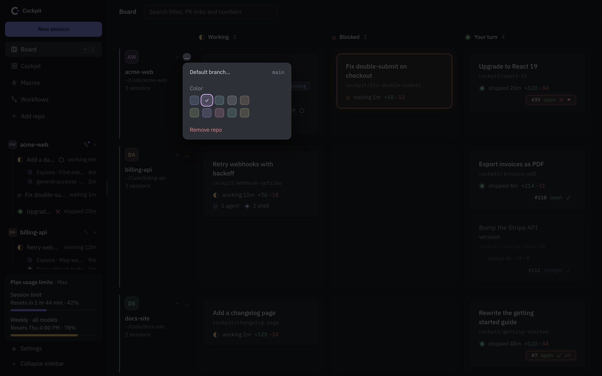

### Collapsing a project

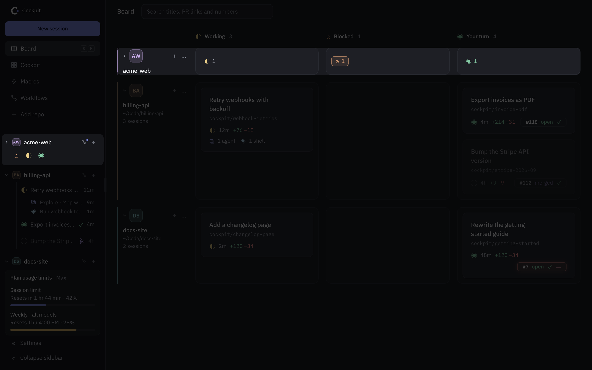

- Click the caret left of a repo's tile to collapse it, and again to expand it.
- On the board, a collapsed row shows how many sessions each column holds instead of cards. Click a count to expand the row.
- In the sidebar, a collapsed repo shows one state icon per session. Click an icon to open the session.
- Collapsing a repo in the sidebar collapses it on the board too, and the other way round. Cockpit remembers it after a restart.
- The collapsed rail has no caret and always shows every repo's sessions.

### Starting a session

- The defaults work: write a first prompt and create. A blank branch name and title are generated from the prompt.
- Type `/` for slash commands, at the start or after a space anywhere in the prompt. A few of a command's letters in order find it: `/supwriski` finds `/superpowers:writing-skills`. As in Claude Code, only a command that starts the prompt runs; later on, it goes to Claude as text, and a skill's name there lets Claude use that skill. Add files by dropping, pasting or **Add files…**.
- **Base branch** starts on the branch you last used in that repo, else on its default branch. The list has the local branches, then the branches only `origin` has.
- Each session gets its own worktree in `<repo parent>/.cockpit-worktrees/`, branched from a fresh `origin/<base>`.
- To add a session to a worktree that is already open, pick **Existing branch** and its branch. The form says which worktree it joins, and **Create session** becomes **Add to …**.
- The chips in the prompt box set the session's permission mode (Auto by default), model and effort. The model starts on **Default model** from Settings. Effort **Default** (the sliders icon) leaves it to your Claude Code settings. Sessions never use `--dangerously-skip-permissions`.
- Claude can propose a session through Cockpit's `new_session` tool. It opens this form prefilled; nothing starts until you click **Create session**.

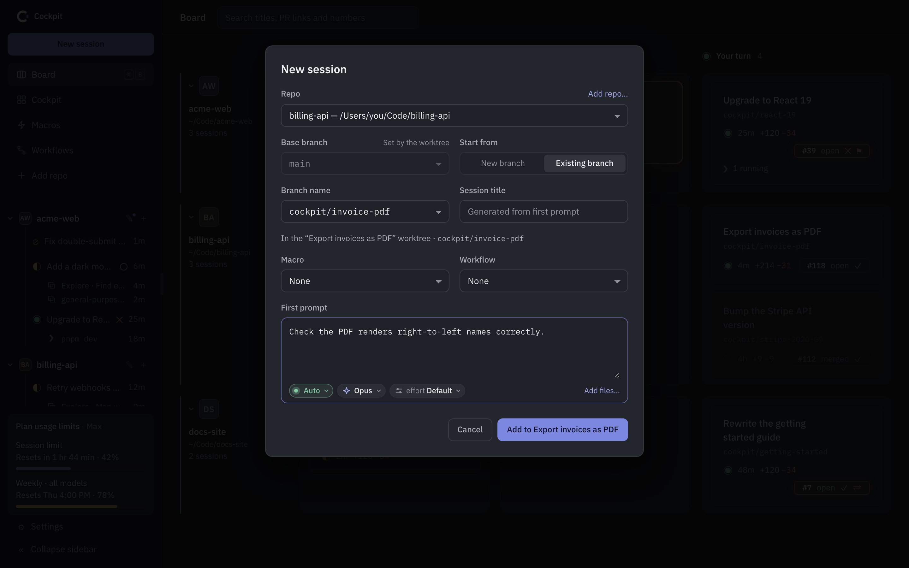

### Session view

| Area | What it shows |
|---|---|
| **Terminal** | The real `claude` process. |
| **Terminal / Chat** | With **Chat UI** on in Settings, the two icons switch the center between the terminal and the chat of the same process (see below). Each session remembers its choice. |
| **Header** | PR badge, branch, lines changed, uncommitted files, ahead/behind, context use. Click the title to rename. |
| **Sidebar** | Every session and what it is running, grouped by repo. Sessions that share a worktree nest under the oldest one (see [Several sessions in one worktree](#several-sessions-in-one-worktree)). Each repo has a tile with its initials, in one of ten colors; the board shows the same tile. A repo you add gets a color its neighbours don't have, and keeps it until you pick another with **…** → **Color** on the board. A repo's name stays at the top while you scroll through its sessions. Each session shows its state icon and how long it has been in that state; hover the icon for the state's name. **Collapse sidebar** shrinks it to a rail. |
| **Side pane** | Files, Diff, PR, Notes, Workflow, and Artifacts (claude.ai pages the session linked, when there are any). Files, Diff, PR and Notes belong to the worktree, so every session in it shows the same ones. The button at the top right hides it. |

Repos have notes too: click the pencil next to the repo name in the sidebar.

### Several sessions in one worktree

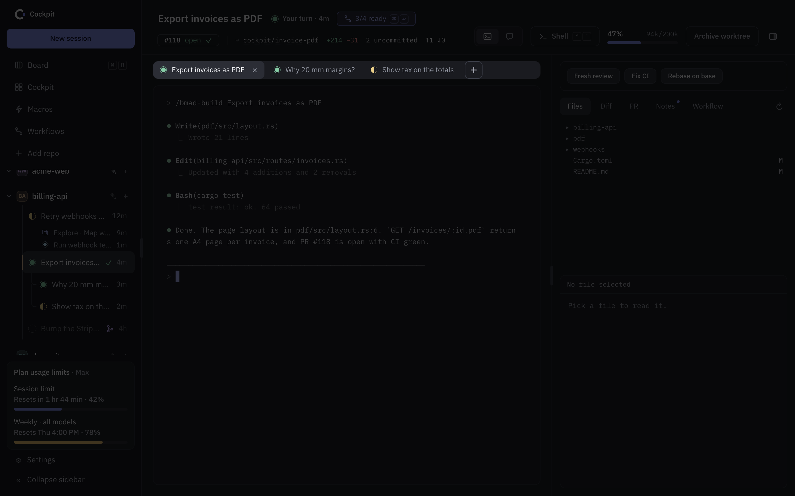

Start another Claude Code session on the same branch and files: a fresh context for the next step, or a side question that stays out of the main conversation.

- Click **+** at the end of the tabs, or press <kbd>⌘</kbd> <kbd>T</kbd>. The new session starts at once, with the open session's mode, model and effort.
- A new session is called **Session 2**, **Session 3** and so on until its first prompt names it.
- Tabs show while a worktree has two sessions or more. Click a tab, or press <kbd>⌃</kbd> <kbd>Tab</kbd> and <kbd>⌃</kbd> <kbd>⇧</kbd> <kbd>Tab</kbd>, to switch.
- When the tabs don't fit, **⋯** lists the rest and shows the most urgent state among them.

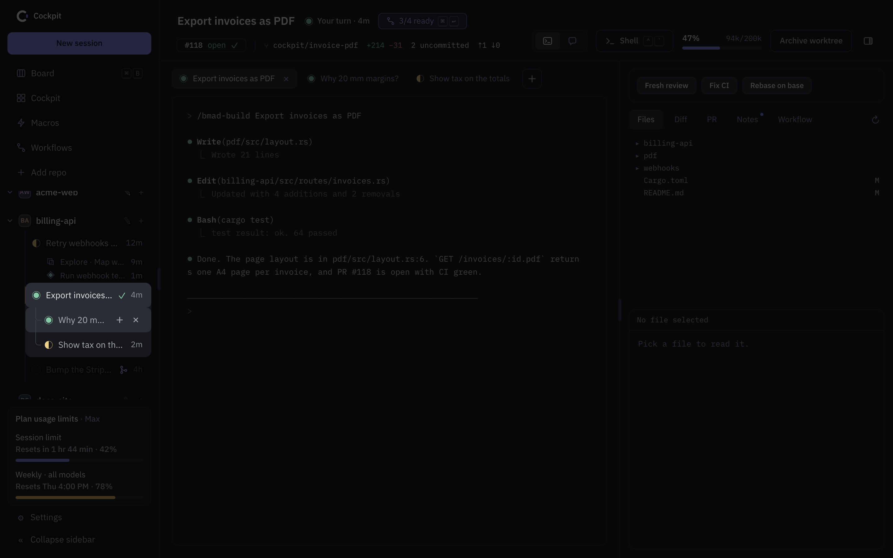

- In the sidebar, the worktree's oldest session carries the CI icon and the others hang under it. Hover a row for **+** (a new session in that worktree) and **×** (close it).

### Closing a session

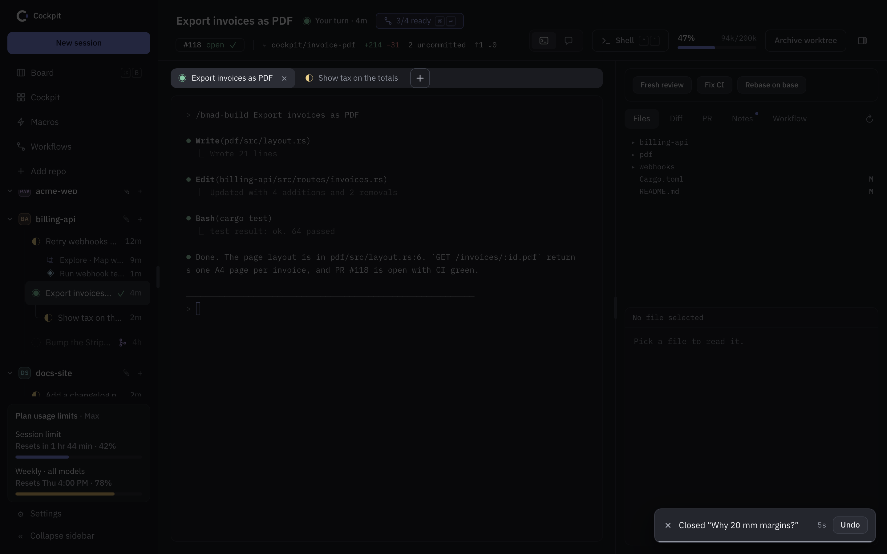

- Click a tab's **×**, or press <kbd>⌘</kbd> <kbd>W</kbd>. The session goes at once and Claude stops. The worktree and its other sessions stay.
- **Undo** brings it back for 5 seconds, resumed where it was. Background shells and monitors that were running don't come back. Hovering the toast pauses it, for up to 30 seconds in all.
- A session you never sent a prompt to closes with no **Undo**.
- If Claude is working or waiting on you, background work is still running, or a message is queued, a popover asks first: **Cancel** or **Close**.
- A worktree's last session can't be closed on its own. To end it, archive the worktree.

### Chat view

Turn on **Chat UI** in Settings. Then click the chat icon in the session header to read the session as a chat instead of a terminal. It is the same `claude` process: switching back and forth never restarts or touches it.

> [!NOTE]
> Chat UI is in beta and may be unstable, so its switch in Settings carries a **Beta** tag. While it is off, every session shows its terminal and there are no chat icons. Turn it back on and each session returns to the view it was in. The terminal is still the full view: anything the chat can't show, the terminal does.

- Your prompts sit on the right, with their images. Claude's replies are formatted text, with their images. An image file shows only if it is inside the session's worktree. An image on GitHub shows too; one from any other site stays a link. An image that can't load shows as its text, a link when it has a web address.
- Each tool call is one line with its command or file and a ✓ or ✕. Click it to see its input and result. Thinking is a collapsed **Thinking** line.
- Two or more tool calls in a row fold into one steps line, along with any thinking between them. Each tool call counts as a step. While Claude works, the line shows the step Claude is on, such as **◐ Bash cargo test · 3 steps**, and each new step replaces it. Once the run is over, it reads like **6 steps Bash ×5 · Edit ✓**. If any steps failed, it ends in ✕ and how many failed instead, also while Claude works. Click it to see every step.
- File paths are links: click one to open it in the Files tab, at its line. <kbd>⌘</kbd>-click a **Read**, **Write** or edit line (**Edit**, **MultiEdit**, **NotebookEdit**) to open its file.
- Every code block has a copy button in its top-right corner: Claude's code, a tool call's input and result, and command output. It shows while the pointer is over the block or the button has keyboard focus. Click it to copy the block's text. It reads **Copied** for 2 seconds, or **Copy failed** if the clipboard refuses.
- A subagent's work sits under the **Agent** line that started it. Click it to open the subagent's thread.
- Subagents, background shells and monitors that are still running are listed above the composer, each with how long it has run. The list stays there while you scroll, and each line goes away when its work ends.
- `!` commands and slash commands such as `/model` show with their output. A skill or custom command you send, such as `/superpowers:brainstorming …`, shows as your prompt, as you typed it. `/compact` and interruptions are divider lines.
- New replies appear within about 2 seconds, a block at a time. The chat follows them while you are at the bottom, and stays put while you scroll up to read.
- Text that arrives while the chat is open moves in a little: a reply fades up line by line and your prompt fades in. Set **Chat text** to **Type** to have replies type themselves out instead, or to **None** for no motion. What the chat already held when you opened it shows at once, and nothing moves while macOS **Reduce motion** is on.
- The chat is a centered column, sized for reading. Set **Chat width** to **Full width** to have it fill the center panel.
- After `/clear` the chat starts empty. After a resume it shows the resumed conversation.
- In a folder Claude Code hasn't opened before, it first asks in the terminal whether to trust the folder. If a session stays **Starting** for a few seconds, the chat says Claude Code may be waiting for an answer, with **Open in terminal**.
- When Claude needs an answer, it shows as a card above the composer (see **Answer cards**). Anything the chat can't show reads **Shown in the terminal**, with **Open in terminal**.

To open every new session in Chat, set **New sessions open in** to **Chat** in Settings. While **Chat UI** is off, new sessions open in the terminal.

### Answer cards

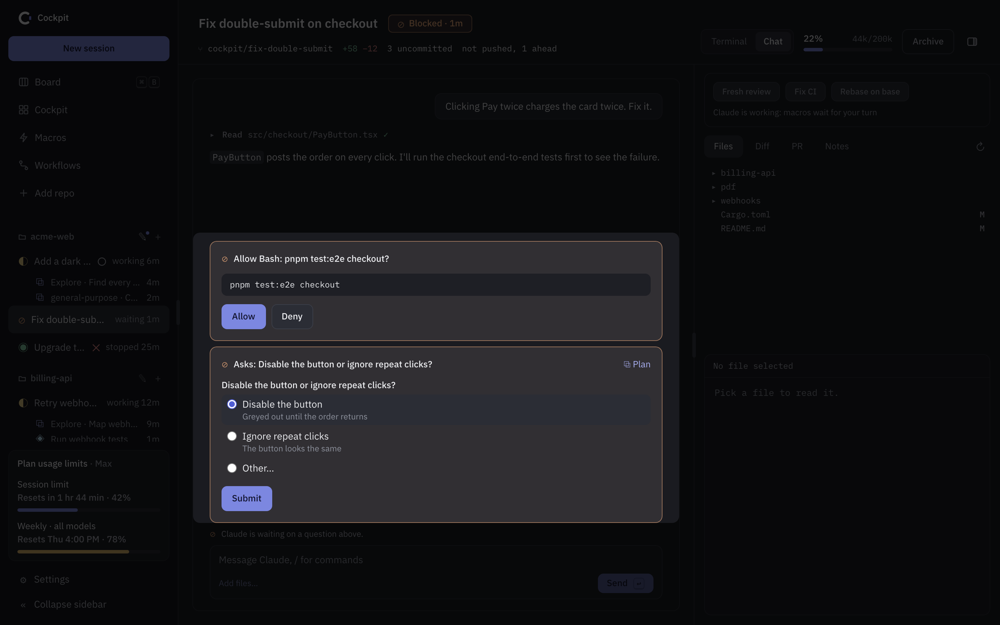

When a session is **Blocked**, its chat shows what Claude is waiting on as cards above the composer. Answer there, or in the terminal as before: whichever comes first counts.

| Claude asks | The card shows | You can |
|---|---|---|
| To use a tool (run a command, edit a file…) | The command or file path | **Allow**, or **Deny** with an optional message for Claude |
| A question (`AskUserQuestion`) | Every question with its options, and **Other…** for your own words | Pick the answers, then **Submit** |
| To approve a plan | The plan, with its images from the worktree or GitHub | **Send feedback** so Claude revises it, or **Approve in terminal** |
| Anything else (an MCP server's form) | **Answer in terminal** | **Open in terminal** |

- A subagent's card names the subagent, with ⧉.
- After a click, the button spins until Claude moves on. Nothing is typed into the terminal.
- A Deny with no message tells Claude "Denied in Cockpit."
- If you answer in the terminal first, the card says **Answered in the terminal** and fades.
- A card left unanswered for about 10 minutes turns into **Answer in terminal**: Claude Code's own question is still open there.
- Cards never offer "allow for the session" or a mode change, and plans are approved only in the terminal. Use the terminal for those.

### Composer

The box under the chat sends your next prompt to Claude, as if you had typed it in the terminal.

- Opening a session in Chat puts the cursor in the composer, so you can start typing right away.
- Press <kbd>↩</kbd> or click **Send**. <kbd>⇧</kbd> <kbd>↩</kbd> starts a new line. Type `/` to pick a slash command, at the start or after a space; only a command that starts the message runs, as in the first prompt. As with files, a few of its letters in order find it, drawn out in the list: `/supwriski` finds `/superpowers:writing-skills`.
- Type `@` to mention a file of the session's worktree, at the start or after a space. A few of its letters in order find it: `@thsdirfi` finds `this/dir/file.ts`. Letters that start a folder or file name, sit side by side or fall in the file name rank higher. A bare `@` lists the files changed on the branch first (**M** modified, **A** added). <kbd>↑</kbd> <kbd>↓</kbd> move, <kbd>↩</kbd> or <kbd>⇥</kbd> picks, <kbd>esc</kbd> closes. The pick goes in as `@path`, quoted when the path has a space, and Claude Code reads that file.
- Your message shows in the chat as soon as you send it, with one tick (**Sent**) in its corner. It gets two ticks (**Seen by Claude**) once Claude Code has taken it, usually a second or two later. A slash command or `!` command is replaced by its output instead, and one that writes nothing to the conversation (a picker like `/model`) goes when Claude hands the turn back. A queued message does the same when it goes in.
- Paste, drop or click **Add files…** to attach screenshots and files, as in the first prompt.
- **Send** sends at once when Claude is ready for a prompt: on your turn, and also when Claude has finished but its background shells or subagents still run (a CI watcher, say), unless a macro is waiting on them to type its next command.
- While Claude works or waits on a question, <kbd>↩</kbd> queues your message instead, as the line above the box says (its ◐ turns while Claude works). The button reads **Queue**, and the message shows above the box as **Queued**. When Claude's turn ends, it goes in by itself. <kbd>↩</kbd> again adds the new text to it as a new paragraph, and the button reads **Add to queue**. Files you add go with it. One message is queued per session, and it lasts until Cockpit quits.
- While Claude works, <kbd>esc</kbd> interrupts it, as in the terminal, wherever you are in the chat. In full screen it no longer takes you out of full screen. A list, menu or reply box that's open closes first. A second <kbd>esc</kbd> straight after does nothing, so a double tap doesn't open Claude Code's rewind menu. In Cockpit mode it goes to the tile you're typing in.
- While the session shows **Starting…** or **Session ended**, a line says why you can't send. You can keep typing; the text waits for you.
- On the queued message, **Edit** puts it back in the box, **Remove** drops it, and **Send now** types it into Claude Code and, once Claude Code shows it queued, presses Claude Code's own send now (its default key, Ctrl+X Ctrl+S): Claude takes it right away, cutting short what it was doing, and it shows in the chat from there. If you bound send now to another key in Claude Code, the message stays in Claude Code's queue and goes in when the turn ends. **Send now** is unavailable while Claude waits on a question, while a macro runs, while the session starts or while text you typed in the terminal waits in Claude's input. Hover it to see why.
- A queued message is held, not sent, when you interrupted Claude (<kbd>esc</kbd>), when you typed text in the terminal during the turn (**Send anyway** sends it), when the session ended (resume it first) or when sending failed. Keys that type nothing, such as <kbd>⇧</kbd> <kbd>⇥</kbd>, don't hold it. The bubble then says why (**Held · you interrupted Claude, so this wasn't sent**, say) and has a **Send** button.
- While a message is held and Claude is ready, <kbd>↩</kbd> or **Send** under the box adds your new text to it and sends both.
- Each session keeps its own draft until you send it, even when you switch views or sessions.
- Chips at the bottom left show the permission mode, model and effort, and change them (see [Run settings](#run-settings)).
- If Claude Code's input in the terminal holds something, Send waits: text you typed there, or a picker you opened. Keys that leave the input empty don't hold it, such as <kbd>esc</kbd>, <kbd>⇧</kbd> <kbd>⇥</kbd>, or text you typed and erased. The run chips are locked too. A live view of the terminal's last lines shows what you left there. Click **Back to terminal** to finish it there, or **Send anyway** to send the composer's text.
- A picker opened by a command from the composer, such as `/model`, holds Send the same way until you close it in the terminal. A command that leaves the input empty, such as `/cost`, doesn't.

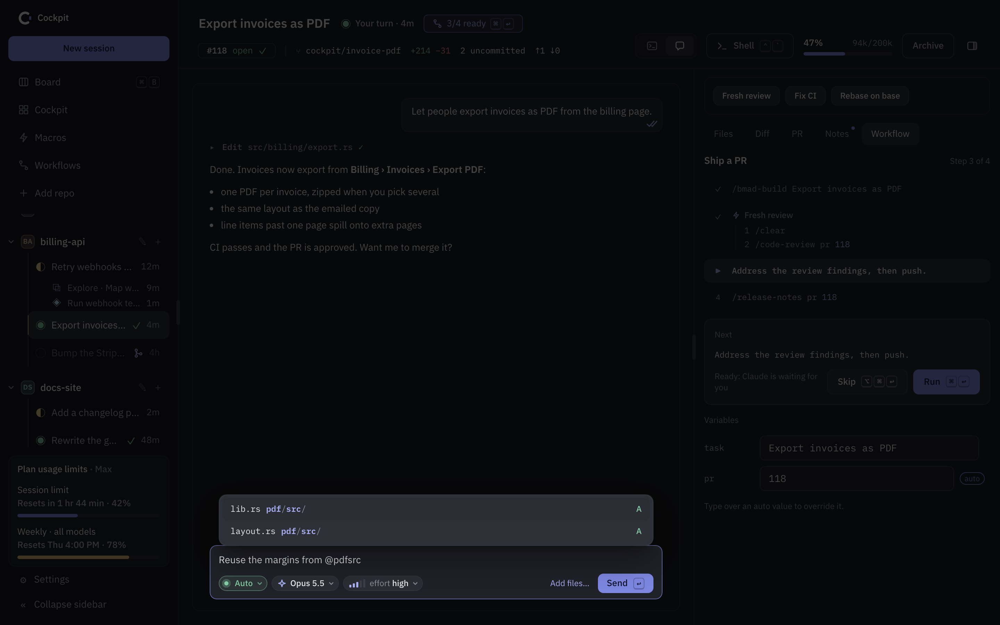

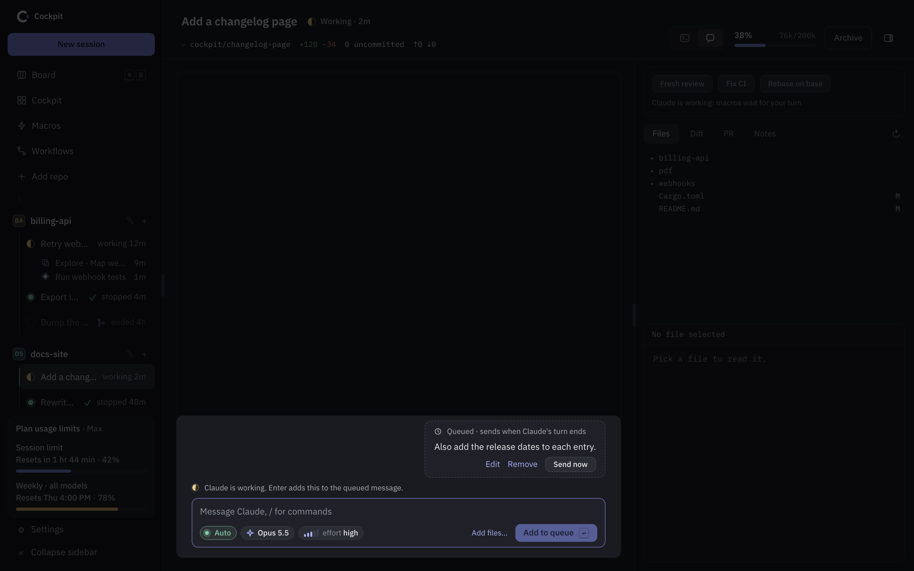

### Run settings

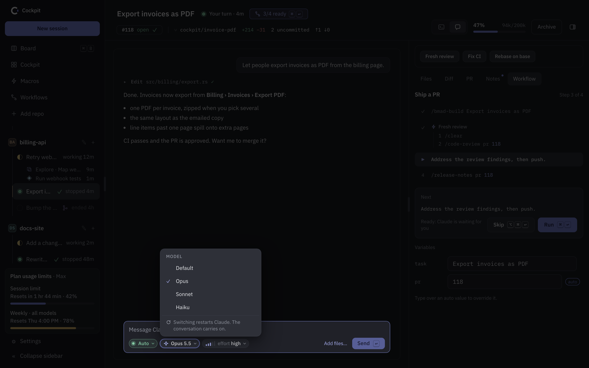

The chips at the bottom left of the composer show what the terminal's status line shows: the permission mode (**Plan**, **Auto**, **Accept edits** or **Manual**, each in its own colour), the model (**Fable**, **Opus**, **Sonnet** or **Haiku**, or **Default** for your Claude Code setting), the effort level and **thinking off** when thinking is off.

- Click the mode, model or effort chip and pick a value. Cockpit restarts Claude with it, in the same conversation. **Restarting Claude…** shows until it is your turn again.
- The chips change only on your turn, or once Claude has finished and only background work still runs. Otherwise they are locked, and hovering one says why.
- If background shells, subagents or monitors still run, the menu asks first and lists them. **Restart** stops them and restarts Claude; **Cancel** keeps them running.
- A <kbd>⇧</kbd> <kbd>⇥</kbd> in the terminal changes the mode too. The mode chip catches up the next time Claude acts: on your turn, that is once you send your next prompt.
- If Claude can't start again, the session ends and the composer says why. **Resume** starts it with the values you picked.

> [!NOTE]
> In Plan mode, Claude Code currently runs Sonnet when Haiku is picked, so the model chip shows Sonnet. The model menu still ticks Haiku and says "Plan mode runs Sonnet" under it, in the composer and in the New session form. In other modes Haiku runs without an effort level, and the effort menu says so.

### Reply to a selection

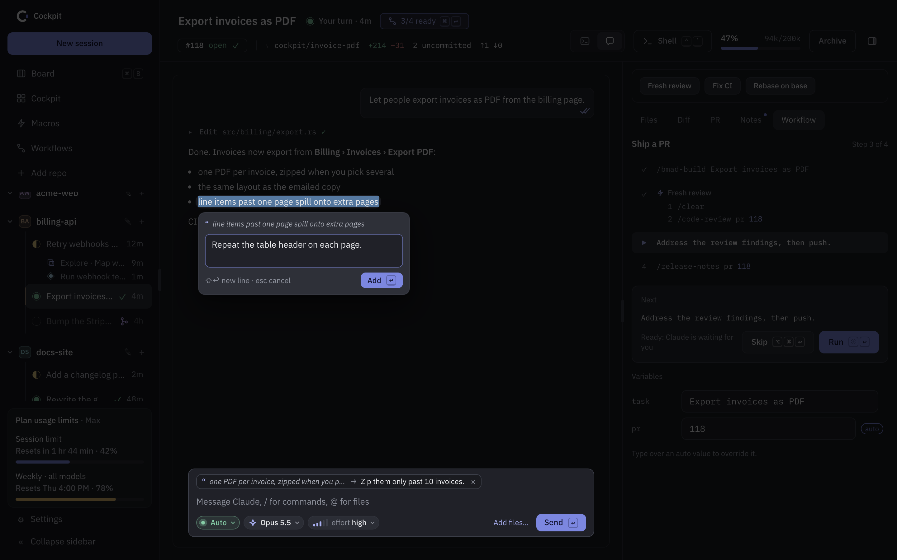

Answer one part of a reply without retyping it.

- Select any text in the chat and click **Reply**. Type your reply and press <kbd>↩</kbd> or click **Add**. <kbd>⇧</kbd> <kbd>↩</kbd> starts a new line, and <kbd>esc</kbd> or a click elsewhere cancels.
- Each reply waits above the composer as a chip: the text you selected, then your reply. Hover a chip to read it in full, or click **×** to remove it.
- Add as many as you like, then write the rest of your prompt and press **Send**. Claude gets each selection quoted, with your reply under it, before the text you typed. A slash command you typed goes first instead, so Claude Code still runs it, with the replies after it.
- While the reply box is open, the chat stops following new messages, so the text you selected stays put.
- Replies stay in the session's draft until you send it, like the rest of the draft.

### Files

- Read-only file tree. `M` marks changed files, `A` added ones.
- Syntax highlighting and line numbers. Markdown is rendered, with its images from the worktree or GitHub. Images from other sites stay links. An image that can't load shows as its text, a link when it has a web address. **Source** shows the raw text.
- <kbd>⌘</kbd>-click a file path in the terminal, like `src/App.tsx:120`, or click one in the chat, to open it here. The tree opens to the file, and the viewer scrolls to that line and highlights it.
- **Pop out** shows the file over the terminal.

### Default branch

- Click a repo's name in the sidebar to browse its default branch, no session needed. In the collapsed rail, click the repo's tile.
- The default branch is set per repo. **Add repo** preselects the one GitHub reports, else the one `origin/HEAD` points at, else `main` or `master`. Change it with **…** → **Default branch…** on the board.
- Cockpit reads `origin/<default>`, else the local `<default>`. The header shows it and its commit, e.g. `origin/main @ 8e2f9a1`.
- It shows what is committed, not the repo folder's uncommitted edits, and leaves submodules out. It never fetches: `origin/<default>` is as fresh as your last `git fetch`. If neither branch exists, the view says so and points to **Default branch…**.
- **Reload** reads the branch again. Same viewer as the Files tab: highlighted code, rendered Markdown with **Source**. Images there stay links.

### Diff

- Everything since the merge-base with `origin/<base>`: commits plus uncommitted changes.
- While the branch has an open PR, `<base>` is the branch the PR merges into (fetched from origin), so the header's line counts and this tab match GitHub. Once the branch has no PR, it goes back to the base the session started from.
- Filter by **Committed**, **Uncommitted** or a single commit.
- **Unified** or **Side by side**. **Pop out** shows the diff over the terminal.

### Pull request

- Description, checks, review, unresolved threads and a GitHub link, read through your `gh` login.
- Each check shows how long it took. A running check has a spinner and a clock that counts up every second, as on GitHub. A queued check has a dashed ring and counts how long it has waited to start: **Queued 42s**. A status reported by another service (a deploy preview, say) shows no clock, since GitHub doesn't say when it started. While any check is queued or running, the tab reads the PR again every 30 seconds.
- The header shows where the PR goes, in GitHub's order: `main ← fix/login`, the branch it merges into, then its own branch. The confirm button names it too: **Confirm squash into main**.
- The description shows its images: pasted screenshots, images from the repo and badges, private repos included. They load through `gh` too. An image that can't load shows as its text, a link when it has a web address.
- Merge or squash-merge after a confirm. The menu offers only the methods the repo and the rules on the PR's base branch allow. Cockpit remembers your method per repo and base branch.
- When no method is allowed (a base that takes only rebase merges, say), the tab says why. Merge on GitHub.
- **Update branch** when the branch is behind. When the PR's own branch is protected on GitHub (a long-lived branch such as `dev`), Cockpit leaves it to GitHub: no **Update branch**, and GitHub keeps the branch after the merge even when the repo deletes merged branches.
- A draft PR gets **Ready for review** in place of the merge button. One click marks it ready on GitHub.
- Refreshes every ~30 s, or on demand.
- A session's PR is the one whose branch matches the session's. When the names differ, Claude can link an existing PR of the repo through Cockpit's `link_pr` tool. The badge tooltip then says "linked by the agent", and the PR tab's header shows the PR's own branch. Claude can remove the link the same way.

### Macros

A macro is a short chain of commands, e.g. `/clear` then `/code-review pr {pr}`.

- Edit them on the **Macros** page.
- Run one from the buttons above the side pane's tabs. Each command is sent when Claude's turn ends. **Cancel** stops the chain.
- **Or…** adds fallback commands. Cockpit sends the first one installed.
- **Show at session create** offers the macro in the new-session form.

Placeholders fill themselves:

| Placeholder | Value |
|---|---|
| `{pr}` | PR number. A macro that uses it is disabled until the branch has a PR. |
| `{pr_url}` | PR link |
| `{branch}` | The session's branch |
| `{base}` | The base branch: the PR's while the branch has an open one |

### Workflows

A workflow is a list of prompts and macros you step through, e.g. build → review → fix → release notes.

- Edit them on the **Workflows** page. `{name}` becomes a variable you fill in; the four placeholders above fill themselves.
- Pick one in the new-session form. Step 1 becomes the first prompt.

- The **Workflow** tab shows the steps, the next one and the variables.
- **Run** sends the next step on your turn. **Skip** passes it.
- The header badge shows progress.

### Cockpit view

Every running session in one grid, as its terminal or its chat. Answer prompts without switching sessions.

- Each tile shows the session's own view, or its terminal while **Chat UI** is off. The terminal and chat icons in its header switch it, and the session view follows.
- A chat tile has what the session's chat has: running work, answer cards and the composer.
- **All tiles**, above the grid, switches every tile at once. It shows a view only while every tile is on it. It appears only while **Chat UI** is on.
- Blocked tiles glow. A pill points to blocked tiles scrolled out of view: click it to jump there, ready to answer.
- ⤢ opens the session.

### Shells

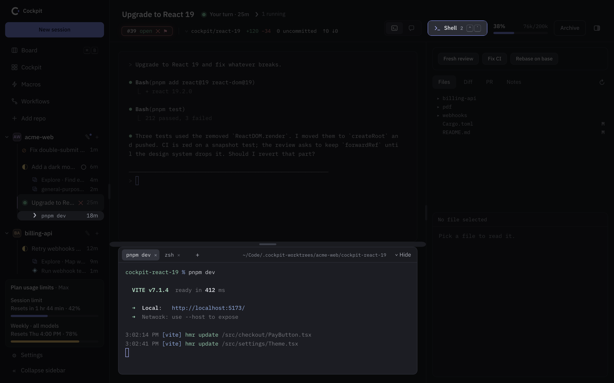

Run your own commands in the session's worktree while Claude stays in view: a dev server, `git log`, the tests.

- Click **Shell** in the session header, or press <kbd>⌃</kbd> <kbd>`</kbd>. A drawer opens under the terminal or chat with a shell (your `$SHELL`) already in the worktree.
- **+** opens another shell in its own tab. A tab shows the title the shell gives it, such as the running command.
- Each tab's **✕** ends that shell. Typing `exit` ends it too. The drawer closes with the last shell.
- A shell that fails to start keeps its tab, which shows the system's error with **Dismiss** and **Try again**. If the worktree is gone, the tab says so, with no **Try again**.
- **Hide**, **Shell** or <kbd>⌃</kbd> <kbd>`</kbd> hides the drawer. If you were typing in a shell, your typing goes back to Claude's terminal, or to the composer in chat view. The shells keep running: **Shell** shows how many, with a green dot. Switching to another session keeps them running too, with their output.
- Drag the drawer's top edge to resize it. Every session uses the same height.
- While a shell runs a command, the sidebar lists it under the session with ❯, the command and how long it has run. The session's card and header count it (**❯ 1 running**), and the chat lists it above the composer. A shell waiting at its prompt shows nothing.
- Your shells never change the session's state. What you type there never holds the composer.
- Every session in a worktree shares its shells.
- Quitting Cockpit ends every shell, and shells don't come back after a restart. Archiving the worktree ends its shells.

### Resume and archive

| | |
|---|---|
| **Resume** | An Ended session keeps its card. Opening it runs `claude --resume` (unless turned off in Settings). The header has a **Resume** button too. |
| **Archive** | Stops Claude in every session of the worktree, deletes the worktree and the branches Cockpit created. In a worktree with several sessions the button reads **Archive worktree** and the dialog lists them. Keeps branches that already existed, the repo's default branch, `main`, `master` and the PR's base branch. Never touches the remote. Warns first about uncommitted changes, unpushed commits and open shells. |

### Usage meters

The sidebar footer shows your plan's 5-hour and weekly limits: % used and reset time. The bar changes color near a limit. Numbers appear once a session has run. When you sign in to Claude Code, or sign in as another account, they update within seconds.

### Settings

Click **Settings** to open the Settings page. A change applies as soon as you click it.

| Section | Setting | Default |
|---|---|---|
| Sessions | Jump into session on create | Off |
| Sessions | Resume when opening an Ended session | On |
| Sessions | Warn about uncommitted changes on archive | On |
| Sessions | Default model | Opus |
| Appearance | Theme | Slate (Ledger is a darker alternative) |
| Appearance | Repo order | Alphabetical (**Manual** keeps the order you drag repo rows into on the Board) |
| Chat | Chat UI (**Beta**) | Off (on after an update if you already used the chat: new sessions opened in Chat, or a session was in Chat). Turns on the chat view, see [Chat view](#chat-view) |
| Chat | New sessions open in | Terminal (**Chat** opens new sessions in the chat view) |
| Chat | Chat text | Fade (how new chat text appears: **Fade** line by line, **Type** letter by letter, or **None**) |
| Chat | Chat width | Centered (**Full width** makes the chat fill the center panel) |
| System | Keep Mac awake while sessions work | Off (only while plugged in) |
| Updates | Beta builds | Off (installed app only, see [Beta builds](#beta-builds)) |

**New sessions open in**, **Chat text** and **Chat width** are greyed out while **Chat UI** is off. **Updates** shows only in the installed app, with its version and **Check for updates**. **About** has **License**, which shows Cockpit's license and the licenses of the open-source software it includes. **Cockpit → About Cockpit** shows the version and the copyright.

---

## Keyboard shortcuts

| Shortcut | Action |
|---|---|
| <kbd>⌘</kbd> <kbd>B</kbd> | Back to the board |
| <kbd>⌘</kbd> <kbd>T</kbd> | New session in the open worktree |
| <kbd>⌘</kbd> <kbd>W</kbd> | Close the open session (never the window, and never a worktree's last session) |
| <kbd>⌃</kbd> <kbd>Tab</kbd> / <kbd>⌃</kbd> <kbd>⇧</kbd> <kbd>Tab</kbd> | Next / previous session in the worktree |
| <kbd>⌃</kbd> <kbd>`</kbd> | Open, show or hide the session's shells |
| <kbd>⌘</kbd> <kbd>+</kbd> / <kbd>⌘</kbd> <kbd>−</kbd> / <kbd>⌘</kbd> <kbd>0</kbd> | Terminal and chat text bigger / smaller / reset |
| <kbd>⌘</kbd> <kbd>↩</kbd> | Run the next workflow step |
| <kbd>⌥</kbd> <kbd>⌘</kbd> <kbd>↩</kbd> | Skip the next workflow step |
| <kbd>⇧</kbd> <kbd>↩</kbd> | New line in the terminal or the composer, without sending |
| <kbd>↩</kbd> | Send the composer's prompt |
| <kbd>⌘</kbd>-click a file path in the terminal | Open the file in the Files tab, at its line |

<kbd>⌘</kbd> <kbd>T</kbd>, <kbd>⌘</kbd> <kbd>W</kbd> and <kbd>⌃</kbd> <kbd>Tab</kbd> also sit in the **Session** menu in the menu bar. They work in the session view only, and Cockpit keeps them: Claude Code, your shells and the terminals on the Cockpit page never get them, so a shell program that uses <kbd>⌃</kbd> <kbd>Tab</kbd> loses it. With a menu or popover open, <kbd>⌘</kbd> <kbd>W</kbd> closes it instead, except the question Cockpit asks before closing a busy session, which stays until you answer it.

---

## Updating

- Cockpit checks for a new version at launch and every 6 hours.
- It downloads and installs a new version in the background while you work. Your sessions keep running.
- When the new version is ready, **Cockpit vX.Y.Z is ready** appears. The update applies the next time you launch Cockpit.
- Click **Restart now** to switch at once, or **Later** to keep working. Until you restart, the sidebar shows **Restart to update** (in the collapsed rail, an ↑ button).
- Click **What's new?** to read what changed, when the release has notes. It sits in the toast, under the update button in the sidebar (not when the sidebar is collapsed), and next to the version in Settings. The notes come from the release and show in a dialog. A beta's dialog adds **Beta build. It may be unstable.**
- After Cockpit restarts into a new version, **Updated to vX.Y.Z** appears once, with **What's new?** to read the notes or **Dismiss** to close it. It goes away when the next update is ready.
- If sessions are running, Cockpit asks before it restarts, because restarting ends them. Resume them afterwards from the board.
- If a download or install fails, Cockpit tries again later, less and less often: after 6 hours, then 12, 24 and 48 hours, then every 4 days.

Settings shows the installed version and has **Check for updates** to check right away. If the check or the download fails, Settings says so. Click **Details** to see why. For a failed check, it names the update feed that failed and how: for example `HTTP 504 Gateway Timeout` when GitHub is having trouble, or a DNS or connection error when you're offline. Cockpit also writes this to its log.

> [!NOTE]
> If your Mac would ask for an administrator password to replace Cockpit (it sits in a folder you can't write to), Cockpit never installs on its own. The sidebar shows **Update to vX.Y.Z** and Settings shows **Install update** instead. Click either one and enter your password when macOS asks.

> [!NOTE]
> The app holds no GitHub token. It reads the public feed at `https://github.com/kaimunlau/cockpit-releases/releases/latest/download/latest.json` and verifies each update's signature before installing it.

### Beta builds

- Turn on **Beta builds** in Settings to get changes before they're released.
- Cockpit checks for a beta at once, then on the usual schedule. Betas install the same way as releases, and their version ends in `-beta.N`.
- A beta's **What's new?** lists everything since the latest release, so it repeats what earlier betas already brought.
- A release newer than your beta still installs.
- Turn **Beta builds** off to go back to the latest release. Cockpit checks at once and installs it, even though it is older than your beta.
- Going back keeps your repos, sessions, workflows and macros. A value only the beta knows (a new setting option, say) goes back to its default. Cockpit first keeps a copy of the beta's data, as `state.json.beta-<time>` in `~/Library/Application Support/com.cc-cockpit.app/`.
- A version from before [several sessions in one worktree](#several-sessions-in-one-worktree) shows each worktree as one session: its oldest open one. The others wait in `worktrees.json`, in the same folder, and come back when you update again. A worktree you archive in the older version takes them with it.

> [!WARNING]
> Beta builds may be unstable.

---

## License

Cockpit is free to use, for any purpose, under the [MIT License with the Commons Clause](LICENSE). You may not sell it. Copies must keep the copyright notice.
