<h1 align="center">Cockpit</h1>

  Run many Claude Code sessions at once on macOS, each in its own git worktree.

  
  

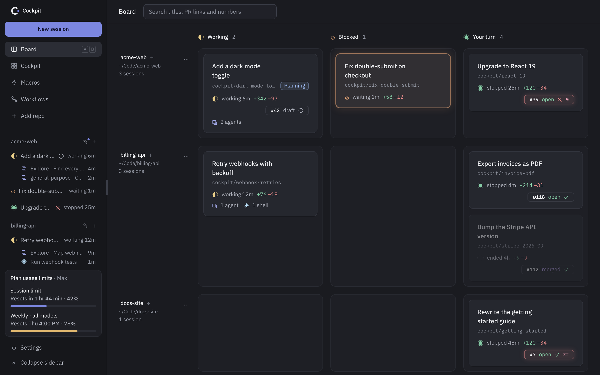

- **One board** for every session: working, blocked on you, or waiting.
- **What changed**: files, diff and the PR each session opened.
- **Your own `claude`**: plugins, skills, hooks, MCP servers and permission prompts work as in a terminal. Cockpit never writes to `~/.claude/`.

**Contents:** [Installation](#installation) · [Features](#features) · [Keyboard shortcuts](#keyboard-shortcuts) · [Updating](#updating)

---

## Installation

### Requirements

| Requirement | Needed for |
|---|---|
| macOS (Apple Silicon or Intel) | Running Cockpit |
| [Claude Code](https://docs.anthropic.com/en/docs/claude-code) (`claude`), signed in | Every session |
| `git` | Worktrees, diffs, branch status |
| [GitHub CLI](https://cli.github.com) (`gh`), signed in with `gh auth login` | PR badges and the PR tab (optional) |

> [!NOTE]
> These must be on your login shell's `PATH`. Cockpit reads it from `$SHELL -l -i`.

### Download and install

1. Download the latest `Cockpit_<version>_universal.dmg` from [cockpit-releases](https://github.com/kaimunlau/cockpit-releases/releases/latest). One app for Apple Silicon and Intel.
2. Open the DMG and drag Cockpit to Applications.
3. Open Cockpit. macOS blocks it the first time: the app is ad-hoc signed, not signed with an Apple Developer ID.
4. Go to **System Settings → Privacy & Security → Security**, click **Open Anyway**, confirm, and open Cockpit again.

> [!TIP]
> You do this once per Mac. After an update, macOS may ask again for access to folders like Documents or Desktop.

### First steps

**1. Add a repo.** Click **Add repo** and pick a local git repo.

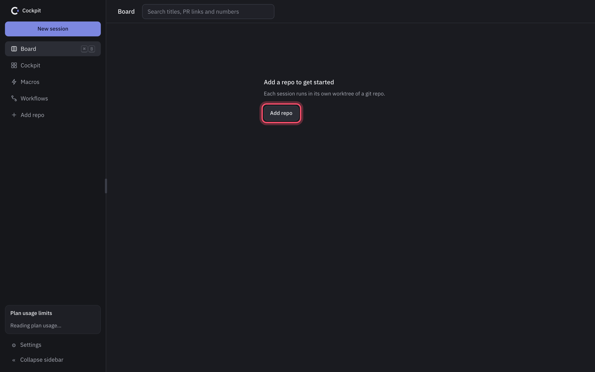

**2. Start a session.** Click **New session** (1), write a **First prompt** (2), click **Create session** (3). Leave the other fields as they are.

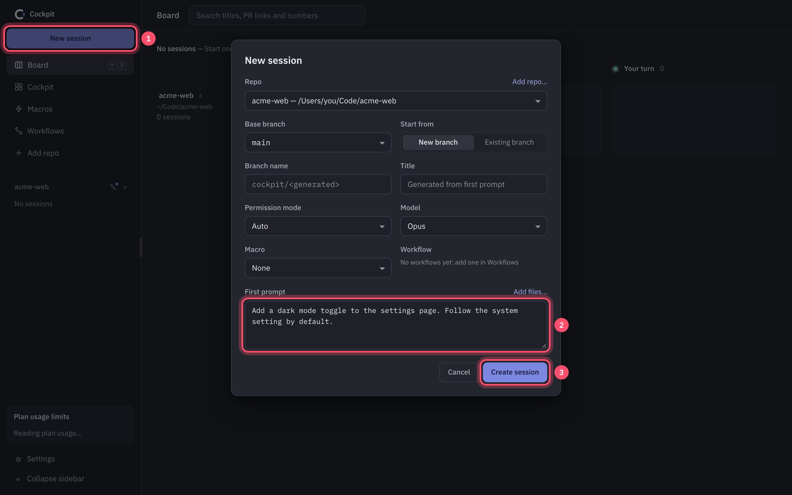

**3. Open it.** Click the new card.

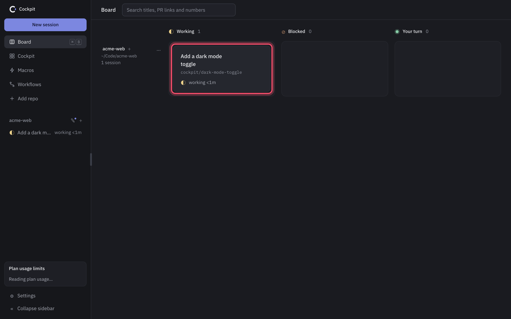

---

## Features

### Board

One row per repo, one column per state:

| Column | Meaning |
|---|---|
| **Working** | Claude is running. The card counts running subagents, shells and monitors. |
| **Blocked** | Claude needs you, usually a permission prompt. The card glows and you get one macOS notification; click it to open the session. |
| **Your turn** | Claude is done. Ended sessions show dimmed here. |

Cards show the branch, time in state, lines changed and the PR badge. The badge turns red on failed CI, requested changes or conflicts; click it to open the PR.

- Drag a repo to reorder rows.
- **+** starts a session in that repo. **…** removes a repo with no sessions.
- Search by title, PR link or PR number.

### Starting a session

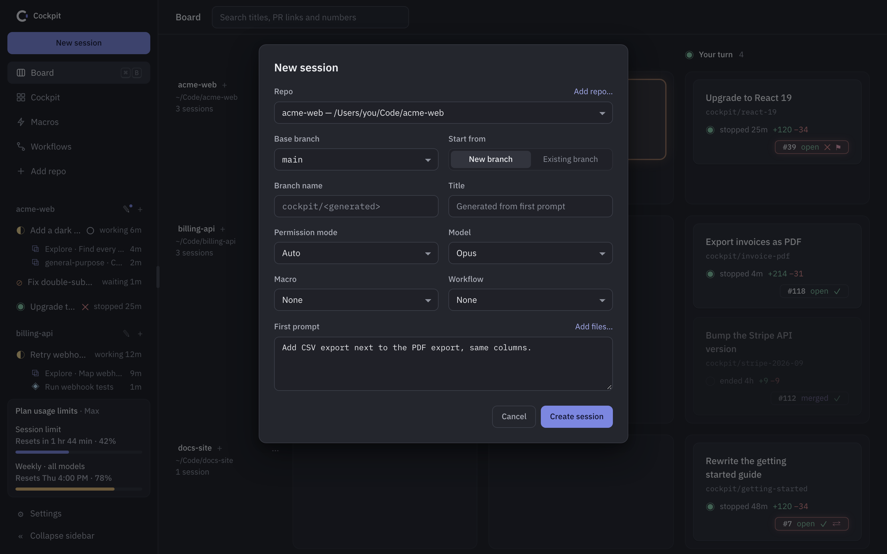

- The defaults work: write a first prompt and create. A blank branch name and title are generated from the prompt.
- Type `/` for slash commands. Add files by dropping, pasting or **Add files…**.
- Each session gets its own worktree in `<repo parent>/.cockpit-worktrees/`, branched from a fresh `origin/<base>`.
- Sessions use the permission mode you pick (Auto by default), never `--dangerously-skip-permissions`.
- Claude can propose a session through Cockpit's `new_session` tool. It opens this form prefilled; nothing starts until you click **Create session**.

### Session view

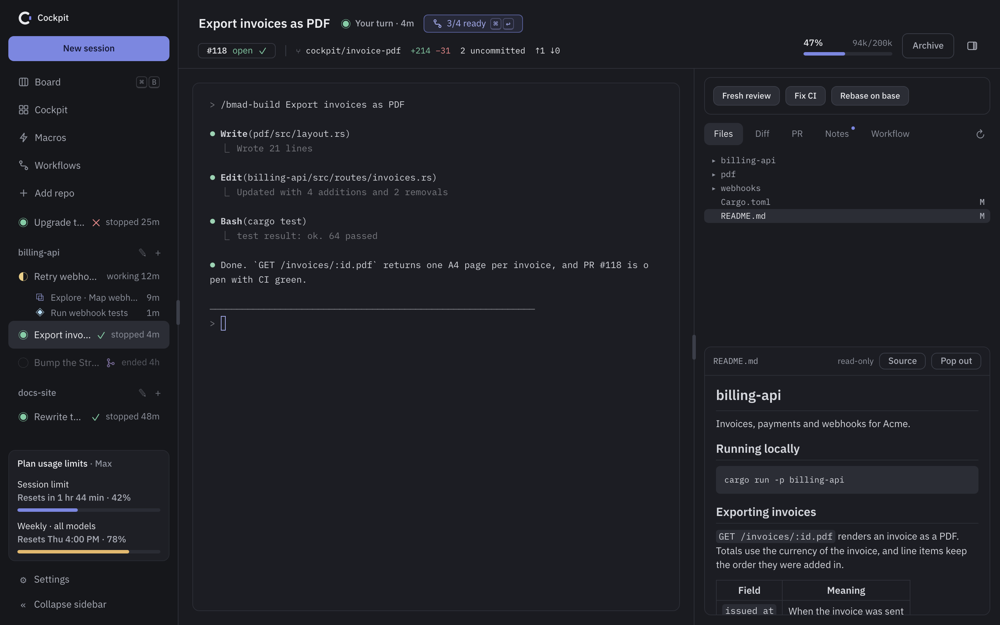

| Area | What it shows |
|---|---|
| **Terminal** | The real `claude` process. |
| **Header** | PR badge, branch, lines changed, uncommitted files, ahead/behind, context use. Click the title to rename. |
| **Sidebar** | Every session and what it is running. **Collapse sidebar** shrinks it to a rail. |
| **Side pane** | Files, Diff, PR, Notes, Workflow, and Artifacts (claude.ai pages the session linked, when there are any). The button at the top right hides it. |

Repos have notes too: click the pencil next to the repo name in the sidebar.

### Files

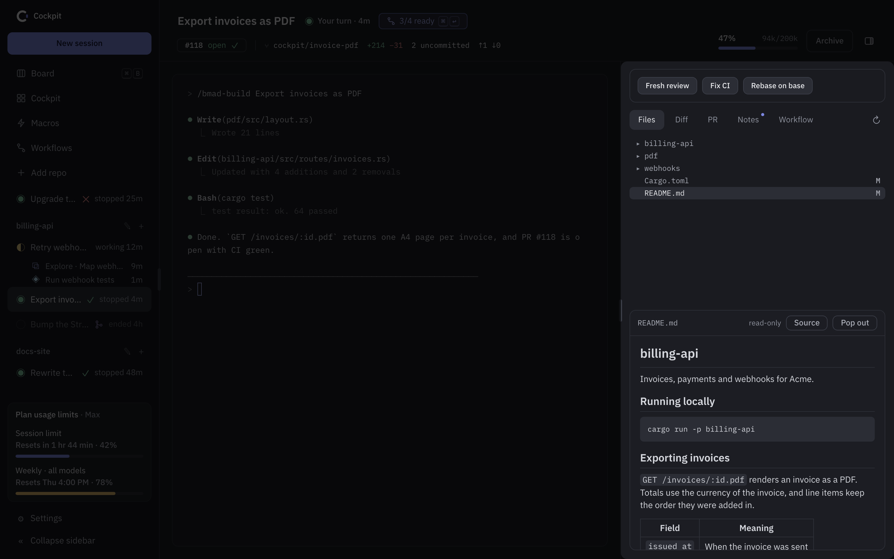

- Read-only file tree. `M` marks changed files, `A` added ones.
- Syntax highlighting. Markdown is rendered; **Source** shows the raw text.
- **Pop out** shows the file over the terminal.

### Diff

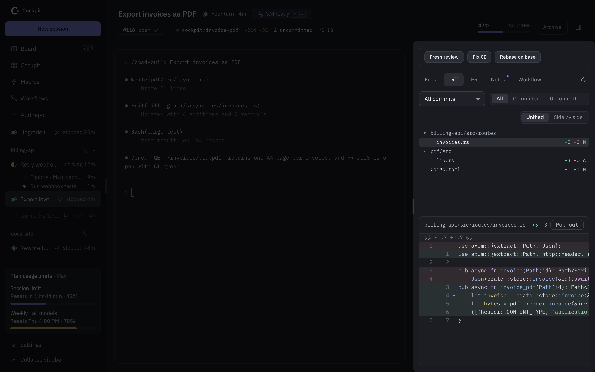

- Everything since the merge-base with `origin/<base>`: commits plus uncommitted changes.
- Filter by **Committed**, **Uncommitted** or a single commit.
- **Unified** or **Side by side**. **Pop out** shows the diff over the terminal.

### Pull request

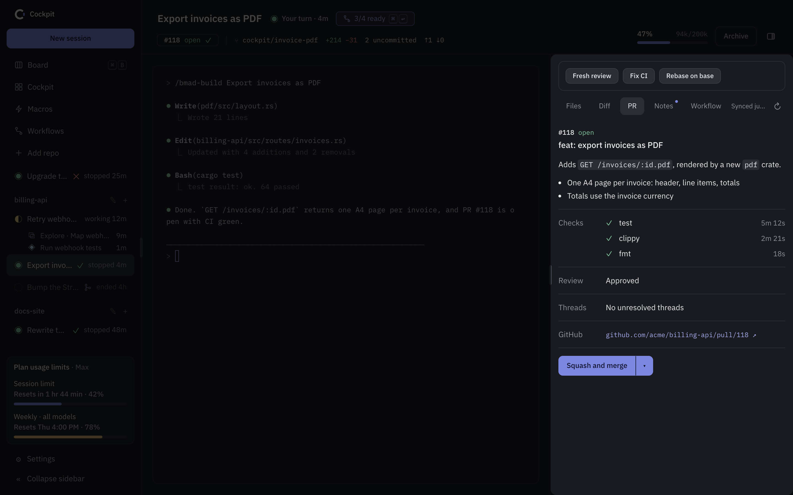

- Description, checks, review, unresolved threads and a GitHub link, read through your `gh` login.
- Merge or squash-merge after a confirm. Cockpit remembers your last method.
- **Update branch** when the branch is behind.
- Refreshes every ~30 s, or on demand.

### Macros

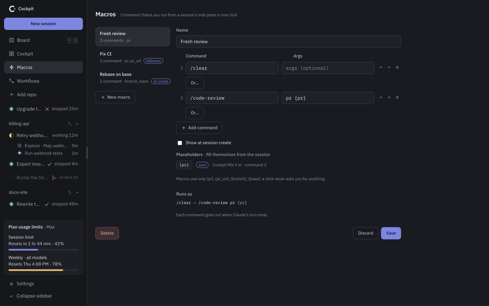

A macro is a short chain of commands, e.g. `/clear` then `/code-review pr {pr}`.

- Edit them on the **Macros** page.
- Run one from the buttons above the side pane's tabs. Each command is sent when Claude's turn ends. **Cancel** stops the chain.
- **Or…** adds fallback commands. Cockpit sends the first one installed.
- **Show at session create** offers the macro in the new-session form.

Placeholders fill themselves:

| Placeholder | Value |
|---|---|
| `{pr}` | PR number. A macro that uses it is disabled until the branch has a PR. |
| `{pr_url}` | PR link |
| `{branch}` | The session's branch |
| `{base}` | The base branch |

### Workflows

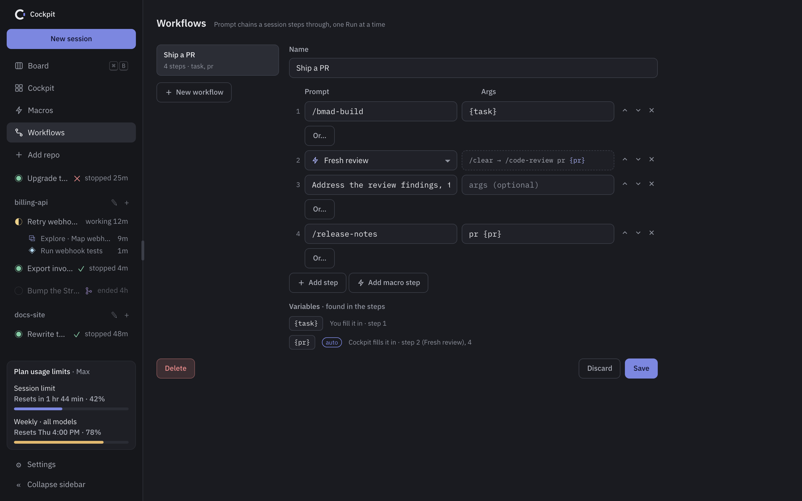

A workflow is a list of prompts and macros you step through, e.g. build → review → fix → release notes.

- Edit them on the **Workflows** page. `{name}` becomes a variable you fill in; the four placeholders above fill themselves.
- Pick one in the new-session form. Step 1 becomes the first prompt.

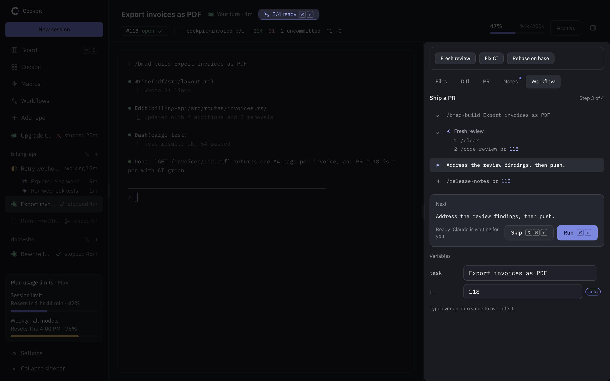

- The **Workflow** tab shows the steps, the next one and the variables.
- **Run** sends the next step on your turn. **Skip** passes it.
- The header badge shows progress.

### Cockpit view

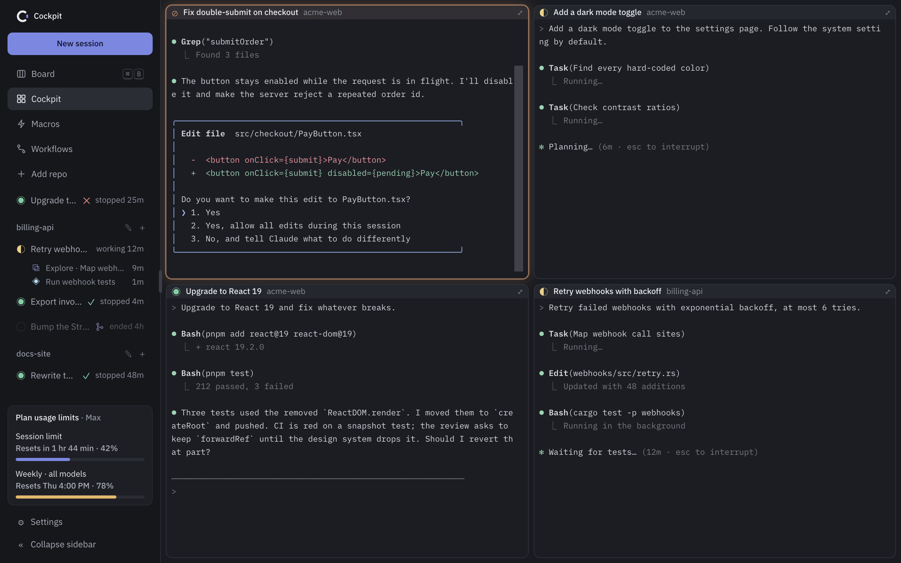

Every running session's terminal in one grid. Answer prompts without switching sessions.

- Blocked tiles glow. A pill points to blocked tiles scrolled out of view.
- ⤢ opens the session.

### Resume and archive

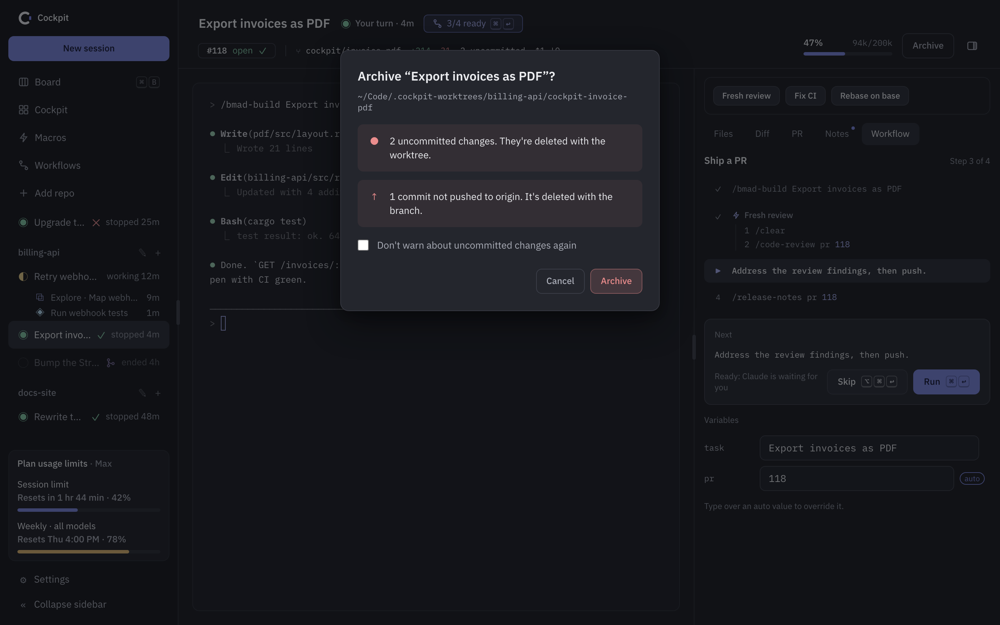

| | |
|---|---|
| **Resume** | An Ended session keeps its card. Opening it runs `claude --resume` (unless turned off in Settings). The header has a **Resume** button too. |
| **Archive** | Stops Claude, deletes the worktree and the branches Cockpit created. Keeps branches that already existed. Never touches the remote. Warns first about uncommitted changes and unpushed commits. |

### Usage meters

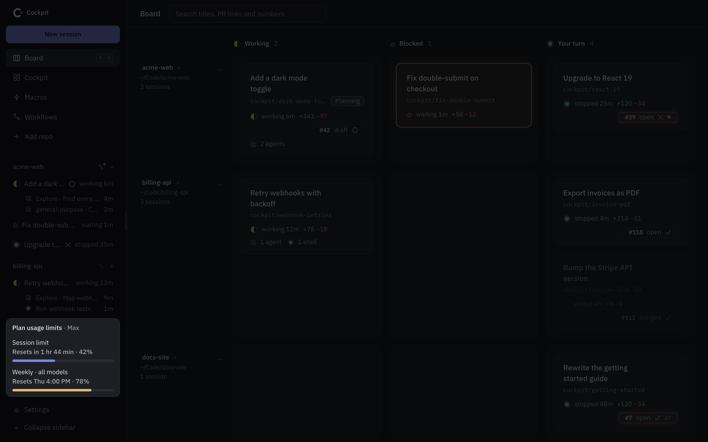

The sidebar footer shows your plan's 5-hour and weekly limits: % used and reset time. The bar changes color near a limit. Numbers appear once a session has run.

### Settings

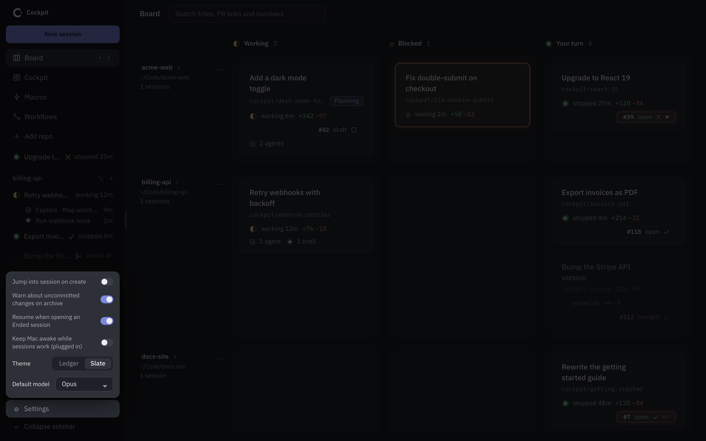

| Setting | Default |
|---|---|
| Jump into session on create | Off |
| Warn about uncommitted changes on archive | On |
| Resume when opening an Ended session | On |
| Keep Mac awake while sessions work (plugged in) | Off |
| Theme | Slate (Ledger is a darker alternative) |
| Default model | Opus |

The installed app also shows its version and **Check for updates**.

---

## Keyboard shortcuts

| Shortcut | Action |
|---|---|
| <kbd>⌘</kbd> <kbd>B</kbd> | Back to the board |
| <kbd>⌘</kbd> <kbd>+</kbd> / <kbd>⌘</kbd> <kbd>−</kbd> / <kbd>⌘</kbd> <kbd>0</kbd> | Terminal font bigger / smaller / reset |
| <kbd>⌘</kbd> <kbd>↩</kbd> | Run the next workflow step |
| <kbd>⌥</kbd> <kbd>⌘</kbd> <kbd>↩</kbd> | Skip the next workflow step |
| <kbd>⇧</kbd> <kbd>↩</kbd> | New line in the terminal, without sending |

---

## Updating

Cockpit checks the release feed at launch and every 6 hours. When a newer version exists, the sidebar footer shows **Update to vX.Y.Z** (in the collapsed rail, an ↑ button). Click it to download, install and relaunch. If sessions are running, Cockpit first asks, because restarting ends them; resume them afterwards from the board.

Settings shows the installed version and has **Check for updates** for a manual check. Nothing is installed without a click, and the app holds no GitHub token: it reads the public feed at `https://github.com/kaimunlau/cockpit-releases/releases/latest/download/latest.json` and verifies each update's signature before installing it.
