<h1 align="center">Cockpit</h1>

  Run many Claude Code sessions at once on macOS, each in its own git worktree.

  
  

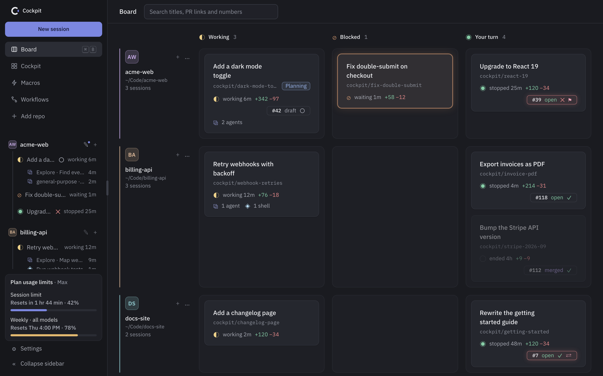

- **One board** for every session: working, blocked on you, or waiting.
- **What changed**: files, diff and the PR each session opened.
- **Your own `claude`**: plugins, skills, hooks, MCP servers and permission prompts work as in a terminal. Cockpit never writes to `~/.claude/`.

**Contents:** [Installation](#installation) · [Features](#features) · [Keyboard shortcuts](#keyboard-shortcuts) · [Updating](#updating) · [License](#license)

---

## Installation

### Requirements

| Requirement | Needed for |
|---|---|
| macOS (Apple Silicon or Intel) | Running Cockpit |
| [Claude Code](https://docs.anthropic.com/en/docs/claude-code) (`claude`), signed in | Every session |
| `git` | Worktrees, diffs, branch status |
| [GitHub CLI](https://cli.github.com) (`gh`), signed in with `gh auth login` | PR badges and the PR tab (optional) |

> [!NOTE]
> These must be on your login shell's `PATH`. Cockpit reads it from `$SHELL -l -i`.

### Download and install

1. Download the latest `Cockpit_<version>_universal.dmg` from [cockpit-releases](https://github.com/kaimunlau/cockpit-releases/releases/latest). One app for Apple Silicon and Intel.
2. Open the DMG and drag Cockpit to Applications.
3. Open Cockpit. macOS blocks it the first time: the app is ad-hoc signed, not signed with an Apple Developer ID.
4. Go to **System Settings → Privacy & Security → Security**, click **Open Anyway**, confirm, and open Cockpit again.

> [!TIP]
> You do this once per Mac. After an update, macOS may ask again for access to folders like Documents or Desktop.

### First steps

**1. Add a repo.** Click **Add repo** and pick a local git repo.

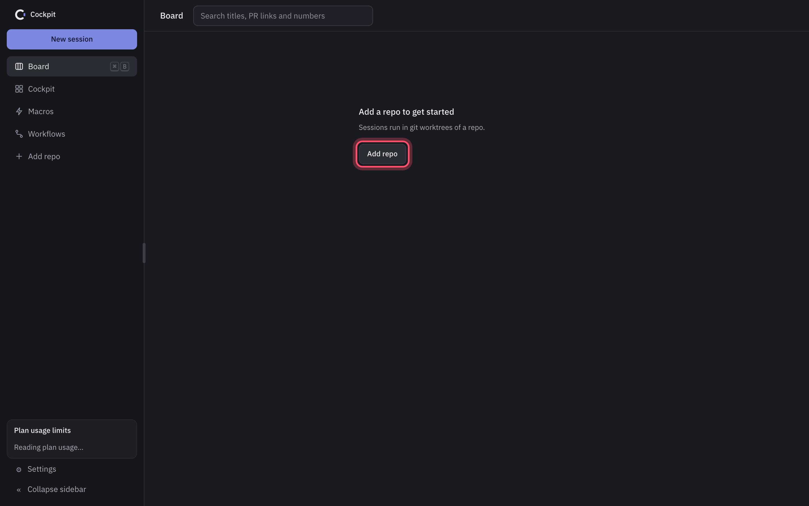

**2. Start a session.** Click **New session** (1), write a **First prompt** (2), click **Create session** (3). Leave the other fields as they are.

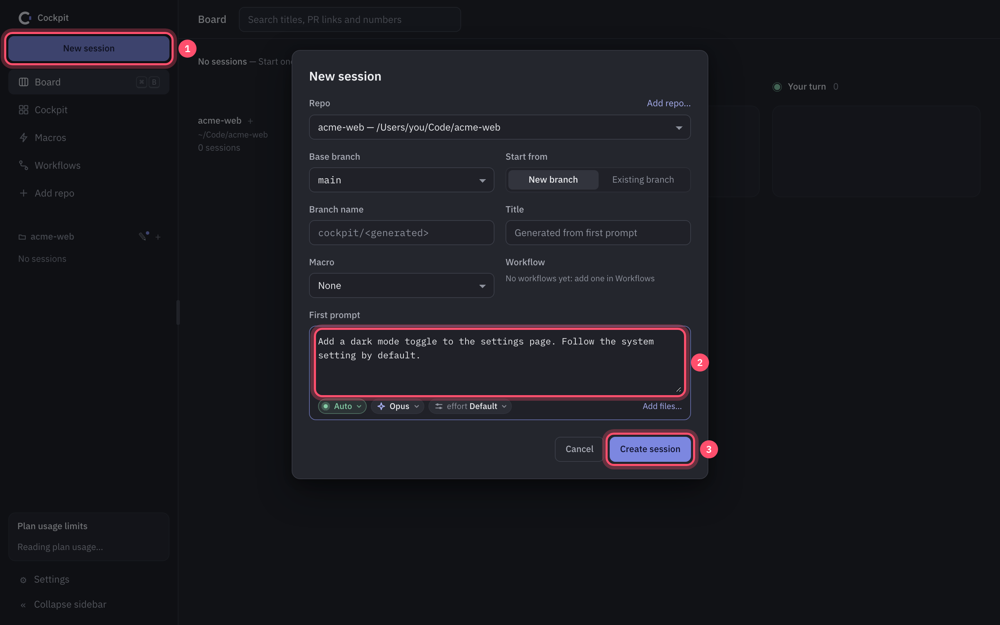

**3. Open it.** Click the new card.

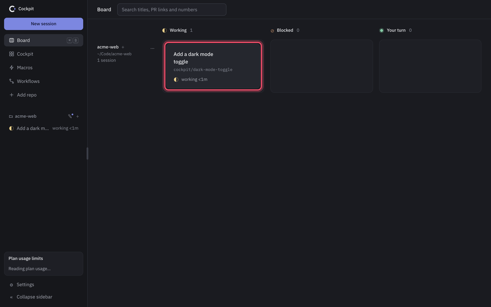

---

## Features

### Board

One row per repo, one column per state:

| Column | Meaning |
|---|---|
| **Working** | Claude is running. The card counts running subagents, shells and monitors. |
| **Blocked** | Claude needs you, usually a permission prompt. The card glows and you get one macOS notification; click it to open the session. |
| **Your turn** | Claude is done. Ended sessions show dimmed here. |

Cards show the branch, time in state, lines changed and the PR badge. The badge turns red on failed CI, requested changes or conflicts; click it to open the PR.

- Rows are in alphabetical order. To set your own order, set **Repo order** to **Manual** in Settings, then drag a repo row.
- **+** starts a session in that repo. **…** removes a repo with no sessions.
- Search by title, PR link or PR number.

### Starting a session

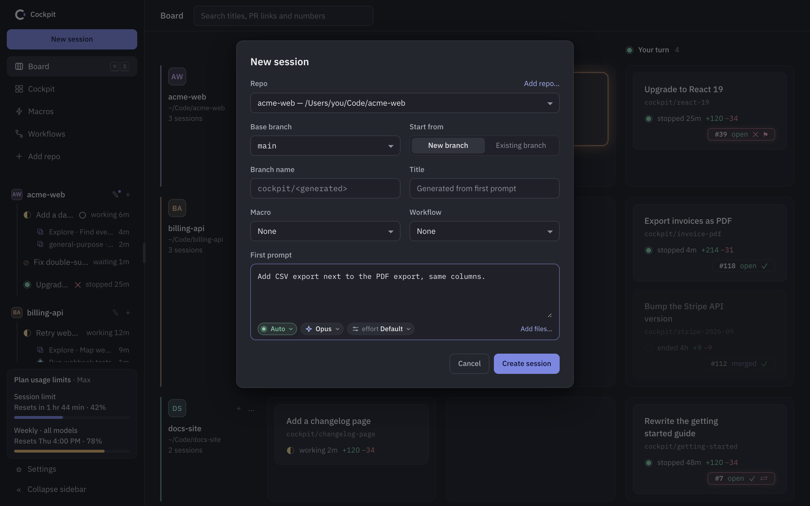

- The defaults work: write a first prompt and create. A blank branch name and title are generated from the prompt.
- Type `/` for slash commands. Add files by dropping, pasting or **Add files…**.
- Each session gets its own worktree in `<repo parent>/.cockpit-worktrees/`, branched from a fresh `origin/<base>`.
- Sessions use the permission mode you pick (Auto by default), never `--dangerously-skip-permissions`.
- Claude can propose a session through Cockpit's `new_session` tool. It opens this form prefilled; nothing starts until you click **Create session**.

### Session view

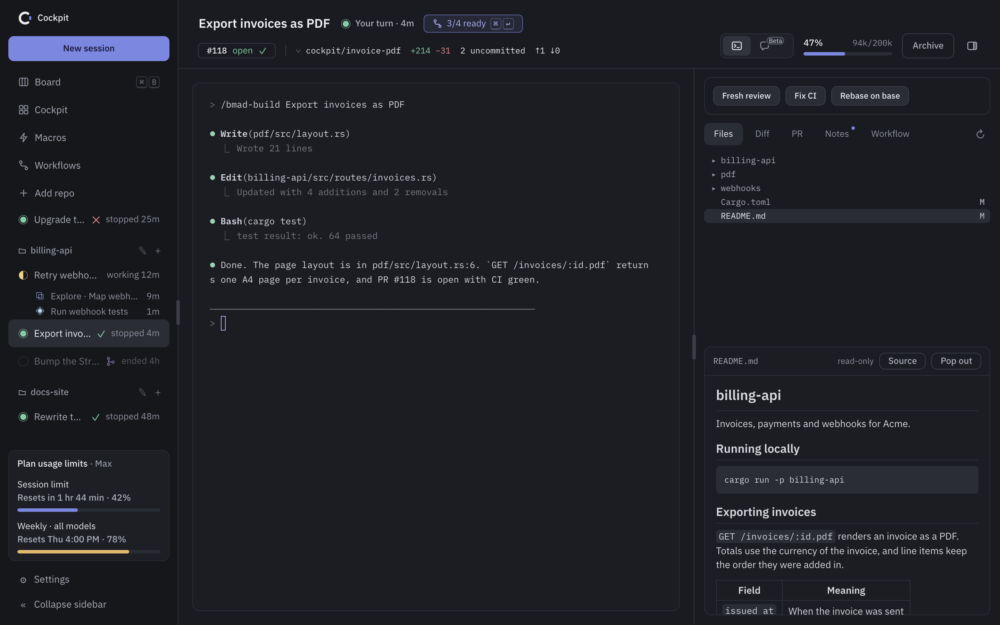

| Area | What it shows |
|---|---|
| **Terminal** | The real `claude` process. |
| **Terminal / Chat** | Switches the center between the terminal and the chat of the same process (see below). Each session remembers its choice. |
| **Header** | PR badge, branch, lines changed, uncommitted files, ahead/behind, context use. Click the title to rename. |
| **Sidebar** | Every session and what it is running. **Collapse sidebar** shrinks it to a rail. |
| **Side pane** | Files, Diff, PR, Notes, Workflow, and Artifacts (claude.ai pages the session linked, when there are any). The button at the top right hides it. |

Repos have notes too: click the pencil next to the repo name in the sidebar.

### Chat view

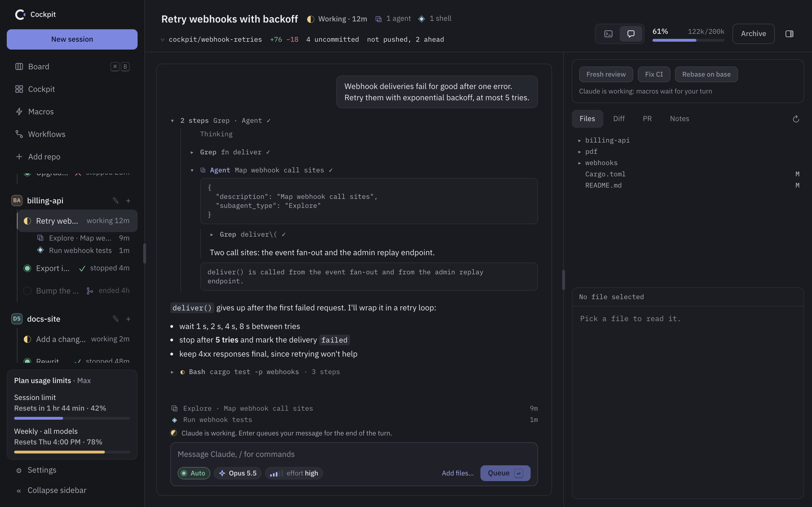

Click **Chat** in the session header to read the session as a chat instead of a terminal. It is the same `claude` process: switching back and forth never restarts or touches it.

- Your prompts sit on the right, with their images. Claude's replies are formatted text.
- Each tool call is one line with its command or file and a ✓ or ✕. Click it to see its input and result. Thinking is a collapsed **Thinking** line.
- A subagent's work sits under the **Agent** line that started it. Click it to open the subagent's thread.
- `!` commands and slash commands such as `/model` show with their output. `/compact` and interruptions are divider lines.
- While Claude works, **Claude is writing…** shows at the bottom. New replies appear within about 2 seconds, a block at a time. The chat follows them while you are at the bottom, and stays put while you scroll up to read.
- After `/clear` the chat starts empty. After a resume it shows the resumed conversation.
- In a folder Claude Code hasn't opened before, it first asks in the terminal whether to trust the folder. If a session stays **Starting** for a few seconds, the chat says Claude Code may be waiting for an answer, with **Open in terminal**.
- Answer Claude's questions in the terminal. Anything the chat can't show reads **Shown in the terminal**, with **Open in terminal**.

To open every new session in Chat, set **New sessions open in** to **Chat** in Settings. The Cockpit view always shows terminals.

### Composer

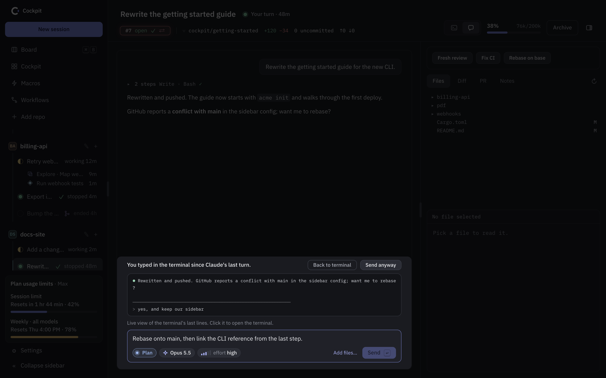

The box under the chat sends your next prompt to Claude, as if you had typed it in the terminal.

- Press <kbd>↩</kbd> or click **Send**. <kbd>⇧</kbd> <kbd>↩</kbd> starts a new line. Type `/` to pick a slash command.
- Paste, drop or click **Add files…** to attach screenshots and files, as in the first prompt.
- It sends only when it's your turn. Otherwise a line says why: **Claude is working**, **Claude is waiting on a question above**, **Starting…** or **Session ended**. You can keep typing; the text waits for you.
- Each session keeps its own draft until you send it, even when you switch views or sessions.
- If you typed in the terminal since Claude's last turn, Send waits. Any key counts, even <kbd>↑</kbd>, <kbd>⇧</kbd> <kbd>⇥</kbd> or <kbd>esc</kbd>; keys that answer a question of Claude's don't. A live view of the terminal's last lines shows what you left there. Click **Back to terminal** to finish it there, or **Send anyway** to send the composer's text.
- Send also waits after a command from the composer that sends no prompt, such as `/model` (its picker may still be open in the terminal) or `/cost`. The note goes once a prompt goes in, or after `/clear`.

### Files

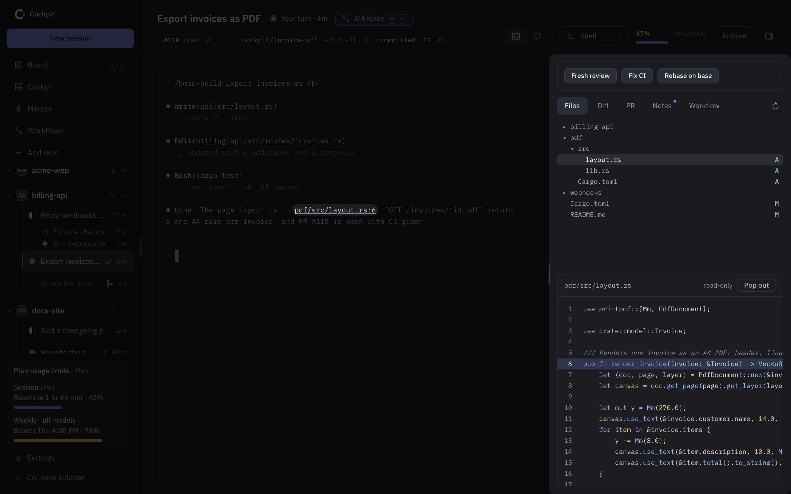

- Read-only file tree. `M` marks changed files, `A` added ones.
- Syntax highlighting and line numbers. Markdown is rendered; **Source** shows the raw text.
- <kbd>⌘</kbd>-click a file path in the terminal, like `src/App.tsx:120`, or click one in the chat, to open it here. The tree opens to the file, and the viewer scrolls to that line and highlights it.
- **Pop out** shows the file over the terminal.

### Main branch

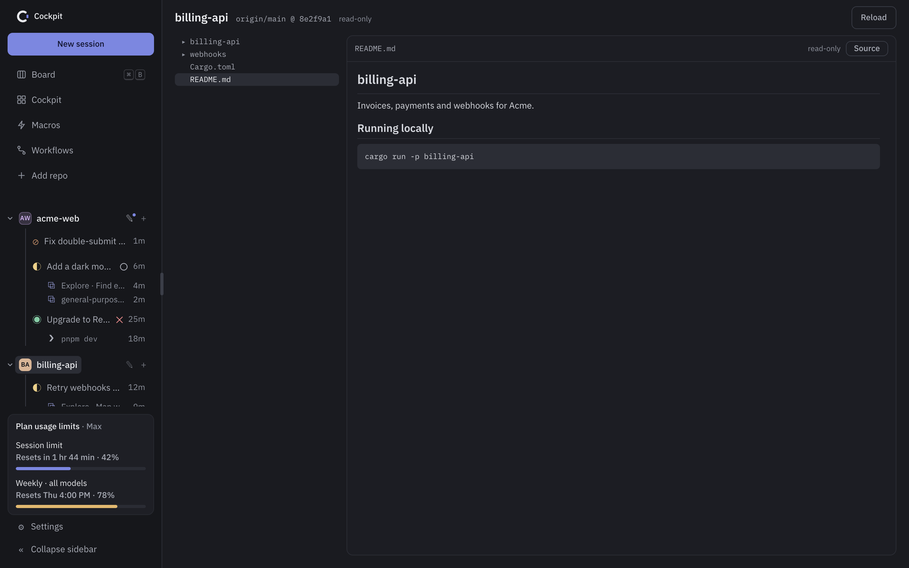

- Click a repo's name in the sidebar to browse its main branch, no session needed.
- Cockpit reads the first branch that exists of `origin/main`, `main`, `origin/master` and `master`. The header shows it and its commit, e.g. `origin/main @ 8e2f9a1`.
- It shows what is committed, not the repo folder's uncommitted edits, and leaves submodules out. It never fetches: `origin/main` is as fresh as your last `git fetch`.
- **Reload** reads the branch again. Same viewer as the Files tab: highlighted code, rendered Markdown with **Source**.

### Diff

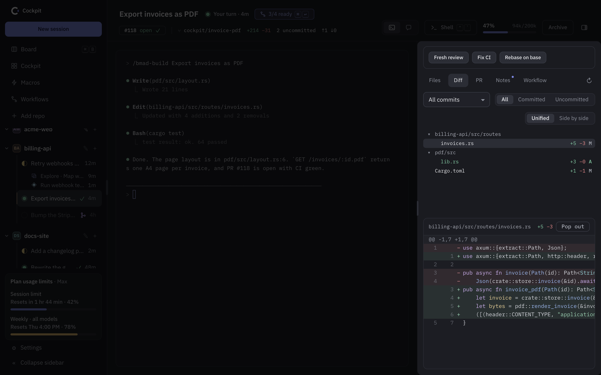

- Everything since the merge-base with `origin/<base>`: commits plus uncommitted changes.
- While the branch has an open PR, `<base>` is the branch the PR merges into (fetched from origin), so the header's line counts and this tab match GitHub. Once the branch has no PR, it goes back to the base the session started from.
- Filter by **Committed**, **Uncommitted** or a single commit.
- **Unified** or **Side by side**. **Pop out** shows the diff over the terminal.

### Pull request

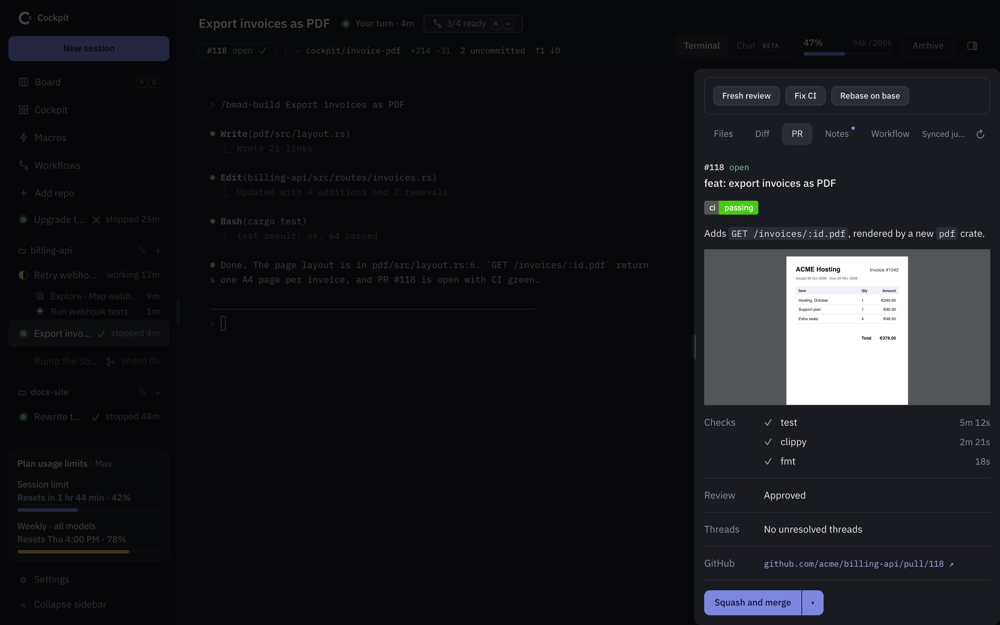

- Description, checks, review, unresolved threads and a GitHub link, read through your `gh` login.
- Merge or squash-merge after a confirm. Cockpit remembers your last method.
- **Update branch** when the branch is behind.
- A draft PR gets **Ready for review** in place of the merge button. One click marks it ready on GitHub.
- Refreshes every ~30 s, or on demand.
- A session's PR is the one whose branch matches the session's. When the names differ, Claude can link an existing PR of the repo through Cockpit's `link_pr` tool. The badge tooltip then says "linked by the agent", and the PR tab shows the PR's head branch. Claude can remove the link the same way.

### Macros

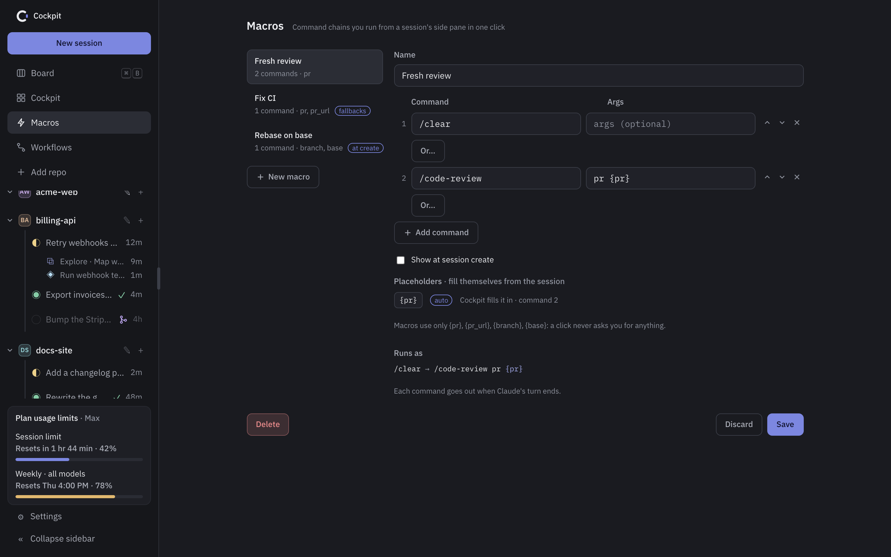

A macro is a short chain of commands, e.g. `/clear` then `/code-review pr {pr}`.

- Edit them on the **Macros** page.
- Run one from the buttons above the side pane's tabs. Each command is sent when Claude's turn ends. **Cancel** stops the chain.
- **Or…** adds fallback commands. Cockpit sends the first one installed.
- **Show at session create** offers the macro in the new-session form.

Placeholders fill themselves:

| Placeholder | Value |
|---|---|
| `{pr}` | PR number. A macro that uses it is disabled until the branch has a PR. |
| `{pr_url}` | PR link |
| `{branch}` | The session's branch |
| `{base}` | The base branch: the PR's while the branch has an open one |

### Workflows

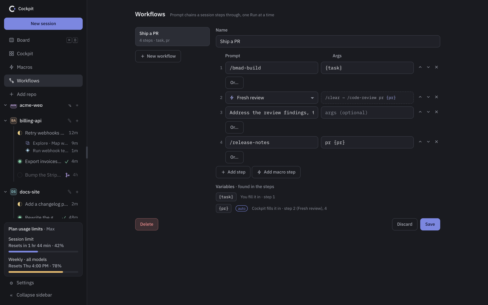

A workflow is a list of prompts and macros you step through, e.g. build → review → fix → release notes.

- Edit them on the **Workflows** page. `{name}` becomes a variable you fill in; the four placeholders above fill themselves.
- Pick one in the new-session form. Step 1 becomes the first prompt.

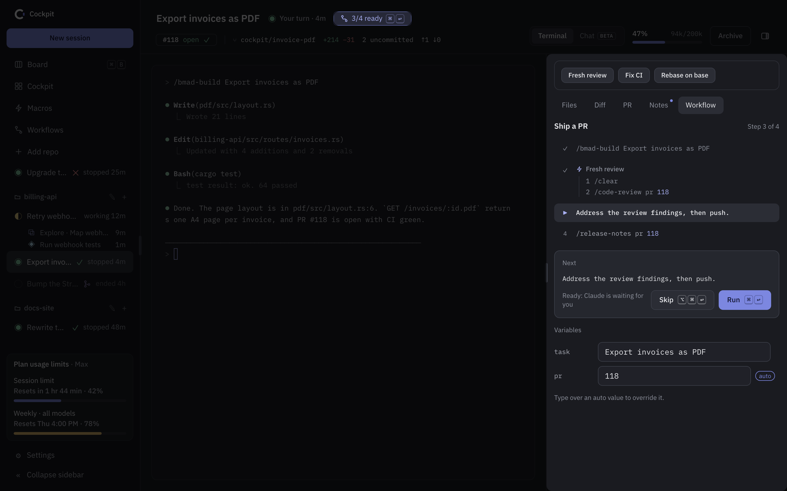

- The **Workflow** tab shows the steps, the next one and the variables.
- **Run** sends the next step on your turn. **Skip** passes it.
- The header badge shows progress.

### Cockpit view

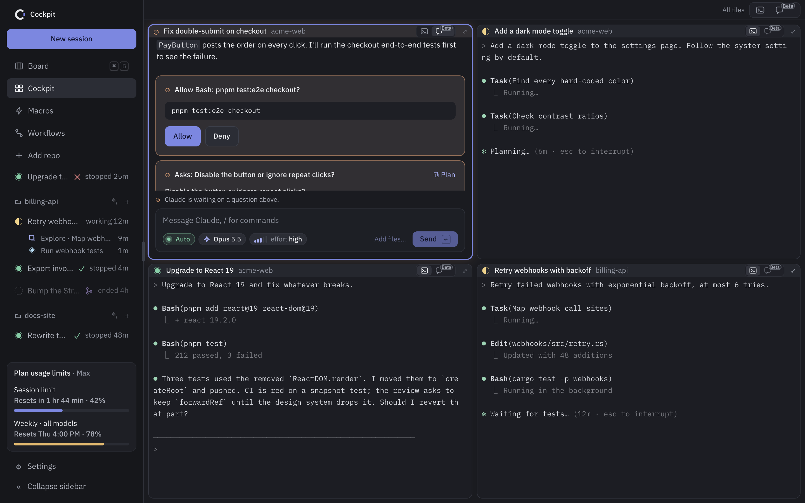

Every running session's terminal in one grid. Answer prompts without switching sessions.

- Blocked tiles glow. A pill points to blocked tiles scrolled out of view.
- ⤢ opens the session.

### Resume and archive

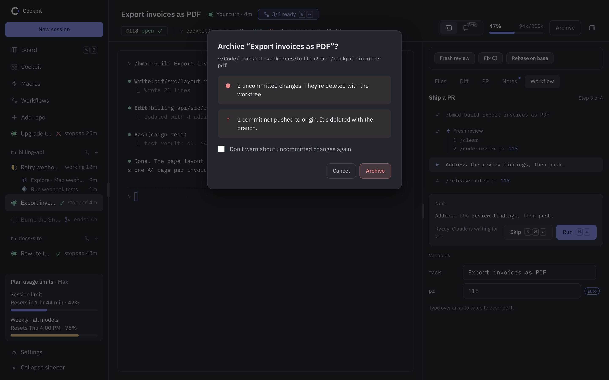

| | |
|---|---|
| **Resume** | An Ended session keeps its card. Opening it runs `claude --resume` (unless turned off in Settings). The header has a **Resume** button too. |
| **Archive** | Stops Claude, deletes the worktree and the branches Cockpit created. Keeps branches that already existed. Never touches the remote. Warns first about uncommitted changes and unpushed commits. |

### Usage meters

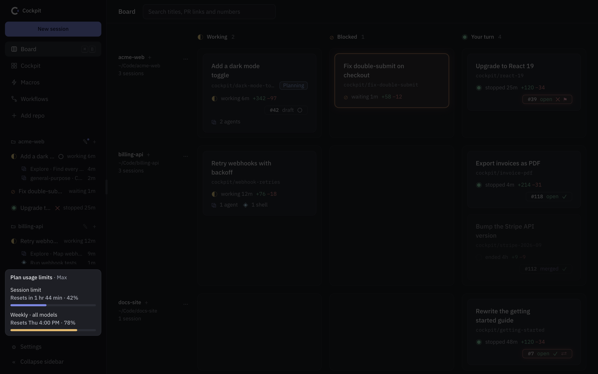

The sidebar footer shows your plan's 5-hour and weekly limits: % used and reset time. The bar changes color near a limit. Numbers appear once a session has run. When you sign in to Claude Code, or sign in as another account, they update within seconds.

### Settings

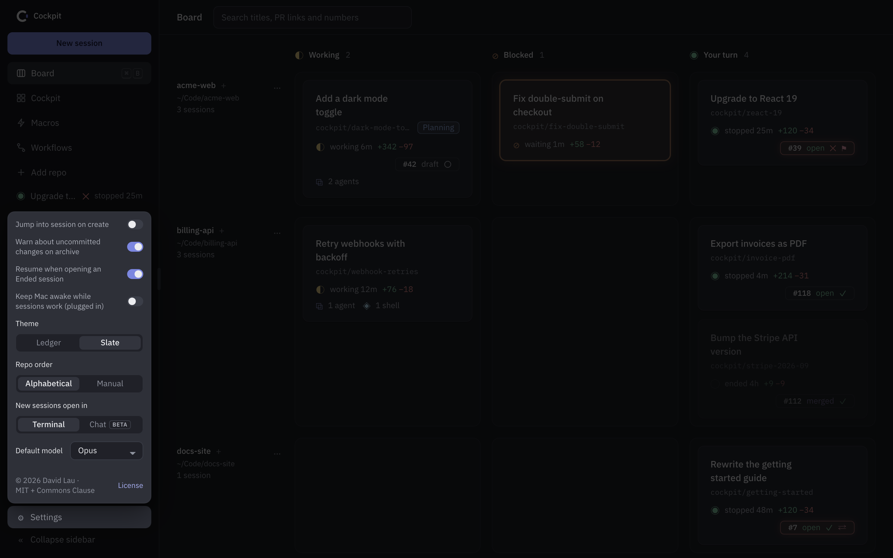

| Setting | Default |
|---|---|
| Jump into session on create | Off |
| Warn about uncommitted changes on archive | On |
| Resume when opening an Ended session | On |
| Keep Mac awake while sessions work (plugged in) | Off |
| Theme | Slate (Ledger is a darker alternative) |
| Default model | Opus |
| Repo order | Alphabetical (**Manual** keeps the order you drag repo rows into on the Board) |
| New sessions open in | Terminal (**Chat** opens new sessions in the chat view) |

The installed app also shows its version and **Check for updates**. The last row, **License**, shows Cockpit's license and the licenses of the open-source software it includes. **Cockpit → About Cockpit** shows the version and the copyright.

---

## Keyboard shortcuts

| Shortcut | Action |
|---|---|
| <kbd>⌘</kbd> <kbd>B</kbd> | Back to the board |
| <kbd>⌘</kbd> <kbd>+</kbd> / <kbd>⌘</kbd> <kbd>−</kbd> / <kbd>⌘</kbd> <kbd>0</kbd> | Terminal font bigger / smaller / reset |
| <kbd>⌘</kbd> <kbd>↩</kbd> | Run the next workflow step |
| <kbd>⌥</kbd> <kbd>⌘</kbd> <kbd>↩</kbd> | Skip the next workflow step |
| <kbd>⇧</kbd> <kbd>↩</kbd> | New line in the terminal or the composer, without sending |
| <kbd>↩</kbd> | Send the composer's prompt |
| <kbd>⌘</kbd>-click a file path in the terminal | Open the file in the Files tab, at its line |

---

## Updating

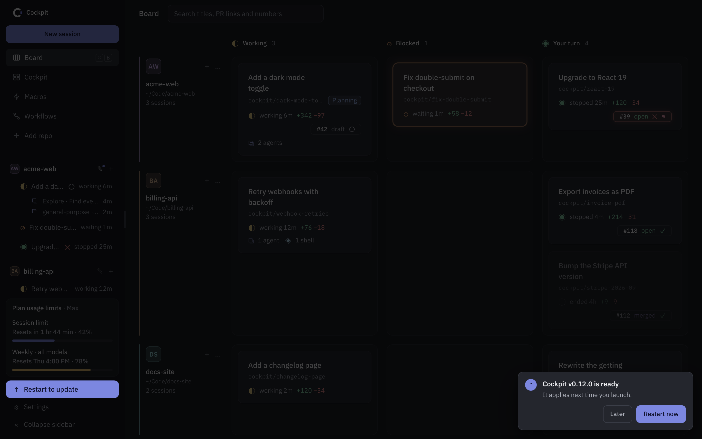

- Cockpit checks for a new version at launch and every 6 hours.
- It downloads and installs a new version in the background while you work. Your sessions keep running.
- When the new version is ready, **Cockpit vX.Y.Z is ready** appears. The update applies the next time you launch Cockpit.
- Click **Restart now** to switch at once, or **Later** to keep working. Until you restart, the sidebar shows **Restart to update** (in the collapsed rail, an ↑ button).
- If sessions are running, Cockpit asks before it restarts, because restarting ends them. Resume them afterwards from the board.
- If a download or install fails, Cockpit tries again later, less and less often: after 6 hours, then 12, 24 and 48 hours, then every 4 days.

Settings shows the installed version and has **Check for updates** to check right away.

> [!NOTE]
> If your Mac would ask for an administrator password to replace Cockpit (it sits in a folder you can't write to), Cockpit never installs on its own. The sidebar shows **Update to vX.Y.Z** and Settings shows **Install update** instead. Click either one and enter your password when macOS asks.

> [!NOTE]
> The app holds no GitHub token. It reads the public feed at `https://github.com/kaimunlau/cockpit-releases/releases/latest/download/latest.json` and verifies each update's signature before installing it.

### Beta builds

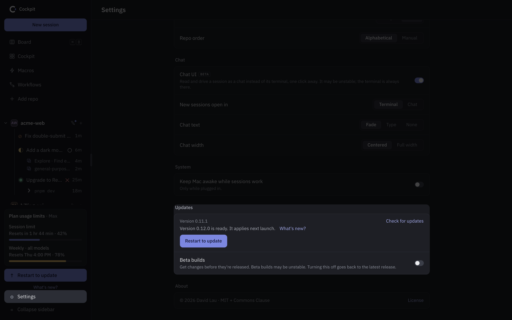

- Turn on **Beta builds** in Settings to get changes before they're released. It is off by default.
- Cockpit checks for a beta at once, then on the usual schedule. Betas install the same way as releases, and their version ends in `-beta.N`.
- A release newer than your beta still installs.
- Turn **Beta builds** off to go back to the latest release. Cockpit checks at once and installs it, even though it is older than your beta.
- Going back keeps your repos, sessions, workflows and macros. A value only the beta knows (a new setting option, say) goes back to its default. Cockpit first keeps a copy of the beta's data, as `state.json.beta-<time>` in `~/Library/Application Support/com.cc-cockpit.app/`.

> [!WARNING]
> Beta builds may be unstable.

---

## License

Cockpit is free to use, for any purpose, under the [MIT License with the Commons Clause](LICENSE). You may not sell it. Copies must keep the copyright notice.
