<h1 align="center">Cockpit</h1>

  Run many Claude Code sessions at once on macOS, each in a git worktree. Several sessions can share one.

  
  

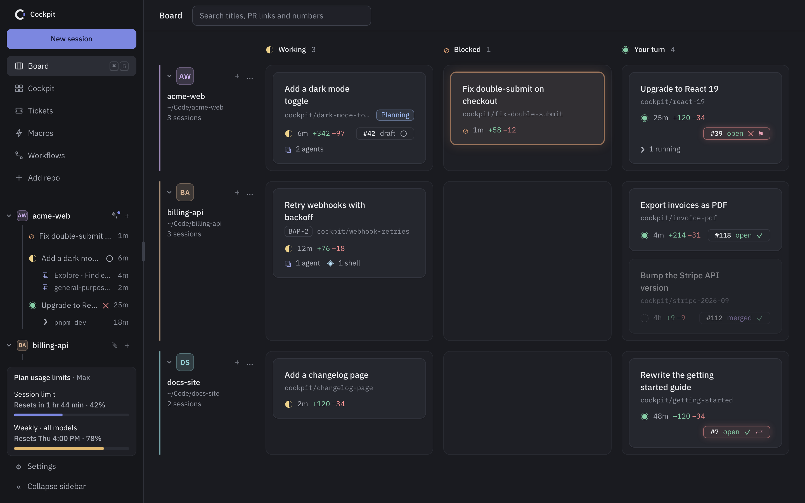

- **One board** for every session: working, blocked on you, or waiting.
- **What changed**: files, diff and the PR of each worktree.
- **Several sessions per worktree**: a fresh context or a side question on the same branch, in tabs.
- **Your own `claude`**: plugins, skills, hooks, MCP servers and permission prompts work as in a terminal. Cockpit never writes to `~/.claude/`.

**Contents:** [Installation](#installation) · [Features](#features) · [Keyboard shortcuts](#keyboard-shortcuts) · [Updating](#updating) · [License](#license)

---

## Installation

### Requirements

| Requirement | Needed for |
|---|---|
| macOS (Apple Silicon or Intel) | Running Cockpit |
| [Claude Code](https://docs.anthropic.com/en/docs/claude-code) (`claude`), signed in | Every session |
| `git` | Worktrees, diffs, branch status |
| [GitHub CLI](https://cli.github.com) (`gh`), signed in with `gh auth login` | PR badges and the PR tab, in repos hosted on GitHub (optional) |

> [!NOTE]
> These must be on your login shell's `PATH`. Cockpit reads it from `$SHELL -l -i`.

### Download and install

1. Download the latest `Cockpit_<version>_universal.dmg` from [cockpit-releases](https://github.com/kaimunlau/cockpit-releases/releases/latest). One app for Apple Silicon and Intel.
2. Open the DMG and drag Cockpit to Applications.
3. Open Cockpit. macOS blocks it the first time: the app is ad-hoc signed, not signed with an Apple Developer ID.
4. Go to **System Settings → Privacy & Security → Security**, click **Open Anyway**, confirm, and open Cockpit again.

> [!TIP]
> You do this once per Mac. After an update, macOS may ask again for access to folders like Documents or Desktop.

### First steps

**1. Add a repo.** Click **Add repo**, pick a local git repo, then click **Add repo** in the dialog. Cockpit preselects the repo's default branch; keep it.

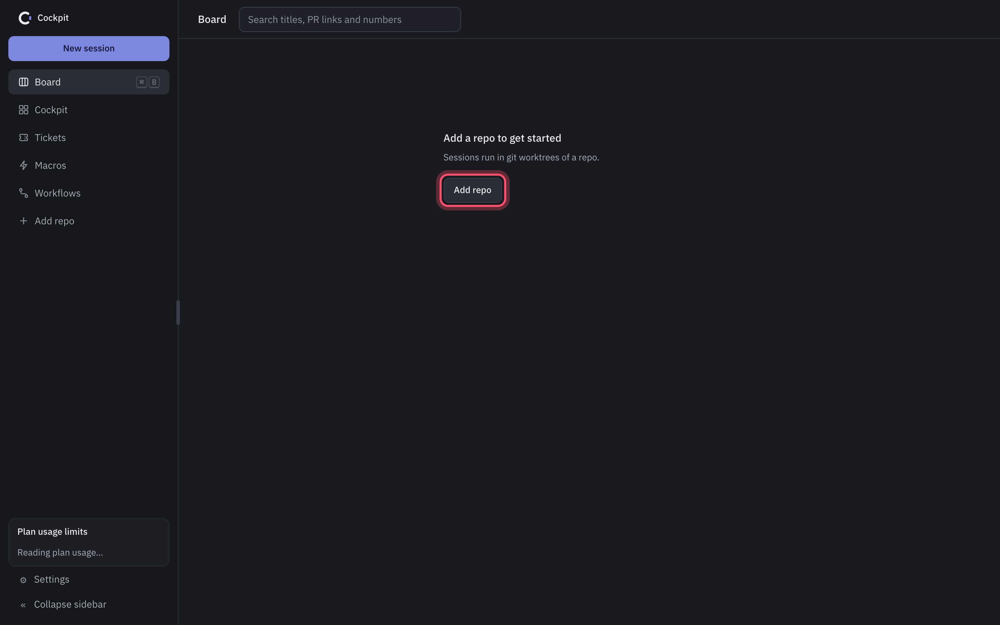

**2. Start a session.** Click **New session** (1), write a **First prompt** (2), click **Create session** (3). Leave the other fields as they are.

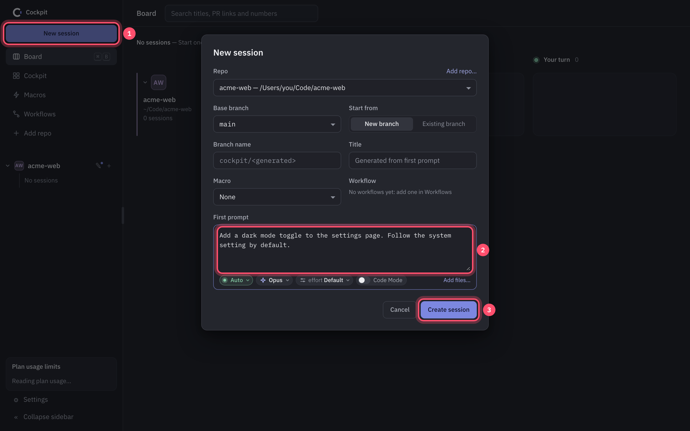

**3. Open it.** Click the new card.

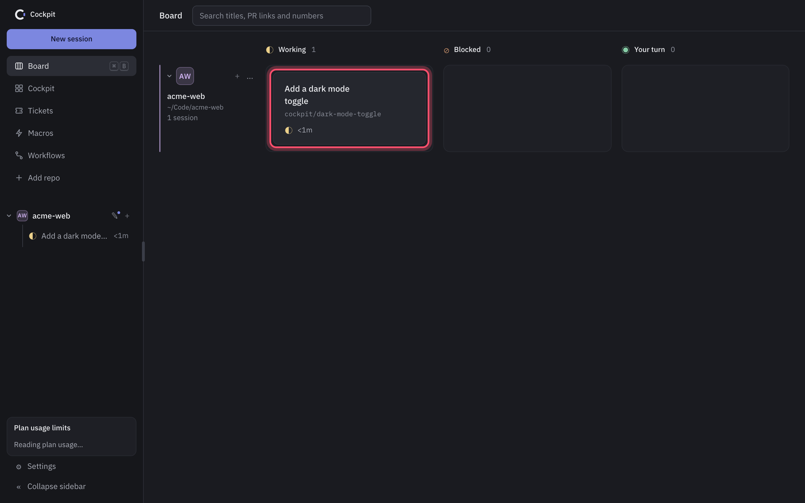

---

## Features

### Board

One row per repo, one column per state:

| Column | Meaning |
|---|---|
| **Working** | Claude is running. The card counts running subagents, shells, monitors and Code Mode scripts. |
| **Blocked** | Claude needs you, usually a permission prompt. The card glows and you get one macOS notification; click it to open the session. |
| **Your turn** | Claude is done. Ended sessions show dimmed here. A turn that ends on an API error (a server error, a rate limit) lands here too: you get a notification with the error, and the next message you send goes in right away. A message you queued before the error is held until you press **Send**. |

Cards show the branch, the state icon with how long the session has been in that state (hover the icon for the state's name), lines changed and the PR badge. The badge turns red on failed CI, requested changes or conflicts; click it to open the PR.

Each session has its own card, also when several share a worktree. The worktree's PR badge shows on its oldest session's card, and the other cards add the worktree's name to their title.

- Rows are in alphabetical order. To set your own order, set **Repo order** to **Manual** in Settings, then drag a repo row.
- **+** starts a session in that repo.
- **…** → **Default branch…** changes the repo's default branch. **…** → **Remove repo** removes a repo with no sessions. If the repo has tickets or ticket templates, Cockpit says how many and asks first: removing the repo deletes them.
- **…** → **Color** changes the repo's color, with ten to choose from. The tile, the row's edge and the sidebar change at once.
- Search by title, PR link or PR number. A PR belongs to its worktree, so searching for it lists every session in that worktree.

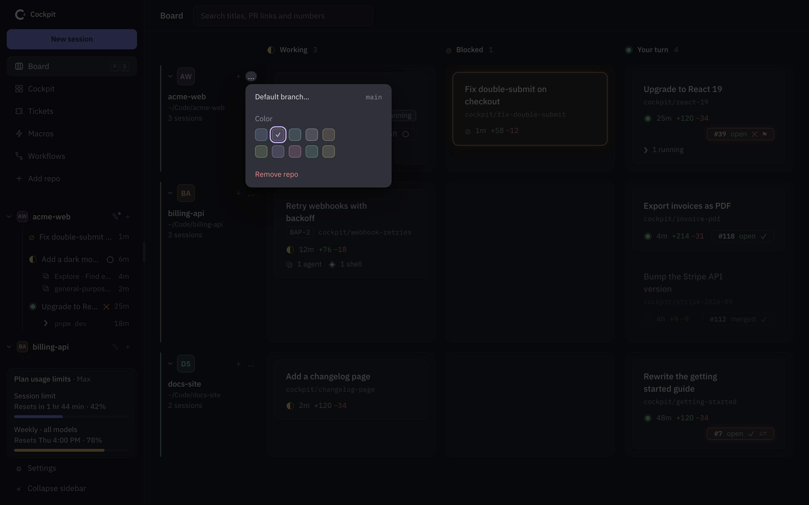

### Collapsing a project

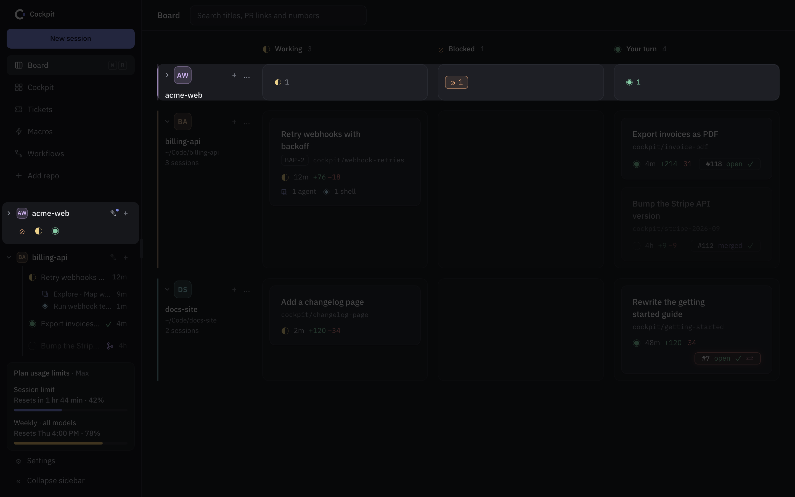

- Click the caret left of a repo's tile to collapse it, and again to expand it.
- On the board, a collapsed row shows how many sessions each column holds instead of cards. Click a count to expand the row.
- In the sidebar, a collapsed repo shows one state icon per session. Click an icon to open the session.
- Collapsing a repo in the sidebar collapses it on the board too, and the other way round. Cockpit remembers it after a restart.
- The collapsed rail has no caret and always shows every repo's sessions.

### Tickets

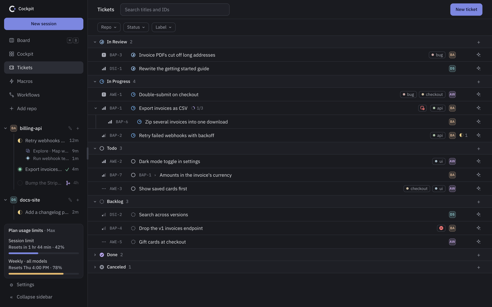

Plan your work next to your sessions. Each ticket belongs to one repo and gets that repo's next ID, like `BAP-12`. Tickets are stored on your Mac, in Cockpit's own data, never in the repo.

- Open **Tickets** in the sidebar. Tickets are grouped by status, then sorted by priority and age. **Done** and **Canceled** start folded; click a group's header to fold or open it.
- Search by title, or type an ID (`BAP-12`) to find that ticket alone. **Repo**, **Status** and **Label** filter the list; tick several values to see any of them. **Select all** at the top of a filter menu ticks every value it shows, or unticks them all. A menu with many values (your repos, say) opens on a find field: type part of a name to narrow it, and **Select all** then ticks only the matches. Hover a repo to see its folder, which tells repos of the same name apart. <kbd>esc</kbd> clears the find field, then closes the menu. The × on a filter's chip clears it.
- While a search or filter is on, every group with a match shows open. A group you fold then stays folded until you change the search or filters.
- Leave Tickets and come back: the search, filters, folded groups and scroll position are as you left them, until Cockpit quits.
- Click a row to open its ticket. Click its status icon to move it.
- A ticket ID in a description or a comment, such as `CCO-9`, shows as a chip with its ticket's status. Click it to open that ticket.
- A red octagon on a row means an open ticket blocks it (**Blocked by**); a ticket square with the octagon on its corner means it blocks an open ticket (**Blocks**). Rows in a ticket's Sub-issues block show them too. Hover either, or Tab to it, to see which tickets; <kbd>esc</kbd> closes the list. A ticket you finish or cancel stops counting on both sides, so a row with no Blocked by octagon is free to start.
- A row shows its labels at the right, before its repo. A long title gets cut short first.
- A row shows its live sessions at the right: the most urgent state (Blocked, then Your turn, then Working) and how many there are. The ✦ button runs **Start with Claude**.
- **New ticket**, or **+** on a group's header, opens a new ticket, filled from your default template if you have one (see [Templates](#templates)). It is saved once it has a repo and a title. **Discard** drops it. Labels you pick on it are attached when it is saved.
- A new ticket that isn't saved yet lasts until Cockpit quits.
- A sub-issue sits under its parent, behind a guide line, when both are in the same status group. Click the arrow before a parent to fold its sub-issues away. A sub-issue whose parent is in another group, or hidden by a search or filter, shows the parent's ID before its title (`BAP-1 ›`).
- A parent shows how many of its sub-issues are done, like `1/3`. Canceled sub-issues don't count.
- The list keeps its search, filters, folds and scroll while Cockpit runs.

| Status | Meaning |
|---|---|
| **Backlog** | Not planned yet |
| **Todo** | Planned, not started. **New ticket** starts here. |
| **In Progress** | Being worked on |
| **In Review** | Waiting for review |
| **Done** | Finished |
| **Canceled** | Won't be done |

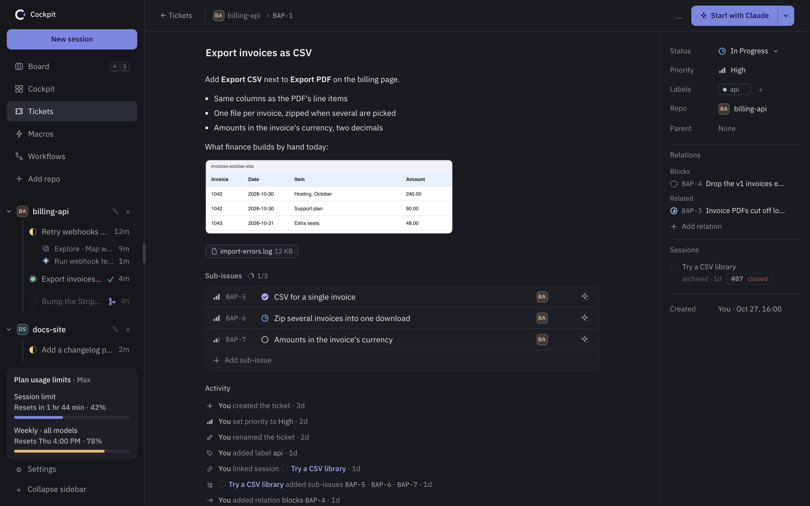

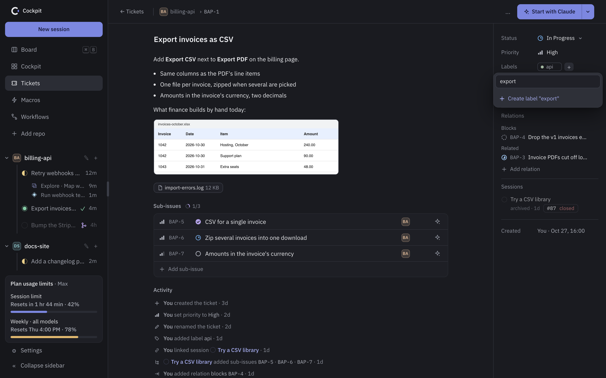

- Click the title to rename the ticket: <kbd>↩</kbd> saves, <kbd>esc</kbd> cancels.
- Click the description to edit it as Markdown. A click outside saves, and so does leaving the page. <kbd>esc</kbd> cancels. Links open in your browser.
- A `mermaid` code block in the description or a comment shows as its diagram. Hover the diagram: **Source** shows its text, **Diagram** goes back, and the copy button copies the text. A block Mermaid can't draw stays a code block, with the reason under it. Diagrams load nothing from the network, so a diagram with an image node, an actor icon from a link, or a `url()` style stays its code block too, with the reason under it.
- Change **Status** and **Priority** in the right column.
- **Labels** tags the ticket. Click **+**, then tick labels, or type a name: a name no label has offers **Create label**, which makes it with the next color. Typing `UX` picks an existing `ux`: names ignore case. Hover a label and click its × to take it off.
- **Sub-issues** lists the ticket's sub-issues, with the same status icon and ✦ button as the list. **Add sub-issue** opens a new ticket in the same repo, with this ticket as its **Parent**.
- **Parent** puts the ticket under another ticket of the same repo, or **None**. Type to filter by ID or title. A ticket can't go under itself or one of its own sub-issues. The parent's ID at the top opens it.
- **Activity** lists every change, who made it and when. **Auto status** marks a move Cockpit made for you. A change Claude made shows its session's title, with the session's state: click it to open the session. An archived session's title is plain text. A parent's activity also shows its sub-issues' status moves. Click a ticket ID in it to open that ticket.
- **Sessions** lists every worktree linked to the ticket, newest first, by its first session. Click one to open it. Closing that session moves the row to the worktree's next one. An archived worktree stays in the list, dimmed, with its PR number and state. Cockpit keeps checking that PR until it merges or closes, so the badge stays true. That badge opens nothing.
- The repo name at the top opens the list filtered to that repo.
- **…** → **Delete ticket** asks first. A deleted ticket's ID is never used again. Its sub-issues stay, with no parent, and its relations go.

#### Comments

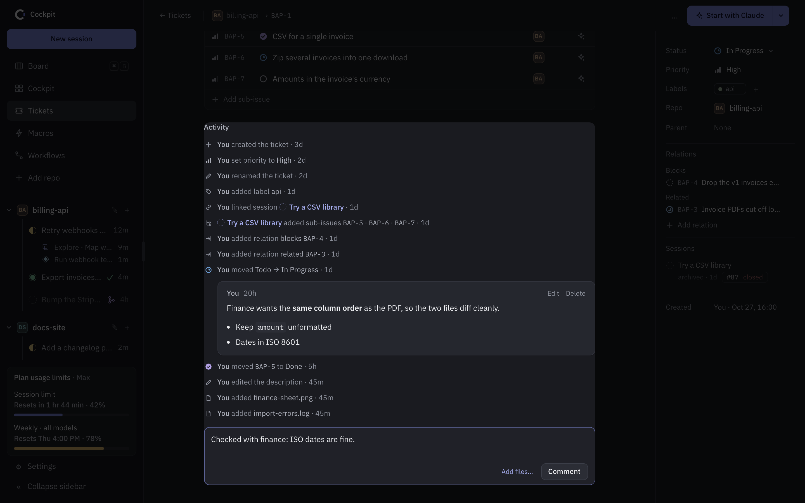

Comments sit in **Activity**, in order with the ticket's changes.

- Type in the **Leave a comment** box at the end of **Activity**, then click **Comment**. Markdown works, `mermaid` diagrams included, and <kbd>↩</kbd> starts a new line.
- Text you haven't posted stays in the box while Cockpit runs, even if you open another page.
- On your own comments, **Edit** opens the text in place: a click outside or leaving the page saves, <kbd>esc</kbd> cancels. **Delete** asks first.
- Edits and deletes show in **Activity** as "edited a comment" and "deleted a comment". Only a comment's author can change it.

#### Files

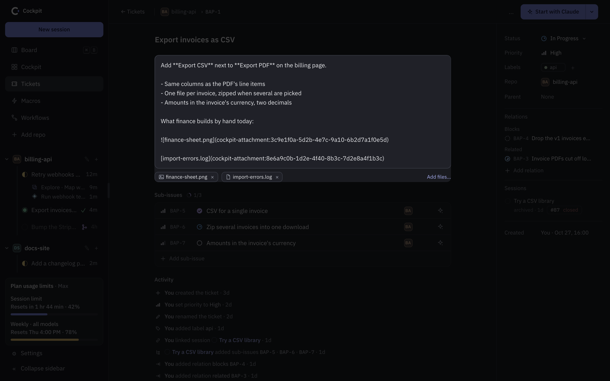

A description or a comment can carry files: screenshots, logs, anything. Cockpit keeps its own copy of each one.

- While you edit a description or a comment, drop files on its box, paste them, or click **Add files…**. A copied file or a screenshot on the clipboard pastes as a file.
- An image shows in the text where you put it. Any other file shows as a chip with its size: click it to open the file in its default app.
- The files show as chips under the box while you edit. Click a chip's × to take the file out of the text.
- A file still copying shows a spinner. A click outside saves once every copy is done.
- **Start with Claude** sends the description's files with the prompt, and the prompt lists them under **Attachments**.
- A file nothing uses any more is deleted once the change is saved. Taking a file out of the description adds "removed trace.log" to **Activity**.
- A file that can't be found shows as **File missing**.

#### Relations

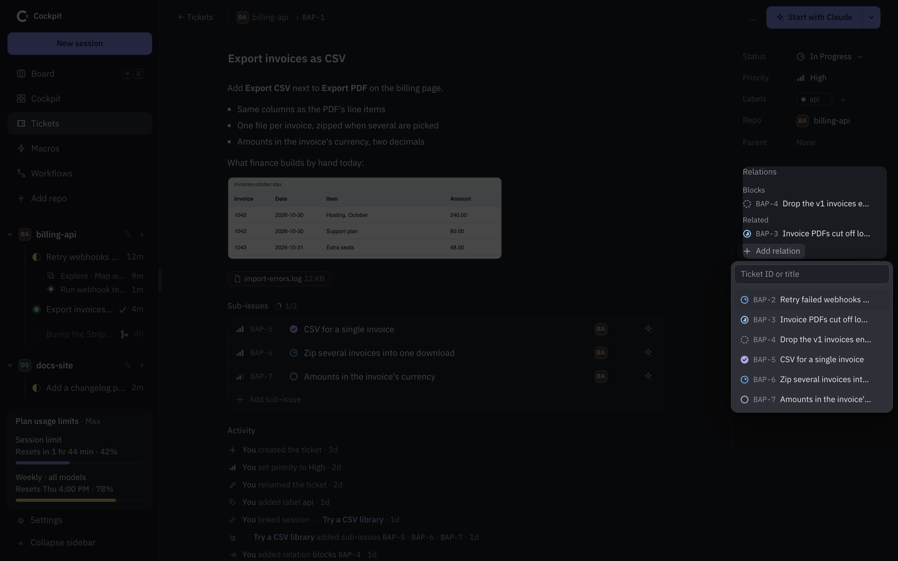

Relations tie a ticket to others in the same repo. Each shows on both tickets.

- Click **Add relation**, pick a type, then a ticket. Type to filter by ID or title.
- Click a relation to open the other ticket. Hover it and click × to remove it from both tickets.
- Marking a ticket a duplicate moves it to **Canceled**, unless it is already done or canceled. Removing the relation leaves its status as it is.

| Type | On the other ticket |
|---|---|
| **Blocks** | **Blocked by** |
| **Blocked by** | **Blocks** |
| **Related** | **Related** |
| **Duplicate of** | **Duplicated by** |

Two tickets can block each other, but they can't each be a duplicate of the other.

#### Claude and tickets

Claude, in any Cockpit session, can read and change the tickets of that session's repo through Cockpit's ticket tools. It can't reach another repo's tickets.

- It can read a ticket in full, with its comments, history and files, list or search the repo's tickets, and list the repo's statuses (in order, with the one new tickets take) and the labels.
- It can create tickets and sub-issues, rename a ticket, rewrite its description, change its status, priority, labels and parent, comment, edit or delete its own comments, and add or remove relations. A file whose link a rewritten description drops is deleted, as when you edit it, unless other ticket text still links it, and Claude is told which.
- It can't delete a ticket or attach files.
- It can list, read, create, change and delete [ticket templates](#templates), and set the shared default and its repo's default. It reaches the shared templates and its own repo's, never another repo's. When a change moves other repos' defaults (deleting a shared template, say), Claude is told how many. Default templates fill only the tickets you start on the **New ticket** page, never a ticket Claude creates.
- A title or description you opened but haven't changed doesn't undo a change Claude makes meanwhile: clicking away saves only an edit. If you did edit it, your text replaces Claude's.
- A comment Claude wrote can be edited or deleted only by that session: it has no **Edit** or **Delete** for you.
- Its changes show at once in the list and on the ticket page. **Activity** and **Created** name the session that made them.
- Cockpit tells Claude a change is done only once it is saved. A refused change changes nothing, and Claude hears why.
- Each ticket tool can also answer as JSON instead of prose, for a skill or script that reads tickets as data (one that uses Cockpit as its issue tracker, say): with `format: "json"`, it answers with one JSON object whose `schema` is `cockpit.ticket/1` and whose `summary` is a one-line summary. In the chat, an answer that a direct call or a Code Mode script returns shows as its summary. The rest show whole: an answer a script logs, an answer from a script Cockpit can't tell called its tools, and the result of a script left running in the background, which Claude collects later with Poll.

#### Labels and ID prefixes

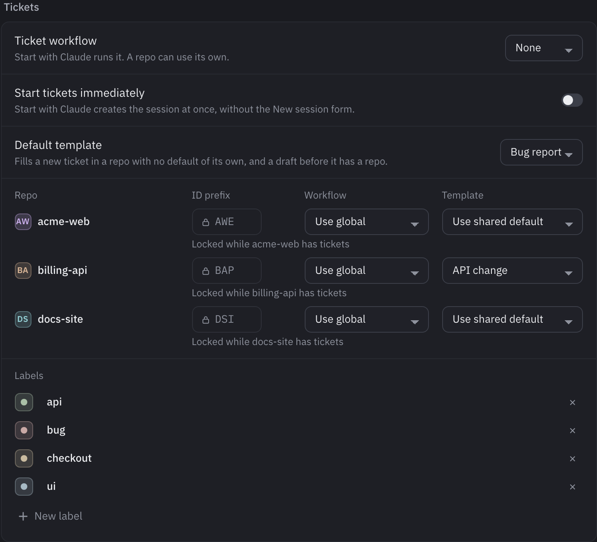

Labels are one list shared by every repo, so the **Label** filter works across repos. Manage them in **Settings** → **Tickets** → **Labels**:

- Click **New label**, type a name and press <kbd>↩</kbd> (or click away). It takes the next of the six colors. <kbd>esc</kbd> cancels.
- Click a label's color square to pick one of six colors.
- Click its name to rename it: <kbd>↩</kbd> or clicking away saves, <kbd>esc</kbd> cancels. Two labels can't share a name, whatever the case.
- Click × to delete it. Cockpit says how many tickets and templates carry it and asks first. Each of those tickets records that the label was removed, and the templates drop it.

Each repo's tickets take its **ID prefix** (`BAP` in `BAP-12`). Change it in the same section, while the repo has no tickets: type letters and digits, then press <kbd>↩</kbd> or click away. <kbd>esc</kbd> cancels. Once the repo has a ticket, the prefix is locked. A prefix another repo uses, or used before, is refused. A changed prefix keeps counting from the repo's last number, so no ID is used twice.

#### Templates

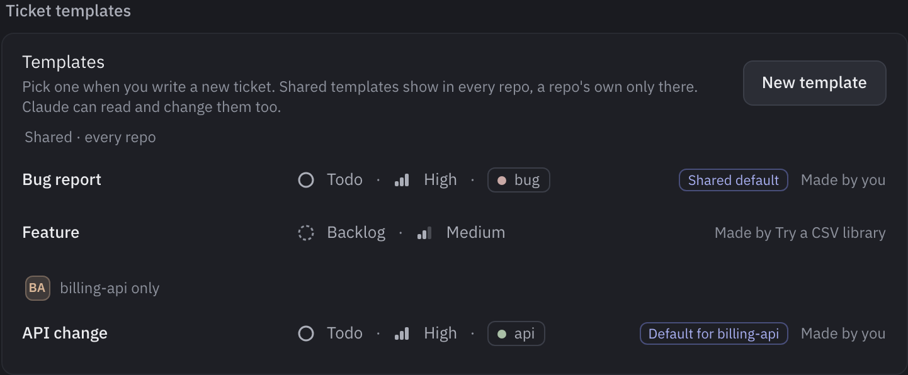

A template fills in a new ticket for you: its title, description, status, priority and labels. A **shared** template shows in every repo; a repo's own template shows only there.

- In **Settings** → **Ticket templates**, click **New template**. Type its name and press <kbd>↩</kbd>: the template is saved. Every change after that saves as you make it. Leave a new template before it has a name and Cockpit asks before it discards what you typed.
- **A new ticket starts with** holds the ticket's title (a start, like `Bug: `, works) and its description. Templates hold text only, no files.
- **Scope** is **All repos** or one repo. A new scope that would change a default asks first and says which defaults change: **Move template** moves it, **Cancel** keeps it where it was. **Status**, **Priority** and **Labels** work as on a ticket. A status is kept by name: a repo with no status of that name uses its default status. A repo's own template whose status that repo no longer has says so.
- **Delete template** asks first and says which defaults change. Tickets made from it keep their text.
- Each row in **Ticket templates** shows its status, priority and labels, a tag for each place it is the default, and who made it.

| Setting | What it does |
|---|---|
| **Default template** (in **Tickets**) | **None**, or a shared template. It fills a new ticket in a repo set to **Use shared default**, and a new ticket before it has a repo. A repo set to **None** gets no template. |
| **Template**, per repo | **Use shared default** (the default), **None**, or a template that repo can use. |

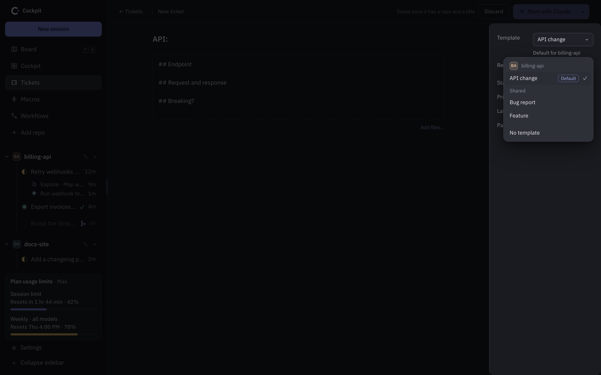

- **New ticket** opens already filled with the default template. **Template** shows which one, and says where the default comes from (**Default for billing-api**, **Shared default**). **Add sub-issue** works the same way; the parent stays.
- **+** on a group's header keeps that group's status, whatever the template says.
- Pick another template, or **No template**, under **Template**. Before you change anything, it switches at once. Picking a repo then switches to that repo's default, unless you picked **No template** or a template that repo can also use: your pick stays.
- Once you have typed or changed something, Cockpit asks first: "Replace what you wrote with “Bug report”?" **Replace** fills the ticket again; **Keep editing** or <kbd>esc</kbd> leaves it as it is. From then on, picking a repo keeps every word.
- Picking a template never saves the ticket. While you haven't changed anything, clicking away doesn't save it either: press <kbd>↩</kbd> in the title to save it. **Discard** drops it without asking until you type a title or description. After that, Cockpit asks "Discard changes?" first, and leaving the page asks the same.

### Start with Claude

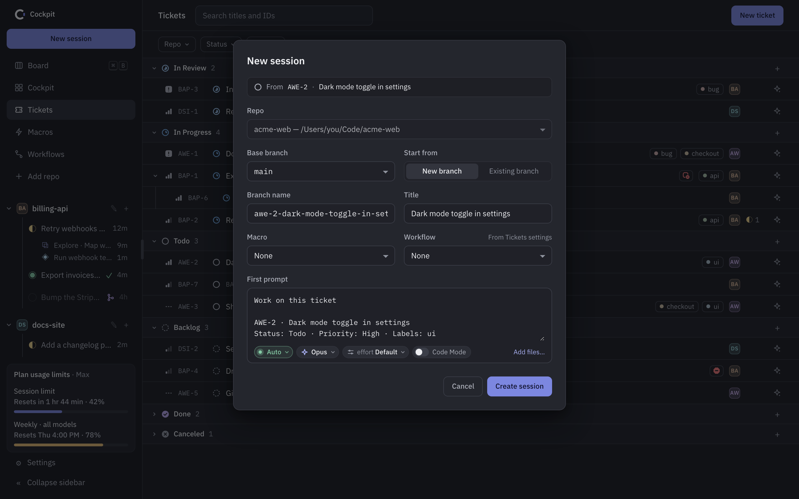

- Click **Start with Claude** on a ticket, or ✦ on its row (right-click ✦ to [pick another workflow](#start-with-another-workflow)). The New session form opens filled in from the ticket: its repo, its title, a branch named after its ID (`awe-2-dark-mode-toggle-in-settings`) and a first prompt with the ticket's ID, status, priority, labels, description, sub-issues and relations.
- **From** under the form's title names the ticket. The repo stays the ticket's. **Cancel** starts nothing and links nothing.
- **Create session** links the session's worktree to the ticket. A ticket in Backlog or Todo moves to **In Progress**. A ticket further along stays where it is.
- Pick a branch already open in a worktree, and **Add to …** links that worktree instead. A worktree works one ticket: one that already works another is refused.
- Any linked worktree's PR moves its ticket too. Open for review (not a draft): **In Review**. Merged: **Done**, from any earlier status, Backlog and Todo included. A PR already open when the worktree is linked counts at once, and so does a PR the agent links, even one already merged.
- These moves only go forward, never out of **Done** or **Canceled**. Each one acts once per PR change: move a ticket back by hand and it stays there until the PR changes again. A draft or a PR closed without merging moves nothing. A PR Cockpit saw before its worktree was archived still moves the ticket when it merges, or when a draft is marked ready: Cockpit checks it every 5 minutes until it merges or closes. A worktree archived before Cockpit saw any PR has nothing to check.
- Start again for another session on the same ticket. Its branch gets the next free name (`…-2`).
- A linked worktree shows the ticket's ID on its card and in the header of each of its sessions. Click it to open the ticket. A deleted ticket's ID stays, greyed out.
- Turn on **Start tickets immediately** in Settings to skip the form. If the session can't be created, the form opens with the problem shown.
- An immediate start runs in **Auto** mode with your **Default model** and **Code Mode by default**, from the repo's last used base branch (else its default branch).

#### Ticket workflow

Pick a **Ticket workflow** in **Settings** → **Tickets** to have Start with Claude run one of your [workflows](#workflows) instead of sending **Work on this ticket**:

- Step 1 becomes the first prompt, with the ticket's [placeholders](#workflows) filled in. **From Tickets settings** shows beside **Workflow** in the form.
- A repo can use its own: set its **Workflow** to a workflow, **None**, or **Use global** (the default).
- The ticket's files go with step 1 when it uses `{ticket}`.
- If step 1 needs a value you type, **Start tickets immediately** still creates the session and sends the placeholder as written (`{story_id}`), as **Create session** does when you leave it blank.
- If step 1 has **Or…** commands and none of them is installed in the repo, **Start tickets immediately** opens the form with the problem shown instead.
- A workflow chosen there can't be deleted. Pick another one in **Settings** → **Tickets** first.

#### Start with another workflow

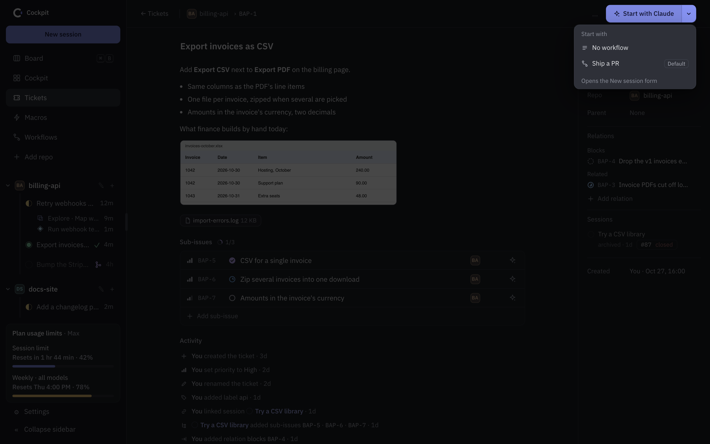

- Click the chevron beside **Start with Claude** to start a ticket with another workflow, or with **No workflow**. On a ticket row or a **Sub-issues** row, right-click ✦. From the keyboard, focus ✦ and press <kbd>⇧</kbd><kbd>F10</kbd> or the context-menu key.
- **Default** marks the workflow a plain **Start with Claude** runs: the repo's own, else the global **Ticket workflow**. **No workflow** carries it when neither is set, or when the repo is set to **None**.
- A pick works as **Start with Claude** does, with that workflow. The menu's last line says what happens: **Opens the New session form**, or **Creates the session at once** with **Start tickets immediately** on.
- A pick is for that start only. It changes no setting, and the form shows no **From Tickets settings**.
- A workflow deleted since the menu opened is refused: the error shows, and nothing opens.

### Starting a session

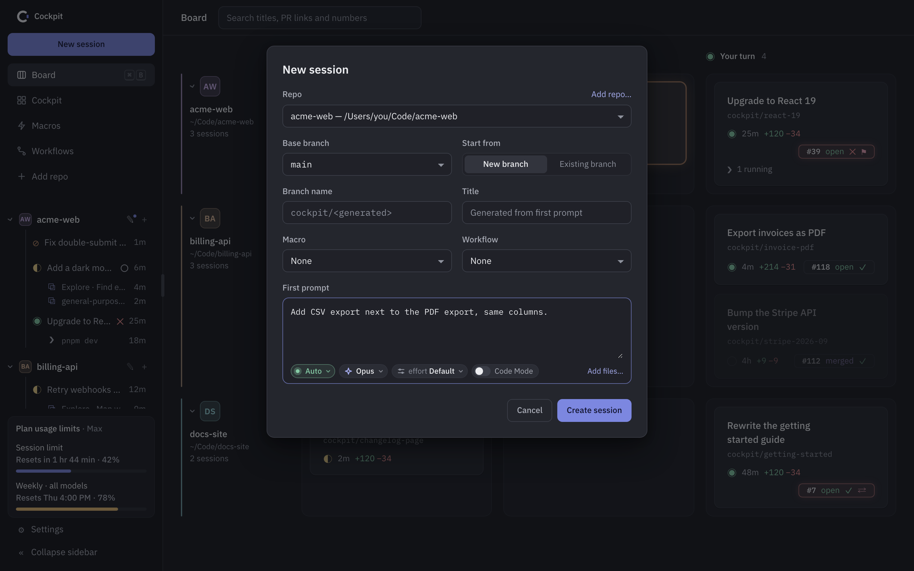

- The defaults work: write a first prompt and create. A blank branch name and title are generated from the prompt.
- Type `/` for slash commands, at the start or after a space anywhere in the prompt. A few of a command's letters in order find it: `/supwriski` finds `/superpowers:writing-skills`. As in Claude Code, only a command that starts the prompt runs; later on, it goes to Claude as text, and a skill's name there lets Claude use that skill. Add files by dropping, pasting or **Add files…**. They go after your text, so a command that starts the prompt still runs, with the images attached.
- **Base branch** starts on the branch you last used in that repo, else on its default branch. The list has the local branches, then the branches only `origin` has.
- Each session gets its own worktree in `<repo parent>/.cockpit-worktrees/`, branched from a fresh `origin/<base>`.
- To add a session to a worktree that is already open, pick **Existing branch** and its branch. The form says which worktree it joins, and **Create session** becomes **Add to …**.
- The chips in the prompt box set the session's permission mode (Auto by default), model and effort. The model starts on **Default model** from Settings. Effort **Default** (the sliders icon) leaves it to your Claude Code settings. The **Code Mode** switch starts the session in Code Mode (see [Code Mode](#code-mode)). Sessions never use `--dangerously-skip-permissions`.
- Claude can propose a session through Cockpit's `new_session` tool. It opens this form prefilled; nothing starts until you click **Create session**. Claude says only "Session draft sent." about it and carries on; ask it about the draft when you want the details. Cockpit's other tools let Claude work with the repo's tickets (see [Claude and tickets](#claude-and-tickets)).

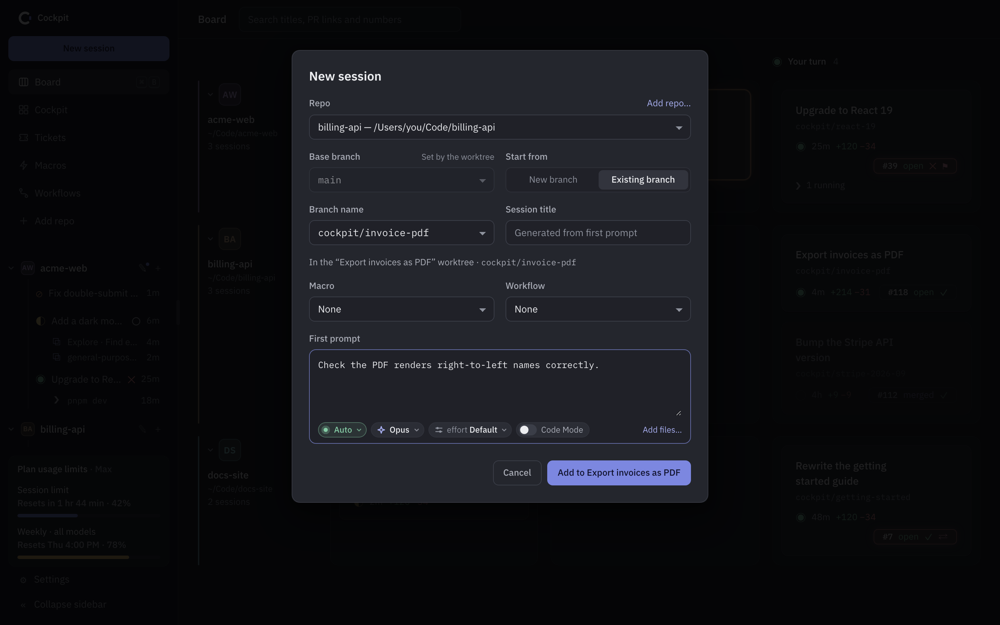

### Session view

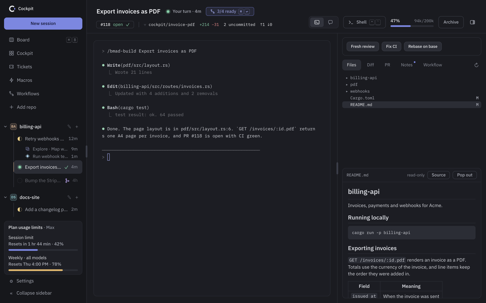

| Area | What it shows |
|---|---|
| **Terminal** | The real `claude` process. |
| **Terminal / Chat** | With **Chat UI** on in Settings, the two icons switch the center between the terminal and the chat of the same process (see below). Each session remembers its choice. |
| **Header** | PR badge, branch, lines changed, uncommitted files, ahead/behind, context use. Click the title to rename. |
| **Sidebar** | Every session and what it is running, grouped by repo. Sessions that share a worktree nest under the oldest one (see [Several sessions in one worktree](#several-sessions-in-one-worktree)). Each repo has a tile with its initials, in one of ten colors; the board shows the same tile. A repo you add gets a color its neighbours don't have, and keeps it until you pick another with **…** → **Color** on the board. A repo's name stays at the top while you scroll through its sessions. Each session shows its state icon and how long it has been in that state; hover the icon for the state's name. **Collapse sidebar** shrinks it to a rail. |
| **Side pane** | Files, Diff, PR, Notes, Workflow, and Artifacts (claude.ai pages the session linked, when there are any). Files, Diff, PR and Notes belong to the worktree, so every session in it shows the same ones. The button at the top right hides it. |

Repos have notes too: click the pencil next to the repo name in the sidebar.

### Several sessions in one worktree

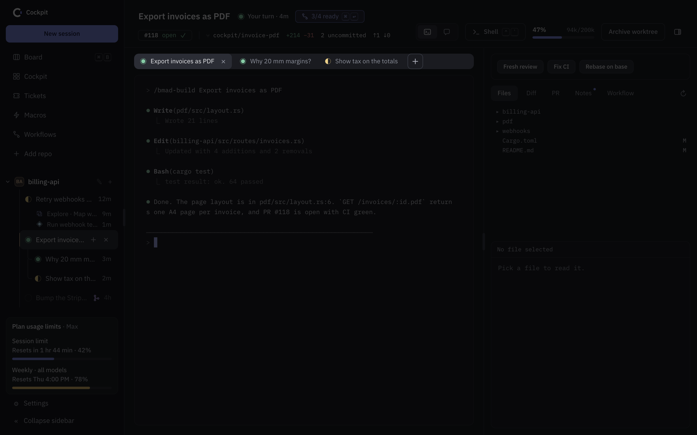

Start another Claude Code session on the same branch and files: a fresh context for the next step, or a side question that stays out of the main conversation.

- Click **+** at the end of the tabs, or press <kbd>⌘</kbd> <kbd>T</kbd>. The new session starts at once, with the open session's mode, model, effort and Code Mode switch.
- A new session is called **Session 2**, **Session 3** and so on until its first prompt names it.
- Tabs show while a worktree has two sessions or more. Click a tab, or press <kbd>⌃</kbd> <kbd>Tab</kbd> and <kbd>⌃</kbd> <kbd>⇧</kbd> <kbd>Tab</kbd>, to switch.
- When the tabs don't fit, **⋯** lists the rest and shows the most urgent state among them.

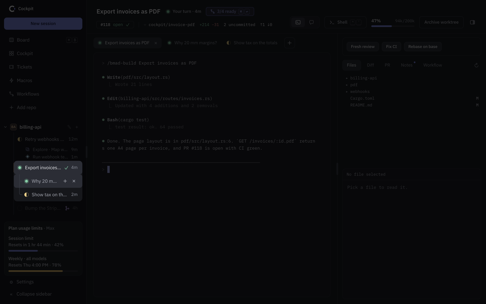

- In the sidebar, the worktree's oldest session carries the CI icon and the others hang under it. Hover a row for **+** (a new session in that worktree) and **×** (close it).

### Closing a session

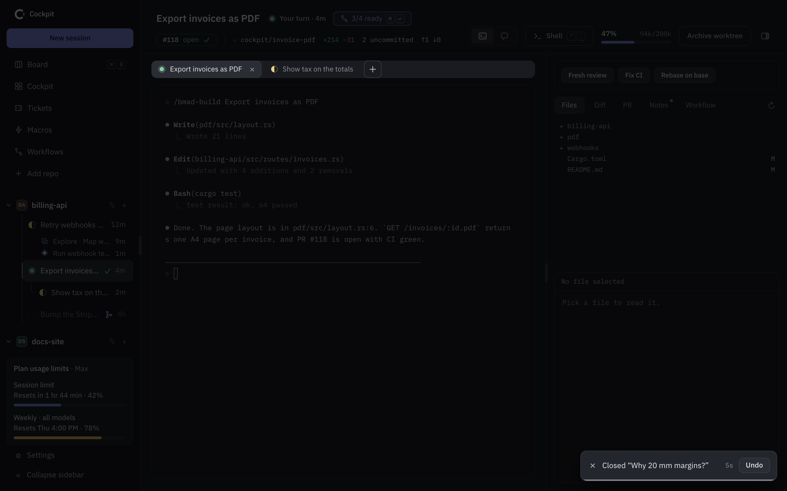

- Click a tab's **×**, or press <kbd>⌘</kbd> <kbd>W</kbd>. The session goes at once and Claude stops. The worktree and its other sessions stay.
- **Undo** brings it back for 5 seconds, resumed where it was. Background shells, monitors and Code Mode scripts that were running don't come back. Hovering the toast pauses it, for up to 30 seconds in all.
- A session you never sent a prompt to closes with no **Undo**.
- If Claude is working or waiting on you, background work is still running, or a message is queued, a popover asks first: **Cancel** or **Close**.
- A worktree's last session can't be closed on its own. To end it, archive the worktree.

### Chat view

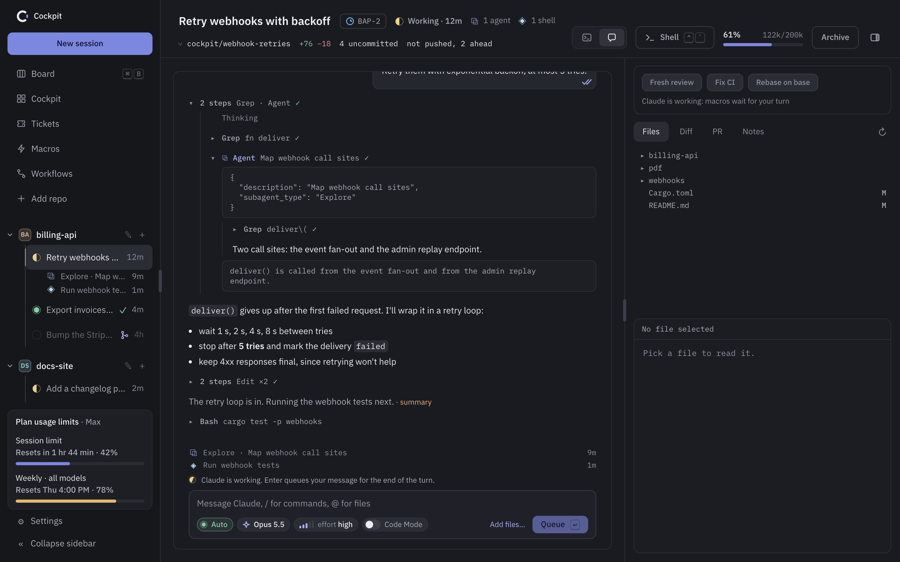

Turn on **Chat UI** in Settings. Then click the chat icon in the session header to read the session as a chat instead of a terminal. It is the same `claude` process: switching back and forth never restarts or touches it.

> [!NOTE]
> Chat UI is in beta and may be unstable, so its switch in Settings carries a **Beta** tag. While it is off, every session shows its terminal and there are no chat icons. Turn it back on and each session returns to the view it was in. The terminal is still the full view: anything the chat can't show, the terminal does.

- Your prompts sit on the right, with their images. Claude's replies are formatted text, with their images. An image file shows only if it is inside the session's worktree. An image on GitHub shows too; one from any other site stays a link. An image that can't load shows as its text, a link when it has a web address.
- Each tool call is one line with its command or file and a ✓ or ✕. Click it to see its input and result. Claude's thinking is a collapsed **Thinking** line.
- In a long turn, Claude writes short progress notes, which the terminal marks `· summary`. In the chat each is its own grey line between the steps, ending in a peach **summary** tag.
- In a Code Mode session, a script Claude runs is a **Script** line showing its first line. Click it to see the script and its result; the tool calls the script made sit under it, each opening on its own output. When Claude collects a script's result with a **Poll** call, the result shows on that **Poll** line instead, under the script's number (`#12`), and the **Script** line reads `(dispatched #12)`. A **Poll** line ends in ✕ when a script it collected failed.
- A background task's notice that a **Poll** call brings in shows on that **Poll** line, after anything else it brought in, one line per notice, worded as the terminal words it: `Agent "review" finished`, `Monitor event: tick 1 · tick monitor`. An agent a script starts in the background reads **Backgrounded agent**, and a monitor it starts reads `Monitor started · task <id> · timeout 30s`.
- Two or more tool calls in a row fold into one steps line, along with any thinking between them. Each tool call counts as a step. While Claude works, the line shows the step Claude is on, such as **◐ Bash cargo test · 3 steps**, and each new step replaces it. Once the run is over, it reads like **6 steps Bash ×5 · Edit ✓**. If any steps failed, it ends in ✕ and how many failed instead, also while Claude works. Click it to see every step.
- File paths are links: click one to open it in the Files tab, at its line. <kbd>⌘</kbd>-click a **Read**, **Write** or edit line (**Edit**, **MultiEdit**, **NotebookEdit**) to open its file.
- Ticket IDs such as `CCO-9` show as chips with their ticket's status, in Claude's replies, the summaries and your own prompts. Click one, or Tab to it and press <kbd>return</kbd> or <kbd>space</kbd>, to open the ticket. An ID with no ticket stays plain text.
- Every code block has a copy button in its top-right corner: Claude's code, a tool call's input and result, and command output. It shows while the pointer is over the block or the button has keyboard focus. Click it to copy the block's text. It reads **Copied** for 2 seconds, or **Copy failed** if the clipboard refuses.
- A subagent's work sits under the **Agent** line that started it. Click it to open the subagent's thread. In a Code Mode session, Claude Code records a subagent's **Agent** line only when the script that started it ends, so its thread shows then, under the **Script** line. Until then, the subagent is listed above the composer.
- Subagents, background shells, monitors and Code Mode scripts that are still running are listed above the composer, each with how long it has run. The list stays there while you scroll, and each line goes away when its work ends.
- `!` commands and slash commands such as `/model` show with their output. A skill or custom command you send, such as `/superpowers:brainstorming …`, shows as your prompt, as you typed it, with any images you sent with it. `/compact` and interruptions are divider lines.
- New replies appear within about 2 seconds, a block at a time. The chat follows them while you are at the bottom, and stays put while you scroll up to read.
- Text that arrives while the chat is open moves in a little: a reply fades up line by line and your prompt fades in. Set **Chat text** to **Type** to have replies type themselves out instead, or to **None** for no motion. What the chat already held when you opened it shows at once, and nothing moves while macOS **Reduce motion** is on.
- The chat is a centered column, sized for reading. Set **Chat width** to **Full width** to have it fill the center panel.
- A message waiting in Claude Code's own queue shows at the end of the chat with one tick (**Sent**). When Claude takes it in, it becomes your prompt. That covers one you queued in the terminal while Claude worked, and one **Send now** put there. It stays when you switch to the terminal and back. It also stays on your turn, for a few seconds: Claude Code finishes the turn first, then takes the message. If the session ends or is relaunched first, Claude Code never takes the message, and it leaves the chat.
- Cockpit's own queue is different: a message you queue in the chat's box shows above the box as **Queued**, not in the chat. It shows in the chat once Cockpit sends it to Claude Code.
- After `/clear` the chat starts empty. After a resume it shows the resumed conversation.
- In a folder Claude Code hasn't opened before, it first asks in the terminal whether to trust the folder. If a session stays **Starting** for a few seconds, the chat says Claude Code may be waiting for an answer, with **Open in terminal**.
- When Claude needs an answer, it shows as a card above the composer (see **Answer cards**). Anything the chat can't show reads **Shown in the terminal**, with **Open in terminal**.

To open every new session in Chat, set **New sessions open in** to **Chat** in Settings. While **Chat UI** is off, new sessions open in the terminal.

### Answer cards

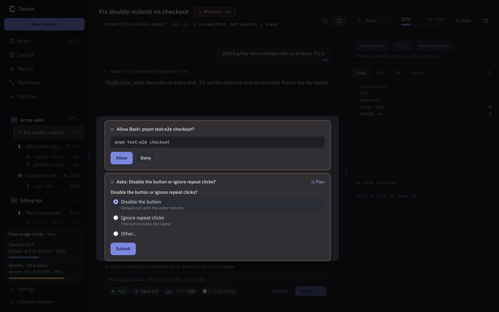

When a session is **Blocked**, its chat shows what Claude is waiting on as cards above the composer. Answer there, or in the terminal as before: whichever comes first counts.

| Claude asks | The card shows | You can |
|---|---|---|
| To use a tool (run a command, edit a file…) | The command or file path | **Allow**, or **Deny** with an optional message for Claude |
| A question (`AskUserQuestion`) | Every question with its options, and **Other…** for your own words | Pick the answers, then **Submit** |
| To approve a plan | The plan, with its images from the worktree or GitHub | **Send feedback** so Claude revises it, or **Approve in terminal** |
| Anything else (an MCP server's form) | **Answer in terminal** | **Open in terminal** |

- A subagent's card names the subagent, with ⧉.
- After a click, the button spins until Claude moves on. Nothing is typed into the terminal.
- A Deny with no message tells Claude "Denied in Cockpit."
- If you answer in the terminal first, the card says **Answered in the terminal** and fades.
- A card left unanswered for about 10 minutes turns into **Answer in terminal**: Claude Code's own question is still open there.
- Cards never offer "allow for the session" or a mode change, and plans are approved only in the terminal. Use the terminal for those.

### Composer

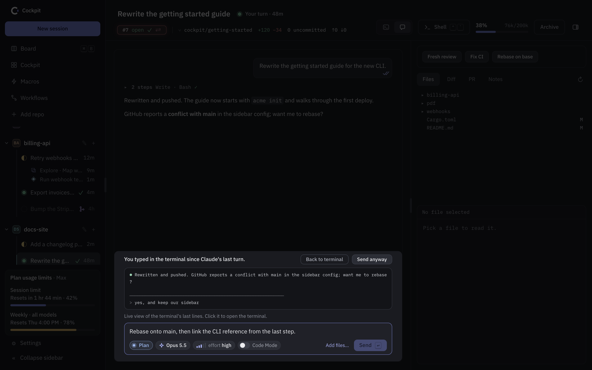

The box under the chat sends your next prompt to Claude, as if you had typed it in the terminal.

- Opening a session in Chat puts the cursor in the composer, so you can start typing right away.
- Press <kbd>↩</kbd> or click **Send**. <kbd>⇧</kbd> <kbd>↩</kbd> starts a new line. Type `/` to pick a slash command, at the start or after a space; only a command that starts the message runs, as in the first prompt. As with files, a few of its letters in order find it, drawn out in the list: `/supwriski` finds `/superpowers:writing-skills`.
- Type `@` to mention a file of the session's worktree, at the start or after a space. A few of its letters in order find it: `@thsdirfi` finds `this/dir/file.ts`. Letters that start a folder or file name, sit side by side or fall in the file name rank higher. A bare `@` lists the files changed on the branch first (**M** modified, **A** added). <kbd>↑</kbd> <kbd>↓</kbd> move, <kbd>↩</kbd> or <kbd>⇥</kbd> picks, <kbd>esc</kbd> closes. The pick goes in as `@path`, quoted when the path has a space, and Claude Code reads that file.
- Your message shows in the chat as soon as you send it, with one tick (**Sent**) in its corner. It gets two ticks (**Seen by Claude**) once Claude Code has taken it, usually a second or two later. A slash command or `!` command is replaced by its output instead, and one that writes nothing to the conversation (a picker like `/model`) goes when Claude hands the turn back. A queued message does the same when it goes in.
- Paste, drop or click **Add files…** to attach screenshots and files, as in the first prompt.
- **Send** sends at once when Claude is ready for a prompt: on your turn, and also when Claude has finished but its background shells, subagents or Code Mode scripts still run (a CI watcher, say), unless a macro is waiting on them to type its next command.
- While Claude works or waits on a question, <kbd>↩</kbd> queues your message instead, as the line above the box says (its ◐ turns while Claude works). The button reads **Queue**, and the message shows above the box as **Queued**. When Claude's turn ends, it goes in by itself. <kbd>↩</kbd> again adds the new text to it as a new paragraph, and the button reads **Add to queue**. Files you add go with it. One message is queued per session, and it lasts until Cockpit quits.
- While Claude works, <kbd>esc</kbd> interrupts it, as in the terminal, wherever you are in the chat. In full screen it no longer takes you out of full screen. A list, menu or reply box that's open closes first. A second <kbd>esc</kbd> straight after does nothing, so a double tap doesn't open Claude Code's rewind menu. In Cockpit mode it goes to the tile you're typing in.
- While the session shows **Starting…** or **Session ended**, a line says why you can't send. You can keep typing; the text waits for you.
- On the queued message, **Edit** puts it back in the box, **Remove** drops it, and **Send now** types it into Claude Code and, once Claude Code shows it queued, presses Claude Code's own send now (its default key, Ctrl+X Ctrl+S): Claude takes it right away, cutting short what it was doing. It shows in the chat as **Sent** from the moment Claude Code queues it, then as your prompt once Claude takes it in. If you bound send now to another key in Claude Code, the message stays in Claude Code's queue, still **Sent** in the chat, and goes in when the turn ends. **Send now** is unavailable while Claude waits on a question, while a macro runs, while the session starts or while text you typed in the terminal waits in Claude's input. Hover it to see why.
- A queued message is held, not sent, when you interrupted Claude (<kbd>esc</kbd>), when you typed text in the terminal during the turn (**Send anyway** sends it), when the session ended (resume it first) or when sending failed. Keys that type nothing, such as <kbd>⇧</kbd> <kbd>⇥</kbd>, don't hold it. The bubble then says why (**Held · you interrupted Claude, so this wasn't sent**, say) and has a **Send** button.
- While a message is held and Claude is ready, <kbd>↩</kbd> or **Send** under the box adds your new text to it and sends both.
- Each session keeps its own draft until you send it, even when you switch views or sessions.
- Chips at the bottom left show the permission mode, model and effort, and change them (see [Run settings](#run-settings)).
- If Claude Code's input in the terminal holds something, Send waits: text you typed there, or a picker you opened. Keys that leave the input empty don't hold it, such as <kbd>esc</kbd>, <kbd>⇧</kbd> <kbd>⇥</kbd>, or text you typed and erased. The run chips are locked too. A live view of the terminal's last lines shows what you left there. Click **Back to terminal** to finish it there, or **Send anyway** to send the composer's text.
- A picker opened by a command from the composer, such as `/model`, holds Send the same way until you close it in the terminal. A command that leaves the input empty, such as `/cost`, doesn't.

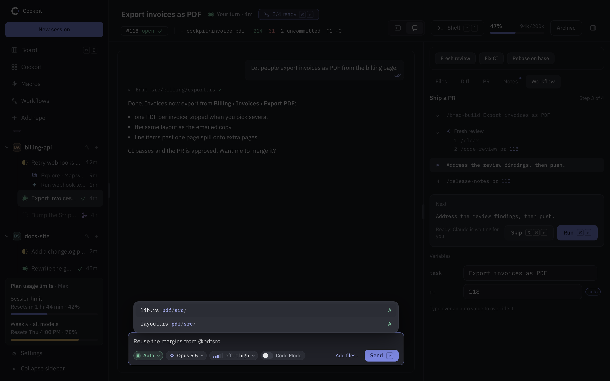

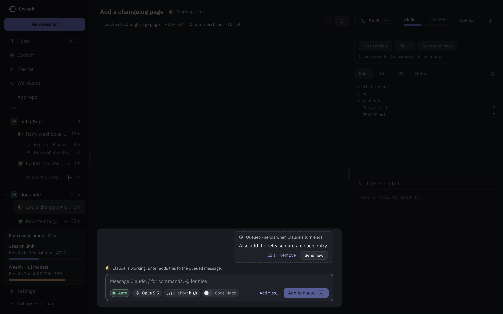

### Run settings

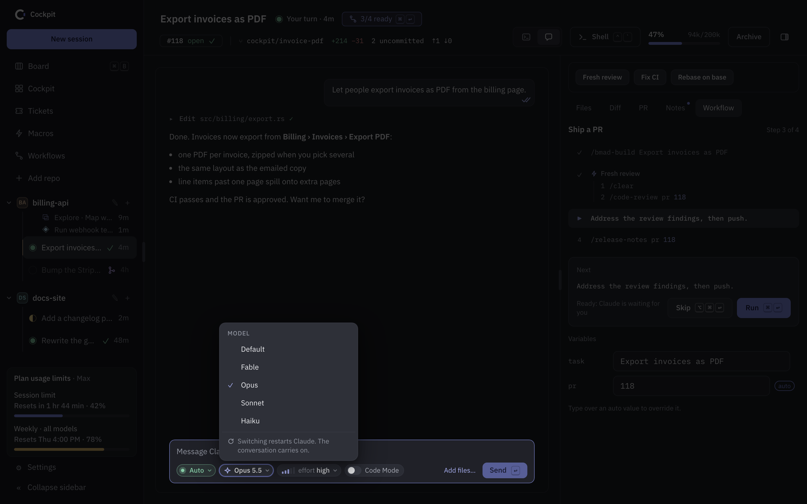

The chips at the bottom left of the composer show what the terminal's status line shows: the permission mode (**Plan**, **Auto**, **Accept edits** or **Manual**, each in its own colour), the model (**Fable**, **Opus**, **Sonnet** or **Haiku**, or **Default** for your Claude Code setting), the effort level and **thinking off** when thinking is off.

- Click the mode, model or effort chip and pick a value. Cockpit restarts Claude with it, in the same conversation. **Restarting Claude…** shows until it is your turn again.
- The chips change only on your turn, or once Claude has finished and only background work still runs. Otherwise they are locked, and hovering one says why.
- If background shells, subagents, monitors or Code Mode scripts still run, the menu asks first and lists them. **Restart** stops them and restarts Claude; **Cancel** keeps them running.
- A <kbd>⇧</kbd> <kbd>⇥</kbd> in the terminal changes the mode too. The mode chip catches up the next time Claude acts: on your turn, that is once you send your next prompt.
- If Claude can't start again, the session ends and the composer says why. **Resume** starts it with the values you picked.

> [!NOTE]
> In Plan mode, Claude Code currently runs Sonnet when Haiku is picked, so the model chip shows Sonnet. The model menu still ticks Haiku and says "Plan mode runs Sonnet" under it, in the composer and in the New session form. In other modes Haiku runs without an effort level, and the effort menu says so.

### Code Mode

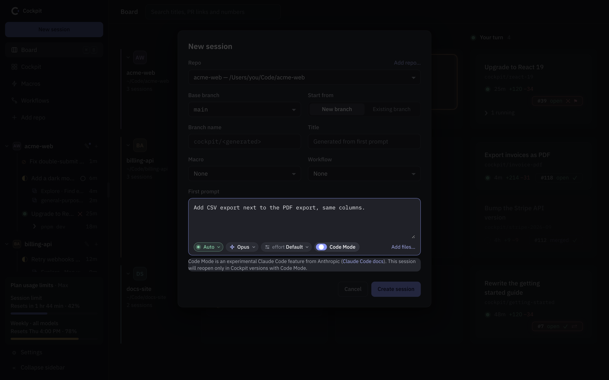

Code Mode is an experimental Claude Code feature from Anthropic: Claude writes short scripts that call its tools, instead of calling them one at a time. Anthropic's [Code Mode page](https://code.claude.com/docs/en/code-mode) has the details and what it needs (Claude Code 2.1.323 or later, a Claude subscription or Console account, a recent model). When those are missing, Claude Code starts without it and says why.

- Turn on **Code Mode** in the New session form. It starts from **Code Mode by default** in Settings, off unless you change it. While it is on, the form says the feature is Anthropic's and links its docs.
- Code Mode applies to a new conversation. In the composer, the switch works until you send the first prompt, and again after `/clear`. Flipping it restarts Claude.
- Once the conversation has started, the switch shows whether it runs in Code Mode and no longer flips. Hover it to see why. Mode, model and effort changes keep the conversation in the mode it started in.
- The first time, Claude Code asks in the terminal before it turns Code Mode on. In the chat, the session stays **Starting** with **Open in terminal** until you answer. If you say no, or Claude Code starts without Code Mode (a requirement above is missing), Cockpit turns the session's switch off, so it isn't asked again.
- Cockpit's switch wins over `CLAUDE_CODE_EXPERIMENTAL_CODE_MODE` in your shell profile: Cockpit sets it for each session. A `0` in your Claude Code settings still keeps Code Mode off.
- A script that is still running when Claude ends its turn keeps the session **Working**, as a background shell does. It counts as **⟐ 1 script** on the card and the session header, and shows as a **Code Mode script** row in the sidebar and above the composer. Its time counts from when Claude's turn ended, not from when the script started.

> [!NOTE]
> A Code Mode session reopens only in Cockpit versions with Code Mode. Claude Code won't resume a Code Mode conversation without it, so an older Cockpit ends that session at once.

### Reply to a selection

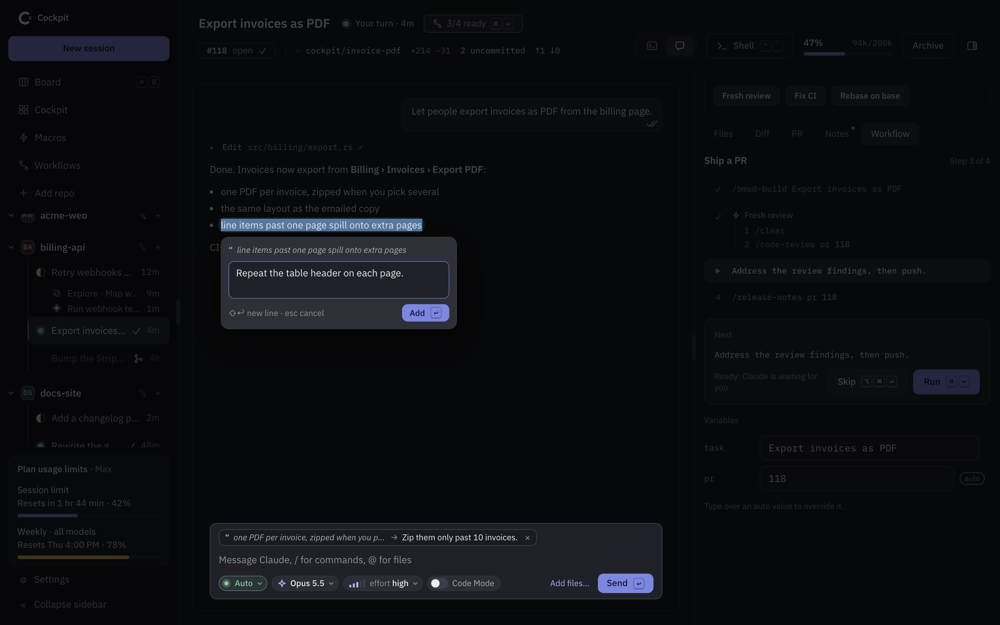

Answer one part of a reply without retyping it.

- Select any text in the chat and click **Reply**. Type your reply and press <kbd>↩</kbd> or click **Add**. <kbd>⇧</kbd> <kbd>↩</kbd> starts a new line, and <kbd>esc</kbd> or a click elsewhere cancels.
- Each reply waits above the composer as a chip: the text you selected, then your reply. Hover a chip to read it in full, or click **×** to remove it.
- Add as many as you like, then write the rest of your prompt and press **Send**. Claude gets each selection quoted, with your reply under it, before the text you typed. A slash command you typed goes first instead, so Claude Code still runs it, with the replies after it.
- While the reply box is open, the chat stops following new messages, so the text you selected stays put.
- Replies stay in the session's draft until you send it, like the rest of the draft.

### Files

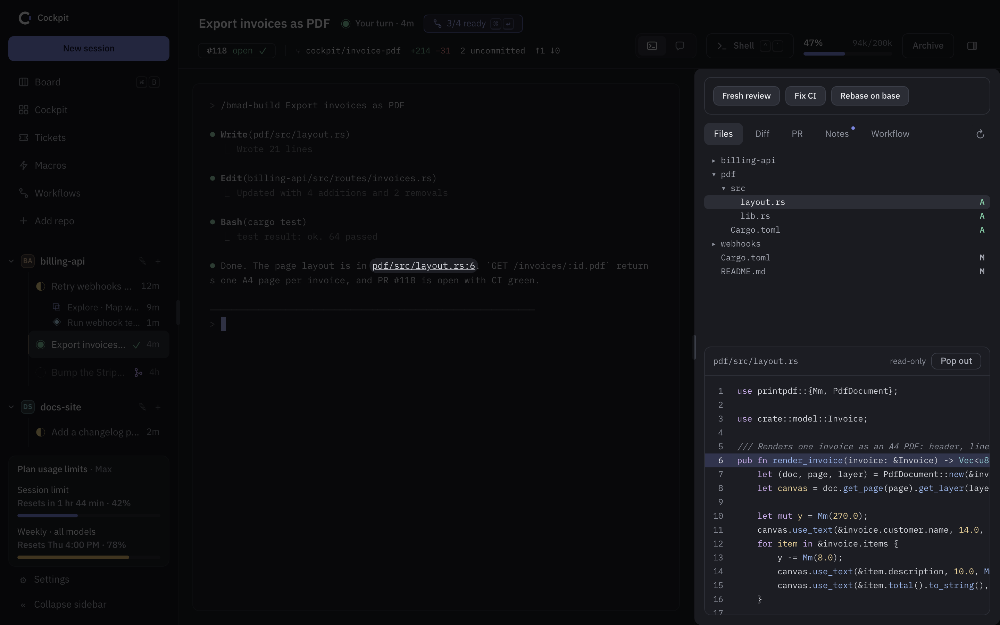

- Read-only file tree. `M` marks changed files, `A` added ones.
- Syntax highlighting and line numbers. Markdown is rendered, with its images from the worktree or GitHub. Images from other sites stay links. An image that can't load shows as its text, a link when it has a web address. **Source** shows the raw text.
- <kbd>⌘</kbd>-click a file path in the terminal, like `src/App.tsx:120`, or click one in the chat, to open it here. The tree opens to the file, and the viewer scrolls to that line and highlights it.
- **Pop out** shows the file over the terminal.

### Default branch

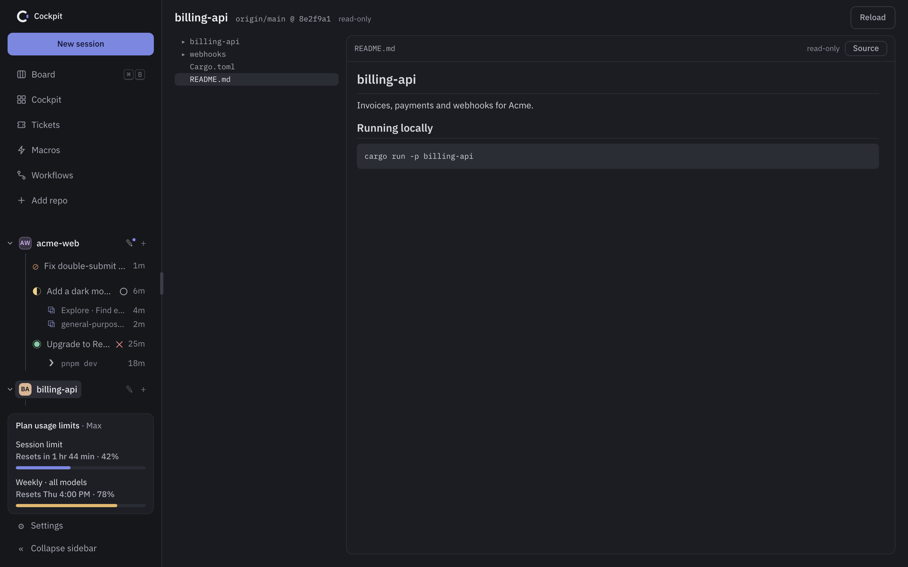

- Click a repo's name in the sidebar to browse its default branch, no session needed. In the collapsed rail, click the repo's tile.
- The default branch is set per repo. **Add repo** preselects the one GitHub reports, else the one `origin/HEAD` points at, else `main` or `master`. Change it with **…** → **Default branch…** on the board.
- Cockpit reads `origin/<default>`, else the local `<default>`. The header shows it and its commit, e.g. `origin/main @ 8e2f9a1`.
- It shows what is committed, not the repo folder's uncommitted edits, and leaves submodules out. It never fetches: `origin/<default>` is as fresh as your last `git fetch`. If neither branch exists, the view says so and points to **Default branch…**.
- **Reload** reads the branch again. Same viewer as the Files tab: highlighted code, rendered Markdown with **Source**. Images there stay links.

### Diff

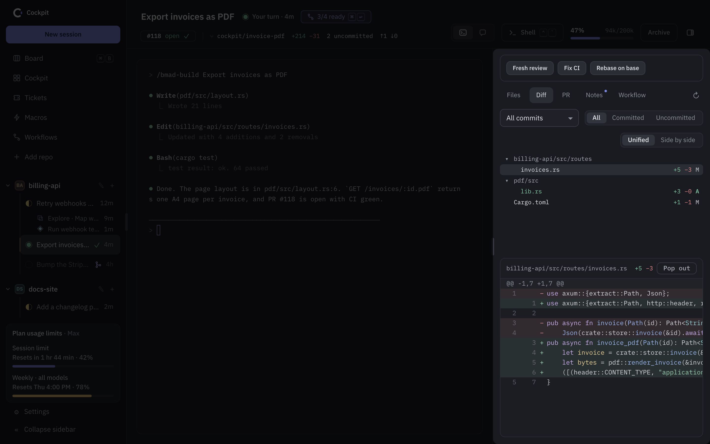

- Everything since the merge-base with `origin/<base>`: commits plus uncommitted changes.
- While the branch has an open PR, `<base>` is the branch the PR merges into (fetched from origin), so the header's line counts and this tab match GitHub. Once the branch has no PR, it goes back to the base the session started from.
- Filter by **Committed**, **Uncommitted** or a single commit.
- **Unified** or **Side by side**. **Pop out** shows the diff over the terminal.

### Pull request

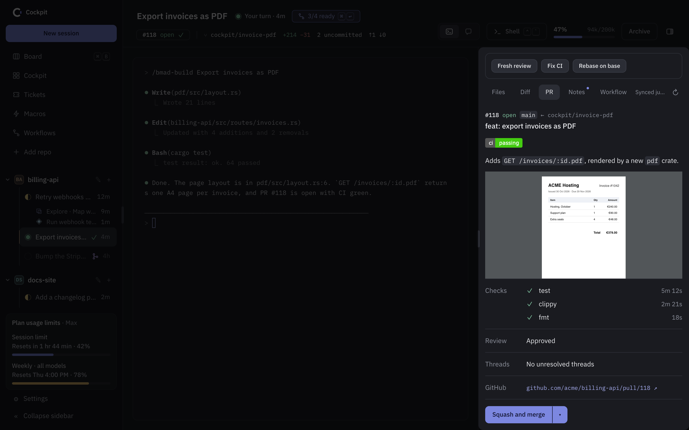

- Description, checks, review, unresolved threads and a GitHub link, read through your `gh` login.
- Each check shows how long it took. A running check has a spinner and a clock that counts up every second, as on GitHub. A queued check has a dashed ring and counts how long it has waited to start: **Queued 42s**. A status reported by another service (a deploy preview, say) shows no clock, since GitHub doesn't say when it started. While any check is queued or running, the tab reads the PR again every 30 seconds.
- The header shows where the PR goes, in GitHub's order: `main ← fix/login`, the branch it merges into, then its own branch. The confirm button names it too: **Confirm squash into main**.
- The description shows its images: pasted screenshots, images from the repo and badges, private repos included. They load through `gh` too. An image that can't load shows as its text, a link when it has a web address.
- Merge or squash-merge after a confirm. The menu offers only the methods the repo and the rules on the PR's base branch allow. Cockpit remembers your method per repo and base branch.
- When no method is allowed (a base that takes only rebase merges, say), the tab says why. Merge on GitHub.
- **Update branch** when the branch is behind. When the PR's own branch is protected on GitHub (a long-lived branch such as `dev`), Cockpit leaves it to GitHub: no **Update branch**, and GitHub keeps the branch after the merge even when the repo deletes merged branches.
- A draft PR gets **Ready for review** in place of the merge button. One click marks it ready on GitHub.
- Refreshes every ~30 s, or on demand.
- A repo with no remote on GitHub (a local or self-hosted origin, or none) has no badges, and its PR tab says **No GitHub remote.** Add a GitHub remote and the next refresh shows its PRs.
- A session's PR is the one whose branch matches the session's. When the names differ, Claude can link an existing PR of the repo through Cockpit's `link_pr` tool. The badge tooltip then says "linked by the agent", and the PR tab's header shows the PR's own branch. Claude can remove the link the same way. If Cockpit hasn't confirmed a link within 30 seconds, Claude is told it may still apply.

### Macros

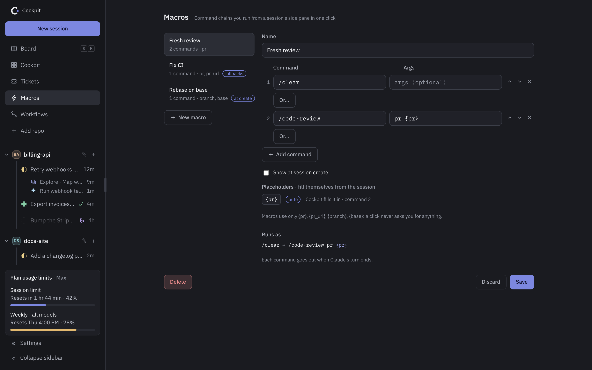

A macro is a short chain of commands, e.g. `/clear` then `/code-review pr {pr}`.

- Edit them on the **Macros** page.
- Run one from the buttons above the side pane's tabs. Each command is sent when Claude's turn ends. **Cancel** stops the chain.
- **Or…** adds fallback commands. Cockpit sends the first one installed.
- **Show at session create** offers the macro in the new-session form.

Placeholders fill themselves:

| Placeholder | Value |
|---|---|
| `{pr}` | PR number. A macro that uses it is disabled until the branch has a PR. |
| `{pr_url}` | PR link |
| `{branch}` | The session's branch |
| `{base}` | The base branch: the PR's while the branch has an open one |

### Workflows

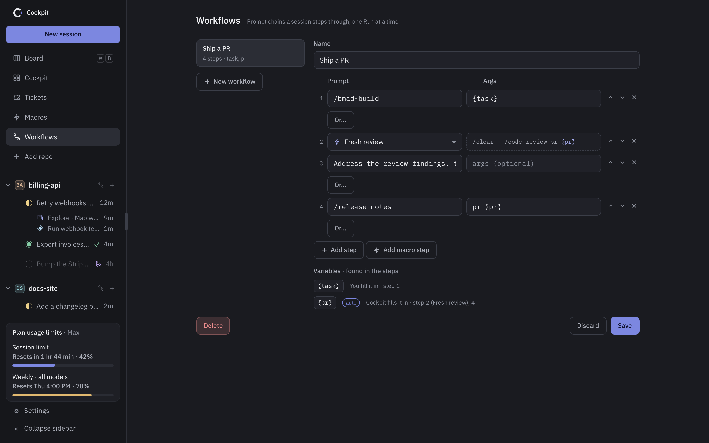

A workflow is a list of prompts and macros you step through, e.g. build → review → fix → release notes.

- Edit them on the **Workflows** page. `{name}` becomes a variable you fill in; the four placeholders above fill themselves.
- Pick one in the new-session form. Step 1 becomes the first prompt.

In a session started from a ticket, three more placeholders fill themselves:

| Placeholder | Value |
|---|---|
| `{ticket_id}` | The ticket's ID, e.g. `AWE-2` |
| `{ticket_title}` | Its title |
| `{ticket}` | The ticket as the first prompt shows it: ID, title, status, priority, labels, description, sub-issues, relations and files |

- Each **Run** takes the ticket as it is then, so an edited title or a new sub-issue shows up in the next step.
- Typing a value in the **Workflow** tab overrides it.
- Once the ticket is deleted, a step that uses one of them can only be skipped.
- In a session with no ticket, type them in the form.

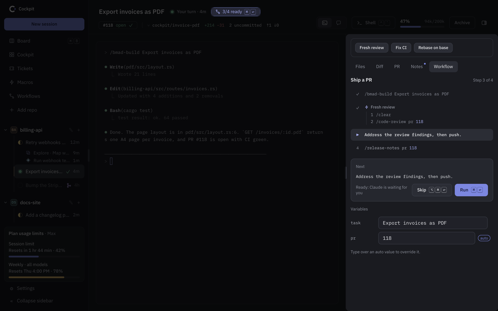

- The **Workflow** tab shows the steps, the next one and the variables.
- **Run** sends the next step on your turn. **Skip** passes it.
- The header badge shows progress.

### Cockpit view

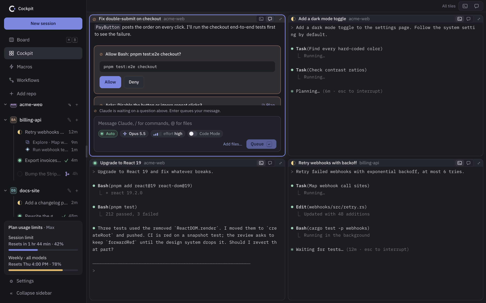

Every running session in one grid, as its terminal or its chat. Answer prompts without switching sessions.

- Each tile shows the session's own view, or its terminal while **Chat UI** is off. The terminal and chat icons in its header switch it, and the session view follows.
- A chat tile has what the session's chat has: running work, answer cards and the composer.
- **All tiles**, above the grid, switches every tile at once. It shows a view only while every tile is on it. It appears only while **Chat UI** is on.
- Blocked tiles glow. A pill points to blocked tiles scrolled out of view: click it to jump there, ready to answer.
- ⤢ opens the session.

### Shells

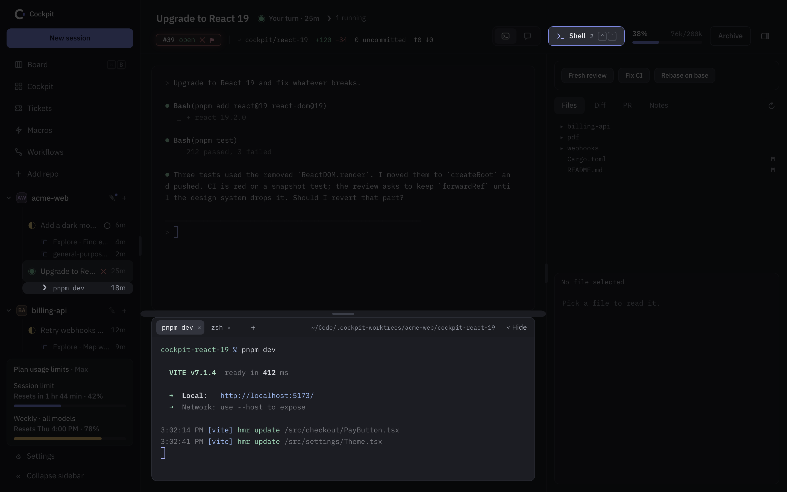

Run your own commands in the session's worktree while Claude stays in view: a dev server, `git log`, the tests.

- Click **Shell** in the session header, or press <kbd>⌃</kbd> <kbd>`</kbd>. A drawer opens under the terminal or chat with a shell (your `$SHELL`) already in the worktree.
- **+** opens another shell in its own tab. A tab shows the title the shell gives it, such as the running command.
- Each tab's **✕** ends that shell. Typing `exit` ends it too. The drawer closes with the last shell.
- A shell that fails to start keeps its tab, which shows the system's error with **Dismiss** and **Try again**. If the worktree is gone, the tab says so, with no **Try again**.
- **Hide**, **Shell** or <kbd>⌃</kbd> <kbd>`</kbd> hides the drawer. If you were typing in a shell, your typing goes back to Claude's terminal, or to the composer in chat view. The shells keep running: **Shell** shows how many, with a green dot. Switching to another session keeps them running too, with their output.
- Drag the drawer's top edge to resize it. Every session uses the same height.
- While a shell runs a command, the sidebar lists it under the session with ❯, the command and how long it has run. The session's card and header count it (**❯ 1 running**), and the chat lists it above the composer. A shell waiting at its prompt shows nothing.
- Your shells never change the session's state. What you type there never holds the composer.
- Every session in a worktree shares its shells.
- Quitting Cockpit ends every shell, and shells don't come back after a restart. Archiving the worktree ends its shells.

### Resume and archive

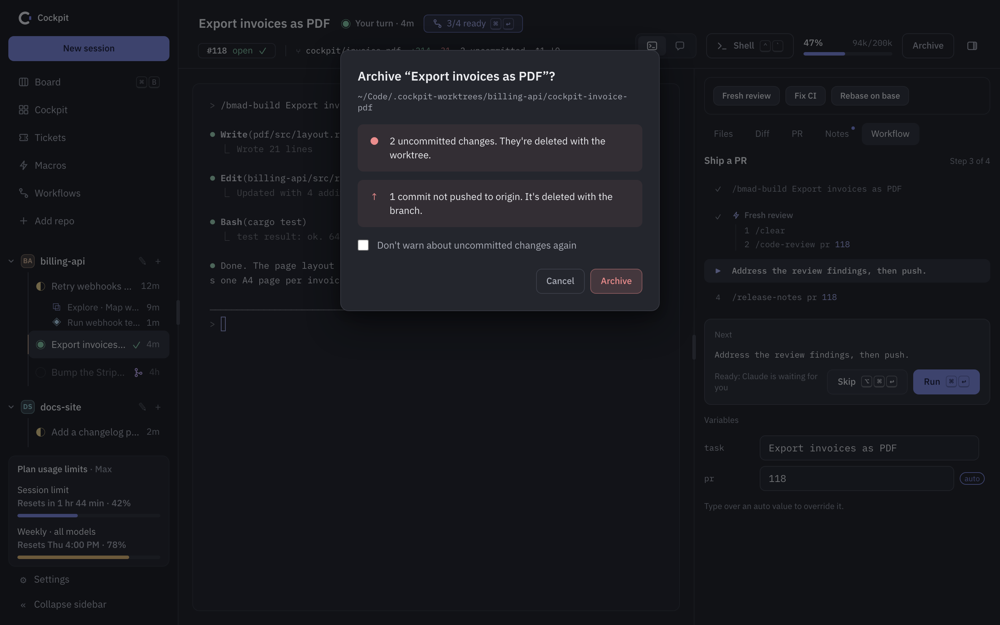

| | |
|---|---|
| **Resume** | An Ended session keeps its card. Opening it runs `claude --resume` (unless turned off in Settings). The header has a **Resume** button too. |
| **Archive** | Stops Claude in every session of the worktree, deletes the worktree and the branches Cockpit created. In a worktree with several sessions the button reads **Archive worktree** and the dialog lists them. Keeps branches that already existed, the repo's default branch, `main`, `master` and the PR's base branch. Never touches the remote. Warns first about uncommitted changes, unpushed commits and open shells. |

### Usage meters

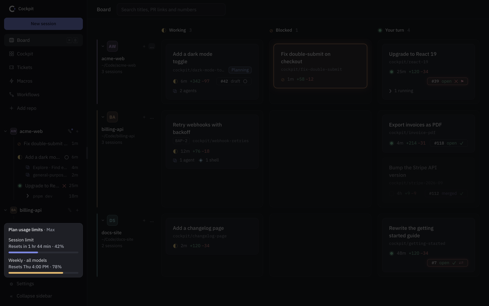

The sidebar footer shows your plan's 5-hour and weekly limits: % used and reset time. The bar changes color near a limit. Numbers appear once a session has run. When you sign in to Claude Code, or sign in as another account, they update within seconds. After hours with no session running, Claude Code's login expires: the numbers then wait for the next session you start, and update within seconds of it.

### Settings

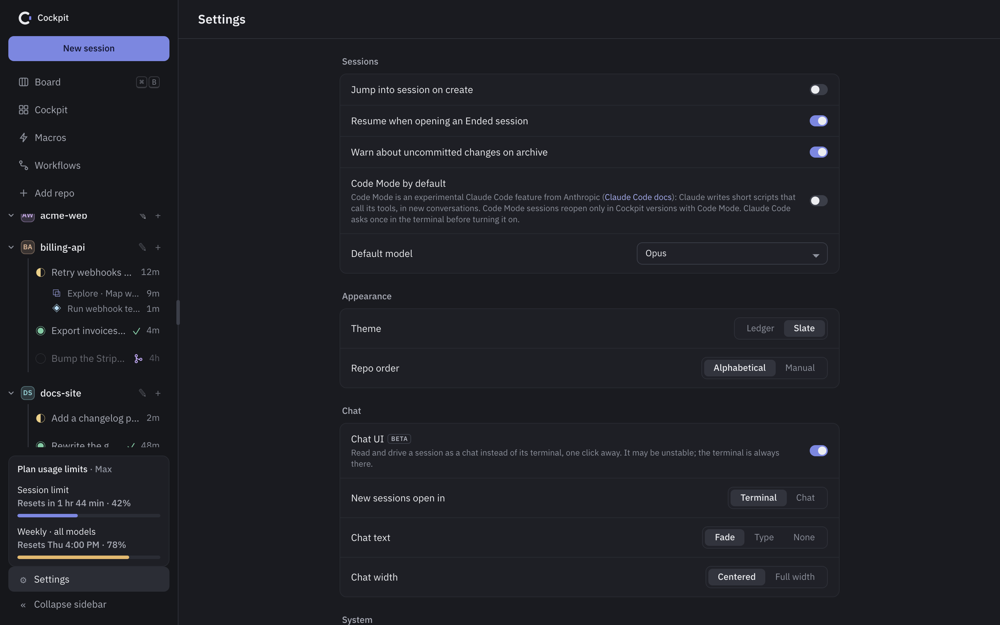

Click **Settings** to open the Settings page. A change applies as soon as you click it.

| Section | Setting | Default |
|---|---|---|
| Sessions | Jump into session on create | Off |
| Sessions | Resume when opening an Ended session | On |
| Sessions | Warn about uncommitted changes on archive | On |
| Sessions | Code Mode by default | Off (see [Code Mode](#code-mode)) |
| Sessions | Default model | Opus |
| Tickets | Ticket workflow | None (the workflow Start with Claude runs, see [Ticket workflow](#ticket-workflow)) |
| Tickets | Start tickets immediately | Off (**On**: Start with Claude creates the session at once, without the New session form) |
| Tickets | Default template | None (the shared default, see [Templates](#templates)) |
| Tickets | Workflow, per repo | Use global (or **None**, or a workflow of its own) |
| Tickets | Template, per repo | Use shared default (or **None**, or a template that repo can use) |
| Tickets | ID prefix, per repo | From the repo's name (see [Labels and ID prefixes](#labels-and-id-prefixes)) |
| Tickets | Labels | None (made with **New label** here, or from a ticket's **Labels** **+**) |
| Appearance | Theme | Slate (Ledger is a darker alternative) |
| Appearance | Repo order | Alphabetical (**Manual** keeps the order you drag repo rows into on the Board) |
| Chat | Chat UI (**Beta**) | Off (on after an update if you already used the chat: new sessions opened in Chat, or a session was in Chat). Turns on the chat view, see [Chat view](#chat-view) |
| Chat | New sessions open in | Terminal (**Chat** opens new sessions in the chat view) |
| Chat | Chat text | Fade (how new chat text appears: **Fade** line by line, **Type** letter by letter, or **None**) |
| Chat | Chat width | Centered (**Full width** makes the chat fill the center panel) |
| System | Keep Mac awake while sessions work | Off (only while plugged in) |
| Updates | Beta builds | Off (installed app only, see [Beta builds](#beta-builds)) |

**New sessions open in**, **Chat text** and **Chat width** are greyed out while **Chat UI** is off. **Updates** shows only in the installed app, with its version and **Check for updates**. **About** has **License**, which shows Cockpit's license and the licenses of the open-source software it includes. **Cockpit → About Cockpit** shows the version and the copyright.

---

## Keyboard shortcuts

| Shortcut | Action |
|---|---|
| <kbd>⌘</kbd> <kbd>B</kbd> | Back to the board |
| <kbd>⌘</kbd> <kbd>T</kbd> | New session in the open worktree |
| <kbd>⌘</kbd> <kbd>W</kbd> | Close the open session (never the window, and never a worktree's last session) |
| <kbd>⌃</kbd> <kbd>Tab</kbd> / <kbd>⌃</kbd> <kbd>⇧</kbd> <kbd>Tab</kbd> | Next / previous session in the worktree |
| <kbd>⌃</kbd> <kbd>`</kbd> | Open, show or hide the session's shells |
| <kbd>⌘</kbd> <kbd>+</kbd> / <kbd>⌘</kbd> <kbd>−</kbd> / <kbd>⌘</kbd> <kbd>0</kbd> | Terminal and chat text bigger / smaller / reset |
| <kbd>⌘</kbd> <kbd>↩</kbd> | Run the next workflow step |
| <kbd>⌥</kbd> <kbd>⌘</kbd> <kbd>↩</kbd> | Skip the next workflow step |
| <kbd>⇧</kbd> <kbd>↩</kbd> | New line in the terminal or the composer, without sending |
| <kbd>↩</kbd> | Send the composer's prompt |
| <kbd>⌘</kbd>-click a file path in the terminal | Open the file in the Files tab, at its line |

<kbd>⌘</kbd> <kbd>T</kbd>, <kbd>⌘</kbd> <kbd>W</kbd> and <kbd>⌃</kbd> <kbd>Tab</kbd> also sit in the **Session** menu in the menu bar. They work in the session view only, and Cockpit keeps them: Claude Code, your shells and the terminals on the Cockpit page never get them, so a shell program that uses <kbd>⌃</kbd> <kbd>Tab</kbd> loses it. With a menu or popover open, <kbd>⌘</kbd> <kbd>W</kbd> closes it instead, except the question Cockpit asks before closing a busy session, which stays until you answer it.

---

## Updating

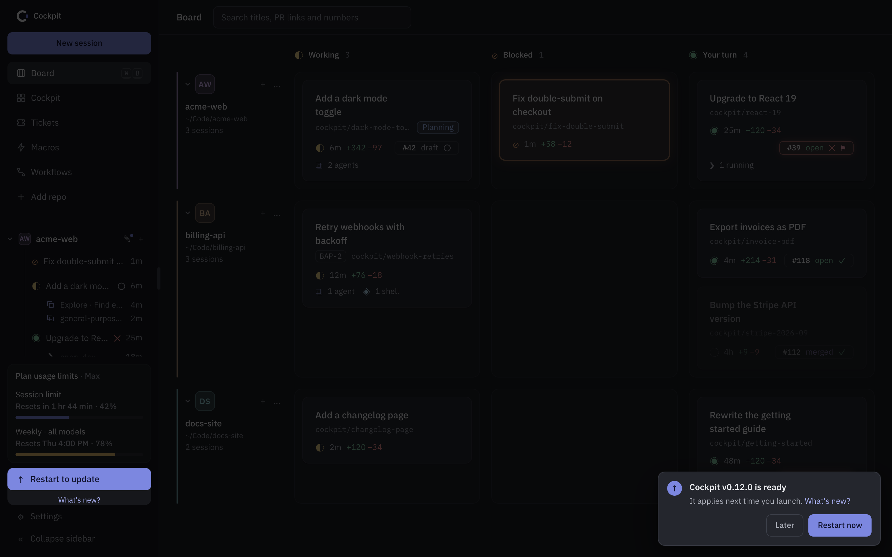

- Cockpit checks for a new version at launch and every 6 hours.
- It downloads and installs a new version in the background while you work. Your sessions keep running.
- When the new version is ready, **Cockpit vX.Y.Z is ready** appears. The update applies the next time you launch Cockpit.
- Click **Restart now** to switch at once, or **Later** to keep working. Until you restart, the sidebar shows **Restart to update** (in the collapsed rail, an ↑ button).
- Click **What's new?** to read what changed, when the release has notes. It sits in the toast, under the update button in the sidebar (not when the sidebar is collapsed), and next to the version in Settings. The notes come from the release and show in a dialog. A beta's dialog adds **Beta build. It may be unstable.**
- After Cockpit restarts into a new version, **Updated to vX.Y.Z** appears once, with **What's new?** to read the notes or **Dismiss** to close it. It goes away when the next update is ready.
- If sessions are running, Cockpit asks before it restarts, because restarting ends them. Resume them afterwards from the board.
- If a download or install fails, Cockpit tries again later, less and less often: after 6 hours, then 12, 24 and 48 hours, then every 4 days.

Settings shows the installed version and has **Check for updates** to check right away. If the check or the download fails, Settings says so. Click **Details** to see why. For a failed check, it names the update feed that failed and how: for example `HTTP 504 Gateway Timeout` when GitHub is having trouble, or a DNS or connection error when you're offline. Cockpit also writes this to its log.

> [!NOTE]
> If your Mac would ask for an administrator password to replace Cockpit (it sits in a folder you can't write to), Cockpit never installs on its own. The sidebar shows **Update to vX.Y.Z** and Settings shows **Install update** instead. Click either one and enter your password when macOS asks.

> [!NOTE]
> The app holds no GitHub token. It reads the public feeds at `https://update.cccockpit.com/release/latest.json` and `https://github.com/kaimunlau/cockpit-releases/releases/latest/download/latest.json`, takes the newer version either one offers, and verifies each update's signature before installing it.

### Beta builds

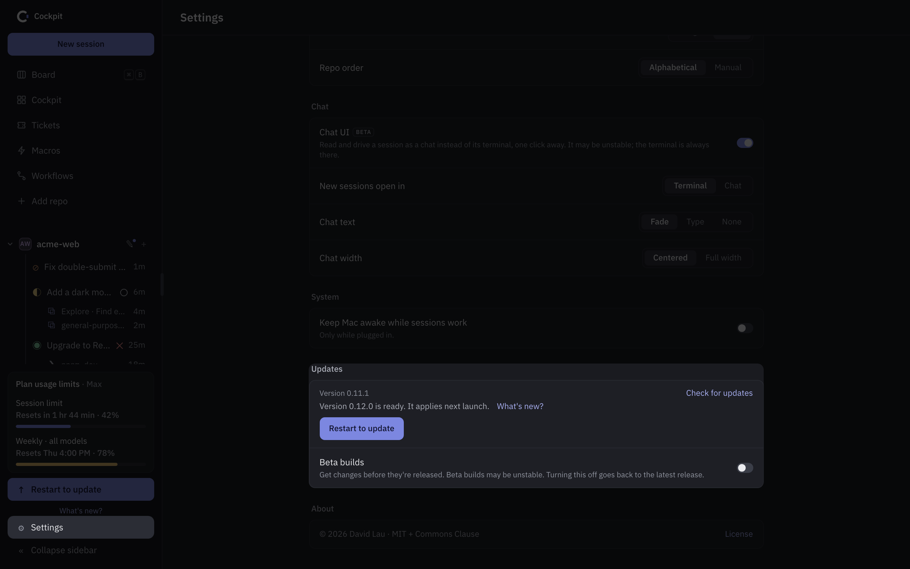

- Turn on **Beta builds** in Settings to get changes before they're released.
- Cockpit checks for a beta at once, then on the usual schedule. Betas install the same way as releases, and their version ends in `-beta.N`.
- A beta's **What's new?** lists everything since the latest release, so it repeats what earlier betas already brought.
- A release newer than your beta still installs.
- Turn **Beta builds** off to go back to the latest release. Cockpit checks at once and installs it, even though it is older than your beta.
- Going back keeps your repos, sessions, workflows and macros. A value only the beta knows (a new setting option, say) goes back to its default. Cockpit first keeps a copy of the beta's data, as `state.json.beta-<time>` (and `worktrees.json.beta-<time>` when that file holds something it doesn't know) in `~/Library/Application Support/com.cc-cockpit.app/`.
- A version from before [several sessions in one worktree](#several-sessions-in-one-worktree) shows each worktree as one session: its oldest open one. The others wait in `worktrees.json`, in the same folder, and come back when you update again. A worktree you archive in the older version takes them with it.
- A version from before [tickets](#tickets) leaves your tickets alone, and each worktree gets its ticket back when you update again. Your ticket settings (the global and per-repo ticket workflow, each repo's ticket source, "start immediately") go back to their defaults, and a worktree archived in the beta loses its archive time, so its ticket lists it without one. The copies above keep them.

> [!WARNING]
> Beta builds may be unstable.

---

## License

Cockpit is free to use, for any purpose, under the [MIT License with the Commons Clause](LICENSE). You may not sell it. Copies must keep the copyright notice.
